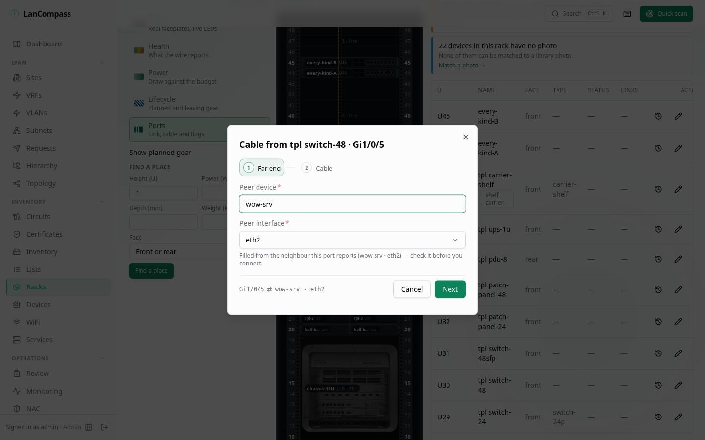

# Cabling

The L1 layer — devices own **interfaces**, interfaces get **cables**, and
"what's patched into switch X port 12" becomes a query instead of a memory.
A patch panel needs no special entity: it's just a device whose interfaces
have kind `patch`, with each front port paired to a back port.

## Interfaces

Every [device](/docs/devices/) detail page has an **Interfaces** section: a
port grid showing name, kind (`rj45`, `sfp`, `sfp28`, `qsfp`, `console`,
`patch`, `power`, `other`), speed and MAC. Cabled ports are tinted and show
their peer (`device · port`) — click one to open the **trace** drawer.

- **Generate** creates a whole port set in one call: pick a kind, a name
  prefix and a count — `Gi1/0/` × 48 yields `Gi1/0/1…48`. Setting a **pair
  prefix** (`b` for `p`) additionally creates same-indexed back ports and
  links each `p_i ↔ b_i` pair — a 24-port patch panel's front+back in one
  click.
- **Add port** creates a single interface; the edit dialog can rename,
  re-kind, set speed/MAC, and change the pair partner (pairs must live on
  the same device — the two sides of a panel position).
- `connected_ip` is the host-side binding — "this NIC serves this IP" — a
  different link from the device's IP ownership and from the address's
  far-end switch port.

### Documented and observed

A port keeps two speeds and two MACs: the **documented** ones a person
set (the port's own fields — edited in its dialog, exported and imported)
and the **observed** ones the last [SNMP poll](/docs/snmp/) saw
(`observed_speed_mbps`, `observed_mac`). A poll never changes the
documented values. When both are set and agree, the tile shows one
value; when they differ it reads *1G seen · 10G documented* and the port
is flagged (`speed_mismatch` or `mac_mismatch`). **Accept observed** on
that line copies the observed value into the documented field — an
ordinary port edit, so it needs write permission, lands in the
[changelog](/docs/changelog/) and clears the flag. A port the poll created
starts with its documented values equal to that first observation.

## Cables

A cable joins exactly two interfaces. Each interface terminates **at most
one** cable — trying to cable a busy port returns the existing cable's id.
Cables carry `kind` (`cat5e`/`cat6`/`cat6a`/`dac`/`fiber_sm`/`fiber_mm`/
`power`/`console`/`other`), a physical `color`/`label`, `length_m` and
notes. Cable labels are searchable — global search resolves a label hit to
**both** ends' devices.

A `power` cable joins two `power` ports, and a data cable never touches a
power port — the 422 names both kinds; `other` is unconstrained, and a
change of kind is checked the same way. A cable's lifecycle is its `status`
(`planned`, `active` or `decommissioning` — see
[Devices → Lifecycle](/docs/devices/)).

Cable a port from its card: pick the peer device (search), then one of its
**free** ports, then kind/color/label. Deleting a port or device takes its
cable with it.

When the port itself reports an LLDP or CDP neighbour that resolves to
one documented free port — the neighbour's name matches exactly one
device, and its port name exactly one free port of that device — the peer
arrives already picked and the field says where it came from. You still
check it and press **Connect**; typing a device first wins.

**From the rack.** In the rack's **Ports** lens (see
[Racks → The Ports lens](/docs/racks/)) a port with no cable offers
**Cable…** in its popover: the same dialog, prefilled with that port and,
when its neighbour resolves the same way, the far end — it saves through the
same cable write with its changelog row. A port carrying the
`lldp_neighbor` flag (a neighbour on a port with no documented cable) draws
a marching line to a chip on the rack's top cap; the chip opens the link in
[Review](/docs/review/), whose **Document** fills the cable form.

**Power cables.** A cable between two `power` ports is a power cord: the
device's power port is its A end, the PDU or UPS outlet its B end (NetBox's
convention). The rack's rear draws each documented power cable as a cord
in its PDU's colour and reads the chain device → PDU → UPS from them
(see [Racks → The rear](/docs/racks/)); a planned cable is dashed and a
decommissioning one striped, on the rear's cords as on the ports.



## Trace

Clicking a cabled port opens the trace drawer: the ordered L1 path through
the interface — `device · interface` per hop, with the cable kind/label on
each cable edge. At a `patch` port the walk continues through the panel's
front↔back pair (shown as *panel pass-through* — not a cable) and keeps
going, so `host → panel-front → panel-back → switch` renders as one path.
Traces launched mid-chain still surface the whole path, loops terminate,
and a walk counts at most 64 cables (pass-through pairs are free) — a
path cut there names the port it continues from.

Each hop also shows **what the wire says**. A port whose LLDP or CDP
neighbour names the device the documented path reaches through its cable
gets a check, *The wire agrees*; one whose neighbour names another device
is drawn amber with *The wire reports …* (the neighbour's name and port),
and the top of the drawer counts the hops that disagree. Patch panels are
passive, so a switch port behind a panel is compared with the active
device beyond it; names compare without case and by their first DNS label
(LLDP often reports the FQDN). A port without neighbour evidence carries
no mark. The marks come from the last poll's evidence, like the port
tiles, and nothing in the trace changes a cable.

**On the rack.** **Trace** in a port's popover on the rack page lights the
same path on the cabinet — every hop's port ringed, amber where the wire
disagrees (hop by hop as in the drawer), the two ends pulsing, a stop bar
where the 64-cable walk was cut — and **Across the row** draws it across
the racks of the row view (see
[Racks → Trace on the rack and across the row](/docs/racks/)).

## Validation — what the switch actually reports

On SNMP-managed devices every poll validates documented cabling against
observed state (see [SNMP → cable validation](/docs/snmp/) for the six
checks: three about cables, two about documented versus observed speed and
MAC, one about an address a person linked to another port). Flagged ports
show an amber ⚠ badge — hover for
the reason and the observed/documented peer — and the port keeps a
`validation` blob with the LLDP neighbors and MACs the switch reported.

Flags are findings, never fixes: nothing deletes or rewrites a cable on
its own. They clear automatically when a later poll disproves the
condition, and editing or deleting the cable (or editing the port)
clears the flag keys immediately. Findings queue under
[Review → Cable mismatches](/docs/review/) with **Open trace** and
**Edit cabling** shortcuts; dismissing one is sticky by fingerprint.

## Cables the wire proposes

A switch's LLDP neighbours name most of its cables. After each poll, a
neighbour on a port that has no cable becomes a **proposed cable** when its
far end is documented: the far port whose MAC is the neighbour's port or
chassis id; else the device that holds that MAC (its own MAC, a port's, an
address linked to it) or, when only one device does, the device named as the
neighbour names itself — then its port named as the neighbour names it, or a
new port the cable makes there (named from the neighbour's port, else its
port description). Neither end may already have a cable: a port a person
cabled is never proposed again.

The proposals wait in [Discovery](/docs/discovery/#creating-devices-in-bulk)
with *Group by what they would become* on: *6 cables the wire proposes*, with
**Review and accept…**. The preview lists each cable as **Port** · **Far end**
· **Heard as** — a far port the cable makes is marked *new port* — and applied
they are one batch with **Undo**: every cable it made goes, unless someone
changed it since (that one stays, listed). A neighbour no device is yet waits
too: its address is offered as *Devices the switch sees*, and once it is a
device the next poll proposes its cable. Review's link that the wire sees and
the docs do not says *Proposed as a cable* when one is waiting.

The bridge table does the same for a person's address: the port the switch
saw it on is proposed, *1 address the switch saw on a port*, and written only
when someone accepts it. The cable dialog's pre-fill from a port's neighbour
still works one cable at a time.

## IP → interface link

The [IP drawer](/docs/addresses/) has a **Connected interface** field — the
far-end port (usually a switch's) the address is patched into. It lives
alongside the legacy `switch_name`/`switch_port` free text, which stays as
the import record and shows as fallback when no link is set.

### Transitioning legacy text

`POST /api/v1/interfaces/match-free-text` is the one-shot matcher: for
every address still lacking a link, a device whose name exactly equals
`switch_name` **and** owns an interface named exactly `switch_port` gets
linked; multiple candidates are reported `ambiguous` (never guessed) and
zero are `unmatched`. Text columns are never touched and every link lands
in the [changelog](/docs/changelog/) for review.

## API sketch

```
GET    /api/v1/devices/{id}/interfaces
POST   /api/v1/devices/{id}/interfaces
POST   /api/v1/devices/{id}/interfaces/generate   # {kind, prefix, count,
                                                  #  start_index?, speed_mbps?,
                                                  #  pair_prefix?}
PATCH  /api/v1/devices/{id}/interfaces/{iface}  # documented fields (Accept observed)
DELETE /api/v1/devices/{id}/interfaces/{iface}
GET    /api/v1/interfaces/{id}                    # resolved peer + bound IP
POST   /api/v1/interfaces/match-free-text         # {matched, ambiguous, unmatched}

GET    /api/v1/cables?device_id=&site_id=&q=
POST   /api/v1/cables            # 409 when either end is already cabled;
                                 # 422 when the kind and the port kinds clash
PATCH  /api/v1/cables/{id}       # ends, kind, color, label, length_m, status, notes
DELETE /api/v1/cables/{id}
GET    /api/v1/cables/trace?interface_id=         # ordered hops, each with evidence
                                                  # (agrees|disagrees|none;
                                                  #  wire_name/wire_port when it disagrees);
                                                  # the last hop says truncated: true
                                                  # when the 64-cable walk was cut

GET    /api/v1/devices/{id}      # gains interface_count + cabled_count
PATCH  /api/v1/addresses/{id}    # connected_interface_id — the structured link
```
