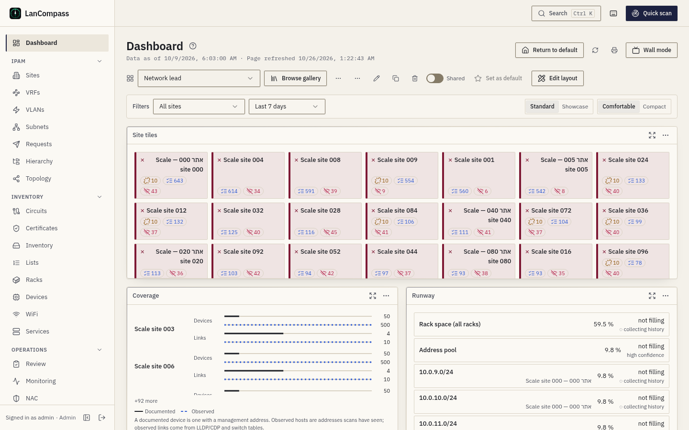
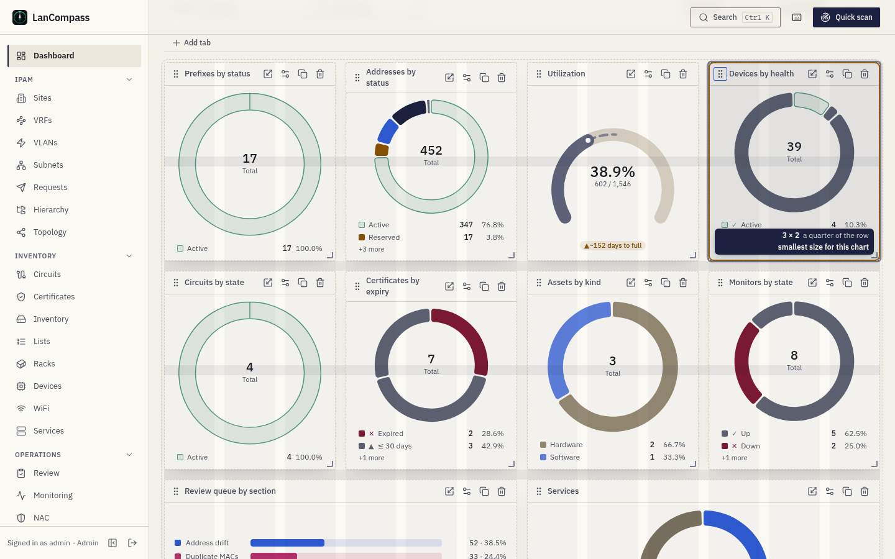
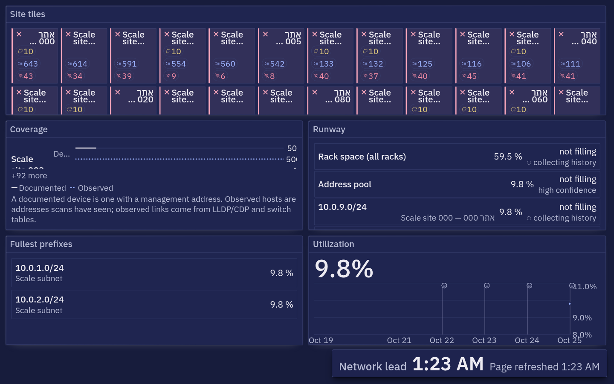

# Dashboards

The home page is a real dashboard system: named dashboards made of
widgets on a drag/resize grid, per-user and shared, with a global filter
bar and per-widget refresh. All widget data comes from the same aggregate
endpoints the rest of the app uses — dashboards rearrange data, they
never recompute it. Behind the charts sits a daily history (for the
estate and for each site); the charts mark what happened on them; every
saved version of a dashboard is kept; and a dashboard can go up on a
wall, onto paper or into a file.

## Which dashboard you land on

The route resolves in order:

1. an explicit **`?d=`** parameter (linked dashboards share fine), or
   **`?ref=`** for a gallery entry,
2. your **home** — your own choice (★ in the switcher), else a home an
   administrator assigned to you, your directory group or your role,
3. the **install default** — the shared or builtin dashboard an admin
   flagged,
4. the builtin **"Overview"** seed, which is the pre-editor layout —
   upgraded installs land exactly where they used to.

Your home is stored on the server, so it follows you to another browser.
The last dashboard you used in this browser before the gallery arrived
becomes your home once, on the first visit. **Return to default**
(top-right) always brings you back to your home.

Ready-made dashboards, following and copying them, suggesting your own and
assigning homes are in the [Dashboard gallery](/docs/dashboard-gallery/).

## Widgets and their data

**Add widget** opens the palette, grouped as below. Every number comes
from the page the same data lives on — a widget never keeps its own copy.
**Site** says whether a widget follows the dashboard's site filter (a
widget that can't shows an **All sites** chip); **Range** whether it
follows the time range.

**Stats**

| Widget | What it shows | Its data | Site | Range |
|---|---|---|---|---|
| **Stat card** | One number — prefixes, addresses and utilization, devices by health or status, sites, VRFs, racks and rack U, certificates, monitors, circuits, assets, services, scans, mismatches, open review items, Check Point, exposure and drift counts — with an optional danger threshold, a ▲/▼ delta chip against the previous window, a forecast chip ("~40 days to full"), a sparkline and a link to the page behind it | the dashboard statistics; the delta and sparkline from the daily history; the chip from the forecast | ✓ | — |
| **Capacity bar** | Rack occupancy: the fleet's total and the fullest racks | the racks | ✓ | — |
| **NAC status** | Network access control in plain words: open findings, pending actions, quarantined ports | the NAC summary | All sites | — |
| **Exposure posture** | Open exposed-service findings by severity, and open drift | the dashboard statistics | All sites | — |

**Charts**

| Widget | What it shows | Its data | Site | Range |
|---|---|---|---|---|
| **Health donut** | Any breakdown, as a ring or as bars: device health or family, address status or family, prefix and VLAN status, certificate expiry windows, monitor state or kind, review sections, assets, circuits, services, Check Point certificates and peers | the dashboard statistics | ✓ | — |
| **Gauge** | One share as a ring — address utilization, addresses used, rack U, certificates in date, monitors up, devices online, Check Point certificates and syncs, availability over the last 30 days — with days-to-full where the forecast covers it | the dashboard statistics (availability: the kept monitor history); the caption from the forecast | ✓ | — |
| **Activity timeline** | Events over time — scans, changes, monitor events, hosts discovered, discovery drift — or a daily level: utilization, addresses used, devices and their health, open review items, NAC, exposure and Check Point counts, each day's availability (empty for today until it is over); with event flags, an optional comparison and a dashed forecast tail | the timeline series; levels from the daily history | ✓ (see "Filters") | ✓ |
| **Subnet utilization** | Bars of the most-used prefixes | the prefixes | ✓ | — |
| **Rack elevation** | One rack's face, U by U, occupancy and health | the racks | ✓ | — |
| **NAC findings trend** | Open NAC findings per day | the daily history | All sites | ✓ |
| **Discovery drift trend** | Documentation-versus-reality drift the scans raised, per day | the timeline series | ✓ | — |

**Lists**

| Widget | What it shows | Its data | Site | Range |
|---|---|---|---|---|
| **Top list** | A short ranked list: expiring certificates, flagged mismatches, recent scans, recent changes, offline addresses, Check Point gateways, communities, certificates and syncs; the fullest prefixes, racks by power, sites by open review items and sites by undocumented links | the page each list comes from (addresses, scans, the change log, prefixes, racks, the site roll-up) | ✓ | — |
| **Monitor status** | Monitor targets, the worst first | the monitor targets | ✓ | — |
| **Open incidents** | The open incidents, the worst first (most targets down now, then the oldest), each with how many targets are down and for how long — a site's outage as one row; a calm line when nothing is open; a row opens it on the Incidents page | the incidents (see "Monitoring" → "Incidents") | ✓ | — |
| **Availability strip** | The targets with the lowest availability over the last 14 days, one cell per day: red below 99 %, amber below 99.9 %, hatched where a maintenance window covered part of the day, blank before history was kept; a cell's tooltip gives the day, its availability and the downtime | the kept monitor history (see "Monitoring" → "History and availability") | ✓ | — |
| **Topology changes** | New, resolved and removed devices, cables and ghost links per site over the last 7 days | the topology history | ✓ | — |

**Network** — see "Where to look first"

| Widget | What it shows | Its data | Site | Range |
|---|---|---|---|---|
| **Site tiles** | A tile per site, the worst first | the site roll-up | All sites | — |
| **Coverage** | Documented against observed, per site | the site roll-up | ✓ | — |
| **Runway** | What runs out first, in days | the forecast | ✓ | — |
| **Watched ports** | The busiest watched ports over the last 24 hours, each with a sparkline of its highest use per hour and its speed; a row opens the port's Traffic drawer; the footer says how many of the cap are watched and how old the newest hour is | the watched ports' hourly rows (see "SNMP Enrichment" → "Watched ports") | All sites | — |

**Content**

| Widget | What it shows | Its data | Site | Range |
|---|---|---|---|---|
| **Note** | Free markdown text | the widget's own settings | — | — |
| **Quick links** | Shortcuts to filtered pages | the widget's own settings | — | — |

A dashboard holds up to 60 widgets. On the wall, every widget's data for
a tick arrives in one request (see "Wall mode").

## Where to look first

Three widgets in the palette's **Network** group answer the network
lead's first question, and the **Network lead** template (also the
composer's **Where do I look first?**) puts them together with the
fullest prefixes and the utilization trend and its events. Nothing on
them writes: every click opens a page.

- **Site tiles** — one tile per site, the worst first. A tile's colour
  (with its glyph) is the site's worst device health; its corner badges
  count the undocumented links (seen on the network, not in the
  inventory), the open review items and the offline devices. A tile opens
  the site's canvas — the team's saved site canvas when there is one —
  with its undocumented links drawn. Long names wrap to two lines. Up to
  200 tiles; "+N more" opens the full-screen view with every site.
- **Coverage** — per site, two pairs of bars: the documented devices
  (devices with a management address) against the hosts scans have seen,
  and the documented links against the observed ones (LLDP/CDP and
  switch tables). The numbers are the topology canvas's own for that site.
  The widest gap comes first; the site filter keeps one site.
- **Runway** — what runs out first: every prefix the forecast tracks, the
  rack space and the address pool, with today's level, the days until
  full and how sure the forecast is. A low-confidence row says so in
  words, next to a ◌.

The undocumented-link and observed counts come from the same evidence
pass as the topology World, so the tiles and the map always agree.

## Devices and addresses

Two families of numbers look alike and mean different things:

- **Devices** — rows of the devices table. *Active devices* counts
  devices whose health is active (health is the worst status among a
  device's linked addresses, a documented address that stopped answering
  counting as offline); *Offline devices* the ones whose health is
  offline; *Devices* all of them. These are the numbers the Devices page
  shows, and the builtin Overview's "Active devices" card is this one.
- **Addresses** — IP rows by status: *Active addresses*, *Offline
  addresses*, *Discovered addresses*, *Reserved addresses*. An estate of
  a few hundred devices easily has tens of thousands of active addresses.
  These stay counts by status: a scan never changes the status of an
  address a person documented, so a documented host the scans stopped
  finding is still an active address. *Addresses not answering* counts
  those — the **missing** items of [Review](/docs/review/) → Address drift.

Widgets saved before this change keep their metric; only the label now
says "addresses" where the number always was addresses.

The *Offline devices* card says why under its number: "**3 not seen by
scans · 40 failing checks**". The first is the scans' count (the number
itself, unchanged); the second counts the devices whose enabled monitor —
on the device or on one of its addresses — is down on a check that is not
stale, so a device that fails its checks shows on the Overview even
while the scans still find it.

**How old is a number.** What a dashboard shows was observed when its lane
last ran, not when the page loaded. The stats, the chart series and the
monitor widgets carry that moment (`observed_at`): the monitor sweep's
end, the newest SNMP answer, the last finished scan, the last discovery
pass. A chart that has nothing in its window says "All clear · checked
{time}" with that time — never the browser's — and a series of documented
rows (changes, requests) names no time at all. When the scheduler's
background work stops, a status line says so on every page and on the
wall (see [Monitoring](/docs/monitoring/)).

## History snapshots

The worker writes one `dashboard_snapshots` row per day — the stats
payload (counts + distribution dicts, no sample lists), kept for 400
days. That turns every scalar into a trend: the activity timeline can draw
**utilization**, **IPs used**, **device**, **address** and
**review-queue** history, and stat delta chips compare against the
previous equal-length window.

**Today is always live.** The point for today on every trend, gauge chip
and forecast is computed from the current data, not read from today's
row; the row itself is rewritten at most every 15 minutes (and right
after an import or the demo estate lands), so a day ends at its last
value. A trend never drops to zero because the first snapshot of an
install was taken before anything was imported.

Snapshot metrics are honest about gaps: days before the first snapshot
render as breaks in the line, and a dashboard on a fresh install shows a
"collecting daily history" state until history lands — never a flat zero
line pretending to be history.

### Per-site history

The same write stores one row per site per day (`site_snapshots`):
addresses and utilization, devices and their health, rack U and expiring
certificates, counted the way the site-filtered dashboard counts them, on
the same day boundary. A dashboard filtered to a site draws those trends
from the site's own rows, today live. Site history starts the day the
upgrade lands — earlier days stay gaps, never borrowed from the estate.
The demo estate brings a scripted month for each of its five sites.

## Time zone

Where a day starts is the install's **dashboard time zone** (**Settings →
Features → Language & region → Dashboard time zone**, an IANA name such
as `Asia/Jerusalem`; UTC by default, Asia/Jerusalem on an install first
set up in Hebrew). It sets one boundary for everything daily: which day a
scan or a change is counted on, the hourly points of a 24-hour chart, the
day each snapshot row (estate and per site) belongs to, "today" for the
forecasts, and the day or hour an event flag stands on. Data is still
stored in UTC, so changing the zone moves the boundaries, never the data.

## Capacity forecasting

The same snapshot table read *forward*: `/dashboard/forecast` runs a
least-squares trend over each daily metric and answers "when does it
fill?" — estate IP utilization, rack U capacity, IPs used against the
live total, plus direction-only trends for review depth, device counts
and expiring certs. Each snapshot also carries the **top-20 hottest
prefixes'** utilization, which the dashboard's prefix widgets (Runway, the
fill chips) read. Beside it, the same writer records **every IPv4 subnet's
and DHCP or pool range's** utilization for the day in its own row, and each
subnet's forecast — its "runs out" day, its thresholds, Review's capacity
items and the capacity report — is fitted on that subnet's own days, by the
rules below ([Subnets → Capacity](/docs/subnets/)).

Every forecast states its confidence: **insufficient** below 14 days of
history — the answer is "collecting", never a guess — then **low**,
**medium**, or **high** on R². A flat series says *stable*, a shrinking
one says so, and nothing projects past a year out: "no reliable trend"
is an answer, rendered as such.

**The band.** Around the projection sits a shaded **likely range (95%)**:
the fit's residual standard error × 1.96. A narrow band is a line that
tracks its history; a wide one says how far the days stray from it. A
**low**-confidence fit draws the band alone, with no dashed line — the
uncertainty is the answer.

**Per site.** Under a site filter the forecast is fitted on that site's
own history only, and the hot prefixes are the site's; the review queue
stays estate-wide.

Where it surfaces: a **forecast chip** on stat cards ("▲ ~40 days to
full"), a **dashed projection tail** on activity timelines — the
projected zone is unmistakably different from measured history — a
**days-to-full** caption on gauges, and fill chips on hot prefixes in
the subnets list and prefix page. Enable it per widget in the settings
drawer (**Forecast** → *Show forecast*); gauges on covered metrics show
it automatically. **Operations → Review → Capacity forecast** flags
anything projected inside 90 days at medium confidence or better —
dismissals pin the entity + metric pair and survive the date drifting —
and every subnet or range past its warning threshold or projected to reach
its critical threshold within 90 days.

## Editing

**Edit layout** unlocks the grid: drag a widget by its header to
reorder, drag its edge or corner to resize it (or pick a quick size —
small, wide, large, extra-large, full row, its preferred size — from the
resize menu), configure with the sliders icon, or remove it. **Add
widget** opens the catalog palette; drag a card from it onto the grid, or
click it to add it at the end. Layout changes are *unsaved* until you
press **Save layout** — the dirty marker is honest. See *Arranging
widgets* below for how resizing and moving work.

Every edit — add, move, resize, configure, remove, tabs — can be undone
with **Ctrl+Z** (or the Undo button) and redone with **Ctrl+Shift+Z**.
The undo history lasts until you save or discard. With unsaved changes,
following a link, switching dashboards or leaving edit mode asks first.

### Tabs

A long dashboard can be split into tabs. In edit mode press **Add tab**:
the first one you add turns tabs on — your existing widgets stay on a
first tab and the new one starts empty. Rename or remove the active tab
with the buttons beside it (a removed tab's widgets move to the first
tab), and move a widget to another tab with the folder button on its
header. The URL carries the open tab (`?tab=`), so a link opens on the
same tab. A dashboard without tabs looks exactly as before.

A widget's settings drawer offers a live preview plus per-type options:
metric or list, row limit, a **site override** (follow the dashboard
filter, all sites, or a pinned site), **time range**, **danger
threshold**, a **title** override, and an **auto-refresh** interval that
polls only that widget. Breakdowns pick a **lens** (which distribution)
and a **display** (donut or bars); gauges pick a **metric** and an
optional threshold; stat cards gain a **delta chip**, a **sparkline**,
and a **forecast** chip on metrics with an honest trend series — the
fields disable with an explanation when a metric has none.

## Arranging widgets

Every row of the grid is the same height — one *row unit*, 152 px (120 px
at the compact density) — so a card is as tall as the rows it spans,
whatever it holds. A list longer than its card scrolls inside the card,
with a soft fade at the clipped edge; a chart in a short card switches to
a compact layout (a donut puts its legend beside the ring, then shows its
total and largest slices as chips) rather than drawing a squashed plot.
Widgets are placed in order, each taking the first free spot from the top
and from the start of the line (the right in Hebrew and Arabic); the
screen, a printout and wall mode place them the same way, cell for cell.
Below 1024 px wide the grid has 6 columns (widths halve), below 640 px one.

**Resize.** In edit mode a card shows three handles when you point at it
or focus it: its inline end, its bottom edge and its corner. Drag one and
an outline follows the pointer one whole cell at a time while the card
itself stays put; a badge reads the size ("6 × 2") and its share of the
row ("half width"). Every widget type has a smallest and a largest size —
a donut is at least 3 × 2, a stat 2 × 1, a line chart 4 × 2, a list 3 × 2.
At a limit the badge says *smallest size for this chart* or *largest
size*, and the outline gives only a few pixels before springing back.
Let go and the card takes its new size; the cards it moves glide to
their places. Double-click the corner to give a widget its preferred size.

**Move.** Drag a card by its header (on a touch screen, press and hold it
briefly; the header's buttons keep their own clicks). A picture of the
card lifts and follows the pointer, a dashed outline marks the slot it
will land in, and the other cards glide out of its way — the card lands
exactly where the outline shows. Drop it outside the grid, or press
**Escape**, to put it back. Near the top or bottom of the window the page
scrolls, faster the closer you get. Cards from the **Add widget** palette
drag onto the grid the same way.

**Keyboard.** Focus a card's grip and press **Space** or **Enter** to pick
it up; the arrow keys move it slot by slot, **Space** or **Enter** drops
it and **Escape** cancels — each move is announced with the card's title
and its position. To resize, focus the card and press **R**: each arrow
grows or shrinks it by one cell (**Shift** + arrow goes straight to the
limit), **Enter** keeps the size and **Escape** puts the old one back;
each step is announced. In Hebrew and Arabic the left and right arrows
follow the reading direction.

Every move and every resize is one step of **Ctrl+Z**. A widget saved
before these limits existed is drawn at the nearest size it allows; its
stored layout is rewritten only when you save.

## Sharing and the install default

- Any signed-in role — including viewers — can create, edit and delete
  *their own* dashboards; they're personal preferences, not shared data.
- The **Shared** toggle (owner only) publishes a dashboard read-only to
  everyone; the owner or an admin can still edit it.
- **Set as default** is an admin operation and only works on a shared or
  builtin dashboard — a private dashboard can't be the install default.
  Setting a new default clears the old one automatically.
- The builtin "Overview" is editable by admins like any shared row;
  users who want a personal variant use **Duplicate**.
- A second builtin, **"Overview + Charts"**, ships alongside it — the
  same widgets in the same order, each scalar expressed as its chart
  twin (breakdown donuts, the utilization gauge, services-by-name).

## Filters

The filter bar sets a **site** and a **time range** for the whole
dashboard. They're written into the URL (`?site=&range=`), so a filtered
dashboard links cleanly. Widgets that are site-aware follow the filter
unless their config opts out; timeline widgets follow the range unless
they pin their own.

**All sites.** A widget that can't follow the site filter says so: an
**All sites** chip in its header means it shows the whole estate. Scans,
hosts discovered and discovery drift follow the site (through the prefix
or address they belong to), and so do the daily trends for addresses,
utilization, devices, rack U and certificates (the site's own history);
the change log, monitor events, the review queue and the NAC, exposure
and Check Point series are estate-wide.

**Last 24 hours.** Event timelines (scans, changes, monitor events,
hosts discovered, drift) draw 24 hourly points. Snapshot trends are
daily: at 24 hours the card shows today's live value and asks for 7 days
or more for a trend.

## Reading the charts

Every chart sits in the same frame: the card's title, a **hero value**
(the latest level, or the window's total for an event series) with a
▲/▼ **delta chip** and an "as of" time, the plot, and a legend under it.
Numbers are tabular, so digits don't shift while a value rolls; big
values read compact on axes and heroes (12.3K) and in full in tooltips
and tables; percents carry one decimal.

- **Lines** are smooth but never overshoot the data. A missing day
  breaks the line and a faint dotted hairline bridges the gap — nothing
  is interpolated; the tooltip says "No data for this day". Only the
  latest point carries a dot; from 2×2 up the period's peak is marked
  too.
- **Y axes** sit on the trailing edge with at most four ticks. Counts and
  shares start at zero; a percentage level (utilization) may zoom in, and
  the axis shows where it starts.
- **Hover** draws a 1 px crosshair; charts sharing the dashboard's range
  hover together. The tooltip shows the date, the value, the change from
  the previous point and the series' colour and glyph.
- **Forecasts** add a dashed line and the shaded **likely range (95%)**;
  a low-confidence fit shows the range only.
- **Breakdowns** draw a thin ring with the total in the middle (hover or
  focus a slice — or its legend row — to see its value and share); the
  legend lists four rows and "+N more" opens fullscreen. Clicking a legend
  row isolates that category (view only, never saved; click again or press
  Escape). A status breakdown whose story is one category — a single
  failing bucket — shows it in its colour and the rest muted.
- **Bars** stay square at the baseline; with up to eight bars each
  carries its value, and a bar past its threshold turns amber or red
  **with ▲** — colour never carries the meaning alone.
- **Small cards** simplify: under 240 px wide a chart shows its hero and
  a sparkline only; up to 360 px it drops the Y axis and keeps three dates.

Each theme has its own tuned palette (blue, orange, aqua, yellow,
magenta, green, violet, red — the eighth and beyond fold into "Other"),
every colour at least 3:1 on its card. In the four dark themes, with
effects on Full, line strokes and gauges get a soft glow. Motion follows
**Settings → Appearance**: under Full a chart draws once on page load and
then tweens its changes; Calm, Off and reduced motion keep everything
still.

## Reading the new charts

Eleven chart widgets answer questions a line or a donut cannot. Each sits
in the same frame as the others: hover or focus a mark for its numbers,
**View as table** for all of them, and the arrow keys move from mark to
mark (Enter opens what a mark links to). Colour never carries a number on
its own — the tooltip, the table and the legend say it.

| Widget | How to read it |
|---|---|
| **Calendar heatmap** | One cell per day, up to a year. Weeks run left to right in every language; rows follow your week (Sunday first in Hebrew). The darker the cell, the more happened that day — scans, changes, monitor events, discovery changes or hosts found. A forward series (certificate expiries, maintenance) starts today and covers the coming year. The frame's big number is the period's total. A day older than what LanCompass keeps is drawn as a dashed outline and reads **Not kept** — never as a quiet day: discovery changes are kept for **Settings → Deep discovery → Evidence retention (days)** (90 by default), and scans, changes and monitor events for as long as **Settings → Features → Data retention** says (forever by default). Raise the setting to keep a full year. |
| **Punch card** | A week of hours: a row per weekday, a column per hour, a circle whose **area** grows with the count. Its sentence names the busiest and the quietest hour — a good place to look for a maintenance window. |
| **Treemap** | A hierarchy as nested rectangles. The area is always the size (addresses, rack units, devices); the colour is how full it is. Past 500 items the smallest fold into **Other (N)**. Activate a rectangle to open it. |
| **Sunburst** | The same hierarchy in up to three rings: VRF, container, prefix — or site, rack group, rack. The centre names what you point at and its share of the whole. Arcs are coloured like the treemap: by how full they are when the hierarchy has a fill (prefixes, racks), by their top-level branch when it only counts (devices). |
| **Flow (sankey)** | Where things go, with each band as wide as its count: the discovery lifecycle (discovered → identified or ignored → documented → monitored), VLANs to prefixes to sites, device families to sites. At most 40 nodes; the rest fold into **Other**. |
| **Small multiples** | One small trend per site, every cell on **one shared scale** so the cells compare honestly, sorted by the latest value. Up to 24 show, then **+N**. A series that has no site path is refused rather than repeated per site. |
| **Site radar** | Each site's profile on six shares: coverage, utilization, monitors up, certificates OK, compliance pass and documented links. Up to six sites overlay; the rest open as small radars in full screen. A share with nothing to measure reads **No data**. |
| **Bullet** | A number against its target and up to three bands you set in the widget's settings (the bar is the value, the tick the target). It says **On target** or **Off target** in words. |
| **Waffle** | A 10 × 10 grid: each square is one percent, rounded so the squares always make 100. |
| **Radial bars** | The fullest racks or prefixes as rings, at most 12, the largest outermost, all on the same 0–100 % sweep. |
| **Address map** | A /16 as 256 blocks on a Hilbert curve — blocks that are next to each other in number stay next to each other on the map — coloured by how many addresses each /24 uses; an outlined block has a prefix defined. Activate a block to zoom into its 256 addresses (coloured by state); the breadcrumb leads back. Without a block in its settings it shows the /16 with the most addresses in use. The map never mirrors. |

The heatmaps, maps and treemaps colour by a six-step ramp from the card
towards your theme's accent; neighbouring steps stay apart for colour-blind
readers too, and the scale prints with the chart.

### Showcase look

A dashboard meant to be looked at — on a wall, in a meeting — can switch
to **Showcase** with the **Standard / Showcase** switch in the filter bar
(editors only). Cards lose their borders and sit on a soft backdrop of
your theme's accent, card titles get larger, the numbers grow to 40 px and
the cards reveal one after another the first time the page opens (Full
effects only). The light themes keep a thin card edge, and print drops the
backdrop. The look is saved with the dashboard like any other change, so
History can bring the previous one back. Gallery entries marked ✦ come in
the showcase look; a copy keeps it until you switch.

## Events, comparisons and zoom

The time charts (activity lines, NAC findings over time, discovery
changes over time) mark what happened on their timeline, so a jump comes
with its reason:

- **Flags** stand on the day (or the hour, at 24h) an event happened —
  a committed import ◆, a scan ○ or a discovery run ◎ (several in the
  same hour on the same site share one flag that counts them), a device
  config that changed ✎, the demo estate loaded or removed ★. A
  **maintenance window** is a shaded span from its start to its end ▭.
  Flags and spans sit beneath the line, never over it, and each kind has
  its own glyph as well as its colour.
- Hover or Tab to a flag to read it ("hq-subnets.csv imported by admin");
  click it or press Enter to open what it points at. A flag whose target
  you can't open still shows its kind and time. Turn the flags off per
  widget in its settings (**Annotations**); they're on by default. A chart
  shows the latest 200 events.
- **View as table** lists each event on its own row at its time among the
  data rows; in fullscreen an events table (time, kind, event, link)
  follows the chart's table.
- **Compare with** (activity lines, in the widget's settings) adds a
  second, dashed series on the same axis: **the previous period** — the
  same metric one range earlier, so "this week" sits on "last week" — or
  **another site**, for series that follow a site (scans, discoveries,
  addresses, utilization, devices; the others don't offer it). The legend
  names both series. A day the other series has no data for is a gap,
  never a zero.
- **Zoom:** drag across a time chart to zoom into that range; the
  **Reset zoom** chip (or Escape) brings the whole range back. From the
  keyboard, Shift+Arrow extends a selection from the focused day and
  releasing Shift zooms. Zoom is a view only — it is never saved and
  sends nothing to the server.

## Accessibility

- Every chart has a **summary sentence** as its name — the latest value
  and its change, the lowest and highest values and any days without
  data.
- **View as table** (the table icon on a chart card, and always under the
  chart in fullscreen) shows the plotted numbers as a captioned table.
- **Keyboard:** Tab to a chart, then the arrow keys move along it; the
  tooltip follows and a live region reads the value. Shift+Arrow selects
  a range to zoom into and Escape resets it; Tab goes on to the chart's
  event flags, each read with its kind, time and label.
- **Patterns in charts** (Settings → Appearance) adds hatch and dot fills
  to slices and bars, so categories differ by more than colour. Printing
  always uses them.
- Time runs left to right in every language; in Hebrew and Arabic the
  card, legend and tooltip mirror around the plot.
- The **Network** widgets have summary sentences too: site tiles name the
  sites that need a look and why, coverage names the widest gap with its
  numbers, runway names what runs out first and in how many days (and
  says "low confidence" when it is). A tile's colour always comes with its
  glyph.
- **Export → CSV table** gives any chart's or list's numbers as a file,
  for a spreadsheet or a screen reader that prefers one.
- On the **wall**, nothing reacts to a click and the clock stays readable
  across a room; **Esc** shows the way out.

## Print

The printer icon opens `/print` — the active dashboard rendered flat:
same widgets, same filter, no chrome, on a light "paper" palette. Pick
the paper above the preview: **A4** or **A3**, **Landscape** or
**Portrait** (A4 landscape unless you choose otherwise; the preview is
laid out at that paper's width). It prints with the dashboard's own
12-column grid, a card never split across pages, and — at the top of
every page — a header naming the dashboard, the site, the range, the
time it was generated and who printed it. Print has no animation and no
glow, and charts use pattern fills.

## Wall mode

**Wall mode** (the TV button beside the printer) shows the dashboard
full-screen for a wall or a TV: no sidebar, header or edit controls, and
nothing on it reacts to a click. A small clock in a corner names the
dashboard, shows the time large enough to read across a room, and gives
two times: **Data as of** — when the oldest widget's data was observed on
the network (a monitor sweep, an SNMP poll, a scan) — and **Page
refreshed**, when this screen last asked for it. When background work has
stopped, the first stays at the moment it stopped while the second keeps
moving, and a status line across the top says **Background work stopped …
ago**.

- **Address:** `/?d=<id>&kiosk=1`. Add `&rotate=<id>,<id>` to rotate
  through more dashboards and `&every=<seconds>` for how long each one
  shows (30 to 3,600 seconds; 60 by default). A dashboard in the list
  that the signed-in user can't see is skipped — the wall never shows an
  error page.
- **Refresh:** every widget refreshes together on the wall's tick — the
  shortest refresh any widget asks for, but never more often than every
  30 seconds (every 60 seconds when no widget sets one). Each tick's
  dashboard data — the stats, every chart series, the forecast and the
  event flags — arrives in one request.
- **Burn-in care:** every 10 minutes the whole layout moves by a couple
  of pixels (never more than 4) and the clock moves to the next corner.
  Add `&static=1` to keep both still.
- **Fit:** the rows stretch to fill the screen's height, so nothing is
  shrunk; only a dashboard with too many rows for that is scaled down to
  fit. The clock keeps a band of its own at the screen's edge, and a list
  shows only the rows its card holds whole.
- **Reading from the back of the room:** every label on the wall is at
  least 24 px and every number at least 72 px on a 1080p screen (larger
  on a taller one). A number's second line goes under it, or beside it
  when there is no room below; nothing is cut at a card's edge, and
  nothing on the wall loops — a changed value marks itself once.
- **Theme:** the wall opens in Night chart, whatever theme the browser
  uses. Add `&theme=<theme>` to choose another for the wall (`survey`,
  `night-chart`, `survey-hc`, `night-chart-hc`, `cyberpunk` or `indigo`).
- **All clear:** a chart with nothing in its window says so, names the
  window and the time it was checked — "All clear · Last 24 hours ·
  checked 07:30" — rather than standing empty. "Checked" is when the
  series' lane last ran (the last scan, discovery pass or monitor sweep),
  so a stopped worker never reads as a fresh all-clear.
- **Leaving:** press **Esc** — or, on a touch screen, press and hold
  anywhere — to show **Leave wall mode**.
- **Signing in:** the wall runs under an ordinary signed-in session; a
  viewer account on the wall's computer is enough. If the session ends,
  the wall shows a full-screen **Sign in again** card instead of going
  blank, and after signing in it comes back to the same dashboards.

## Exporting a widget

The **⋯** menu on a widget offers **Export**: **PNG image** and **SVG
image** for a chart, **CSV table** for any widget with rows (a chart's
numbers, a list's rows).

- The image is the chart as drawn, in your theme's colours, under a
  header with the widget's title, the dashboard, the site and the range,
  and "as of" — in your language and reading direction. The file is
  self-contained: opening it fetches nothing.
- The CSV is UTF-8 with a byte-order mark, like the Reports CSVs, so
  Hebrew and other scripts open correctly in a spreadsheet.
- Files are named `<dashboard>-<widget>-<site>-<range>-<date>`, for
  example `Network-lead-Utilization-Demo-HQ-30d-2026-10-15.png`.

## Two editors, one dashboard

Every save carries the version the page last read. If someone else saved
the dashboard in between (another person, or you in another tab), the
save stops and asks: **Reload (keep mine as a new dashboard)** saves your
version as a private copy and shows theirs; **Overwrite** replaces theirs
with yours — the dialog names their save (who and when), which stays in
**History**. Nothing is lost silently.

## History and restore

Every save of a dashboard's layout, filters, tabs or name keeps the
version it replaced. Open **History…** from the dashboard menu (**⋯**):
each row shows when the version was saved, by whom, how many widgets it
had, and its label. Open a row for a read-only preview — the layout as a
map of titled boxes — then **Restore this version**. A restore is an
ordinary save: what the dashboard shows now is kept in History in turn,
so a restore can itself be undone, and if someone saved in the meantime
you get the same Reload / Overwrite question.

Give an important version a **label** (up to 80 characters, e.g. "before
the pilot"). The newest 50 versions are kept, plus every labelled one.
Anyone who can see the dashboard can read its history; restoring and
labelling need the right to edit it. Backups include the history.

## Export and import

**Export to a file** (dashboard menu) downloads the dashboard as a
`.lancompass-dashboard.json` file: its name, layout, tabs and filters —
no owner and no ids from this install. Sites travel by name, and so do
racks on a rack widget.

**Import from a file…** turns such a file into a new private dashboard of
yours (share it afterwards if you like). Every widget is checked against
this install's widget catalog: a widget type it doesn't know, or settings
it refuses, are left out. Site and rack names are matched to this
install's sites and racks (letter case doesn't matter); a name with no
match is cleared — a widget then follows the page's site filter. A
report lists everything that didn't come over as it was.
