# Racks

Physical rack elevations — which devices sit in which U slots, on which face.

## The list

Racks works like the other entity pages: column sort, pin, drag
to reorder, row colors, history. Each row shows the device count and a
used-U bar (`used_u / height_u` — front and rear gear sharing a U counts
once), plus a **Capacity** column summing device `watts`/`weight_kg` (dashes
when no device supplies a value).

The **Filters** button opens a faceted panel (a Sheet on narrow screens)
with live counts — search on top (name, room, description, site and group
names — Hebrew-folded), then facets for site, group (with an *ungrouped*
entry), room, height (distinct values present), occupancy (empty / partial /
full over the used-U rollup), and a free-U range. Active facets render as
removable chips in the toolbar, and every facet is a URL param
(`?site_id=58&occupancy=partial&min_free_u=4`), so a filtered view is
bookmarkable, survives reload, and can be named via **Saved views**
(built-ins: *Ungrouped*, *Nearly full*, *Empty*). `min_free_u=4` is the
"where can this 4U box go" query — it facets on the computed
`height_u − used_u` aggregate.

## Rack groups (bayed rows)

A datacenter row is never one rack. **Rack groups** collect racks standing
side by side — the "Rack groups" panel at the top of the racks page lists
them with member counts; clicking a name opens the **row view**
(`/racks/groups/[id]`): the member racks drawn left to right, bottom-aligned
like a real bayed row, each with its own health dots. The strip scrolls
horizontally for wide rows; the header rolls up group totals (U used/free,
Σ watts, Σ kg). A long row draws only the racks in view: the others show
as outlines with their summary line and fill in as they scroll in, so a
row of 200 racks opens as fast as a row of two.

- Assign a rack to a group in its dialog — pick the group and optionally a
  **Position** (left-to-right; blank appends at the row's right end). Setting
  the group back to *None* removes it.
- Group rows filter like VLAN groups: the filter button on a group row
  scopes the rack table to its members (sets the `group_id` facet).
- With write access, the row view's **Edit** toggle lets you drag a device
  sideways onto another rack's U row — a real cross-rack move validated by
  the API. A mounted child dropped on a U row unmounts; a carrier carries
  its children across racks with it.

## Rack detail

Open a rack to see it drawn as a **cabinet**: dark steel, top and bottom
caps with vents, two rails with three square holes per U, the U numbers on
both rails (every fifth one stronger, in the rack's own numbering — see
*Capacity*) and a 0U side channel outside each rail. The cabinet looks the
same in every theme; only the page around it follows yours. U1 is at the
bottom, and the drawing is physical in every language: a Hebrew or Arabic
page mirrors the page around it, never the rack.

The header names the rack with a chip each for its site, its room and its
size (height · rail width · depth), and a space meter. When the rack stands
in a group (a bayed row, above), the **row mini-map** above the
cabinet draws the whole row as small cabinets, each with a fill bar and —
where that rack has a power budget — a power bar; click one to open that
rack (the current one is marked).

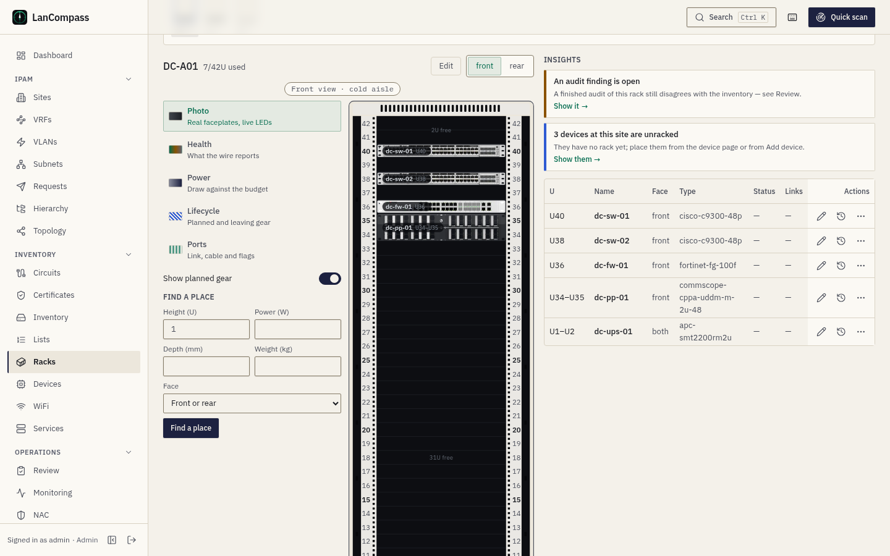

### On a design

A rack can also be drawn on a design in Design Studio (*Topology Map →
What Design Studio can do today*). A rack from the inventory appears there
as this same cabinet with its devices, read again each time the design
opens and never changed from the canvas — **Open rack** brings you back
here to edit it. A **planned rack** is drawn in the design itself, U by U,
with devices from the catalog; the placement rules below apply to it as they
apply here, and **Promote** creates it, with its devices at their U, at the
design's site after its preview.

### Faceplates

Every device fills its U box with a faceplate:

- **A photo** — your own photo for the device's type if you added one,
  else the library's (see *Device image library*). A photo fills its box
  edge to edge; one whose shape is more than 15 % off the box is drawn
  whole on a dark bezel instead of stretched. A rear view uses a rear
  photo only — it never borrows the front.
- **A drawn faceplate** when the face has no photo: one drawing per kind
  (switch, firewall, server, storage, UPS, PDU, patch panel, shelf, KVM,
  cable management, blank, other), chosen from the library category, else
  the device's family. A drawn switch, firewall or patch panel shows
  exactly the ports the device has documented — RJ45 jacks in two rows,
  SFP and QSFP cages, a console port; a device with no documented ports
  reads **Ports not documented** and shows none. Servers and storage show
  drive bays and a power/ID strip — decoration, never a count. A drawn
  rear shows one power inlet per documented power port, fans, and for
  servers, storage and UPSs their data ports. The maker and model are
  printed as text (never a logo), the finish is flat with no photo sheen,
  and the inspector says *No photo — drawn from its ports*.
- A **status LED** on the left ear in the health colour (below — a down
  device's LED pulses when effects are on full and your system allows
  motion) and a **label pill** at the left with the name and U range. The
  pill takes at most 60 % of the faceplate and shortens a long name; the
  full name is always the block's accessible name.

The **Front / Rear** switch flips the cabinet (a crossfade with calm
effects or reduced motion, instant with effects off), and the chip above
it names the face drawn: *Front view · cold aisle* or *Rear view · hot
aisle*. Front and rear devices legitimately share U slots, so each view
shows only its own face, plus `both`-face gear like shelves. The address
keeps `?face=rear`, so a reload or a shared link opens the same face.
Every empty span of 2 U or more reads **{n}U free**. Below 640 px the
device table becomes a card list.

### The inspector

Click a device, or press **Enter** or **Space** on it, to open the
**inspector** — docked in a rail beside the cabinet on a wide window
(1,081 px and wider), a bottom sheet below that. It shows the device's
faceplate, name, status (with the date it took that status, read from its
history) and health, its place (U range and face), model, power and its
share of the rack's power budget, weight, depth and airflow (and whether
the airflow runs against the rack's), ports (cabled and up), address and
last seen, asset, carrier and notes — each only when the device has it — with
**Open device**, **Trace a port** (the device page's ports tab, when it has
ports), **Move…**, **Edit** and **History**. Selecting a device never
leaves the rack page. **Esc** or **Close** returns focus to the device in
the drawing; the sheet keeps focus inside itself while it is open.

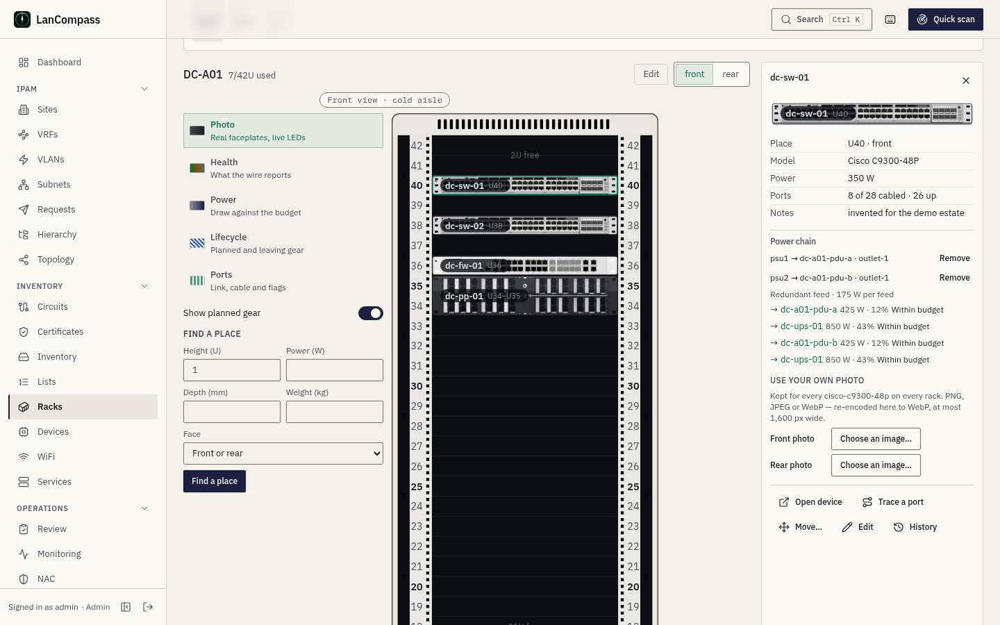

With write access the inspector also offers:

- **Match a photo** — for a device with no library type: library types
  ranked against its maker and model, each with its photo (an exact model
  first, at most five). Choosing one sets the device's type through the
  normal save; **Undo** takes it back.
- **Use your own photo** — a front and a rear picker (PNG, JPEG or WebP).
  The browser writes a new WebP at most 1,600 px wide, so no metadata from
  the original file travels with it, and the server keeps only WebP under
  1 MB in the attachment store. A photo belongs to the device **type**:
  every device of that type, on every rack, shows it at once, and removing
  it falls back to the library photo, then the drawing. A device with no
  type first gets a custom type named from its maker and model
  (`custom-<maker>-<model>`), so every device of the same make and model
  shares the photo.

### Editing the elevation

With write access, the **Edit** toggle (remembered per browser) turns the
cabinet into an editor, with the **library palette** beside it:

- **Drag** a device: a ghost follows the pointer, green where the device
  fits and red where it collides, snapped to whole U. Dropping on the rear
  view places it on the rear face (front view → front) unless it is
  `both`. A drop that can't land sends nothing — the device springs back
  and a toast names what is in the way. A move that lands settles with a
  small pop and a toast (*sw-1 moved to U4–U5*) with **Undo**.
- **Undo and redo**: the editor keeps your last 50 steps — moves, mounts,
  resizes and a type set by *Match a photo*. **Ctrl+Z** (⌘Z on a Mac)
  undoes, **Ctrl+Shift+Z** or **Ctrl+Y** redoes, and the toolbar has
  **Undo** and **Redo** buttons. Each undo is a real save: if someone else
  changed that device after you, you get the *Reload / Overwrite* question
  instead of silently undoing their change. Inside a text field Ctrl+Z
  stays the field's own.
- **Resize**: a device with no library type, or a blank, shows a handle on
  its bottom edge while it is selected or focused — drag it down to make
  the device taller, up to make it
  shorter (its top stays put). The new height goes through the same
  placement check, and a carrier never shrinks below its tallest child.
- **The library palette** lists the bundled library and your device
  templates in one search (name, maker, model — every word you type),
  favourites first (star an entry; the stars are remembered in this
  browser), each with its photo, height and depth. Drag an entry onto a
  free U, or choose it to add it at the first free U it fits: either way
  the **Add device** form opens prefilled with that entry and U, and the
  save is the normal one (a template also adds its ports). Hovering a free
  U shows **+ Add at U{n}**; clicking it filters the palette to the gear
  that fits there. **Custom device…** opens a blank form at that U.
- **Carrier slots**: dropping a device on a carrier's slot mounts it there
  (slot outlines appear while dragging); dragging a mounted child onto a
  plain U row un-mounts it.

### Keyboard

The rack is one **Tab** stop. **↑**/**↓** move between devices (a carrier's
children right after it), **Home** and **End** jump to the top and bottom
device, and **Enter** or **Space** opens the inspector. In edit mode,
**Space** or **Enter** picks the focused device up, **↑**/**↓** move it
(skipping the slots where it doesn't fit — the same ghost as a drag),
**F**/**B** set the face, **Enter** drops it and **Esc** puts it back;
**Move…** in the inspector picks a device up the same way. A screen reader
hears every step by the device's name and U, never an id. In the row view
each rack is one Tab stop.

### Carriers (shelves & trays)

Real racks hold gear that isn't a whole-U full-width box — half-width
switches, RPi trays, quad brackets. A **carrier** is an ordinary rack
device flagged with a *slot layout*; other devices mount into its slots:

| Layout | Slots | Renders as |
|---|---|---|
| `halves` | 2 | vertical split — left / right |
| `quarters` | 4 | 2×2 grid |
| `shelf` | 1 | one full-width tray (useful for grouping) |

- The carrier occupies its whole U span and face like any device; children
  inherit its U position and face (those fields hide in the device form).
- One child per slot; a child never conflicts with rack-level devices — the
  carrier already reserved that space. Children only collide with a sibling
  in the same slot.
- Single level only: a carrier can't mount inside another carrier, and a
  child can't be taller than its carrier.
- Unracking a carrier lifts the whole tray out of the rack — its mounted
  children leave the rack too but stay mounted to it (the tray still
  physically holds them). Devices are first-class rows: removing one from
  a rack never deletes it — it becomes unracked inventory on the
  Devices page.
- The device library includes **1U dual shelf**, **1U quad bracket**, and
  **Rack shelf** starters; any device can become a carrier via the *Carrier
  layout* field.

To mount a device: pick it in the form's **Mounted in** select and choose a
**Slot**, or drag it onto a carrier's slot in the editor. Mounted children
don't take the keyboard pick-up — their slots aren't a linear range.

### Lenses

The tools rail beside the cabinet starts with the **lens** — five ways to
read the same faceplates, each tinting them without hiding them. The lens
is in the address (`?lens=health`, with the face as `?face=rear`) and
remembered per browser, so a shared link opens the lens it was taken in.

- **Photo** — the cabinet as drawn above: real faceplates and live LEDs.
- **Health** — every face is greyed to 40 % and tinted by its health
  rollup (below), with the status's mark on the right ear (● active,
  ◆ reserved, ≈ dhcp, ✦ discovered, ✕ offline, ○ not monitored): colour is
  never the only signal, and a down device's mark pulses. A device whose
  **airflow** runs against the rack's front-to-rear convention carries an
  amber arrow pointing at the cold aisle — rear-to-front gear on the front
  face, or front-to-rear and side-to-rear gear turned round on the rear
  face; the inspector names the conflict too.
- **Power** — faces tinted on four bands of **Power (W)**: under 200, 200–600,
  600–1,200 and over 1,200 W, each band also marked with one to four bars,
  and the watts in the label pill. A device with no watts stays untinted
  and its pill says "no power data".
- **Lifecycle** — planned devices hatched blue with a dashed outline,
  decommissioning devices striped amber, the status in the pill. The hatch
  and the stripe also show, weaker, in every other lens; retired devices
  are never drawn (retiring unracks them).
- **Ports** — an LED grid over every faceplate: link, cable and flag per
  documented port (see *The Ports lens* below).

The **legend** under the cabinet follows the lens and names every colour,
pattern and mark the cabinet can draw in it. **Show planned gear** (on by
default; `?planned=0` when off) hides planned devices from the drawing and
the meters' projection — the placement checks still see them.

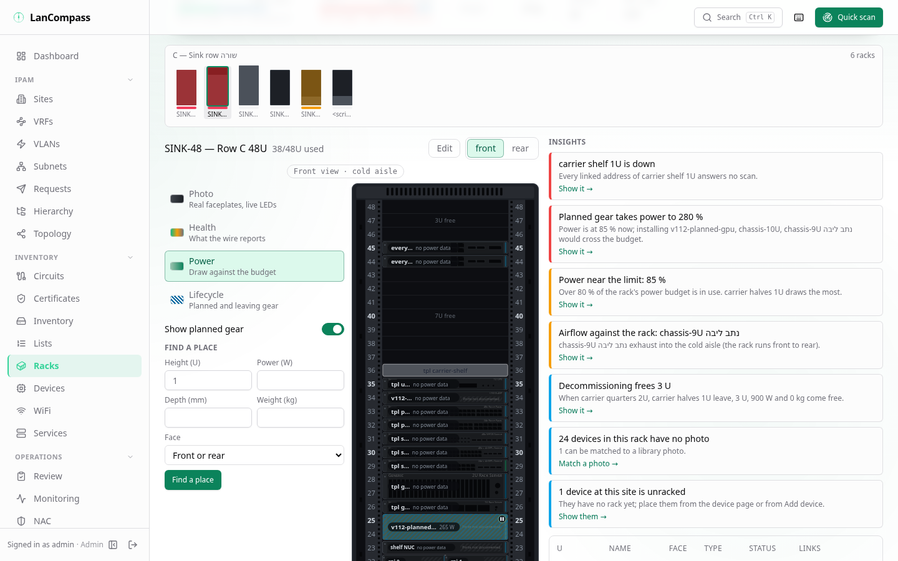

Every lens on the demo's DC-A01 — Photo, Health, Lifecycle and Ports on
the front, Power on the rear, where the PDUs and their cords are:

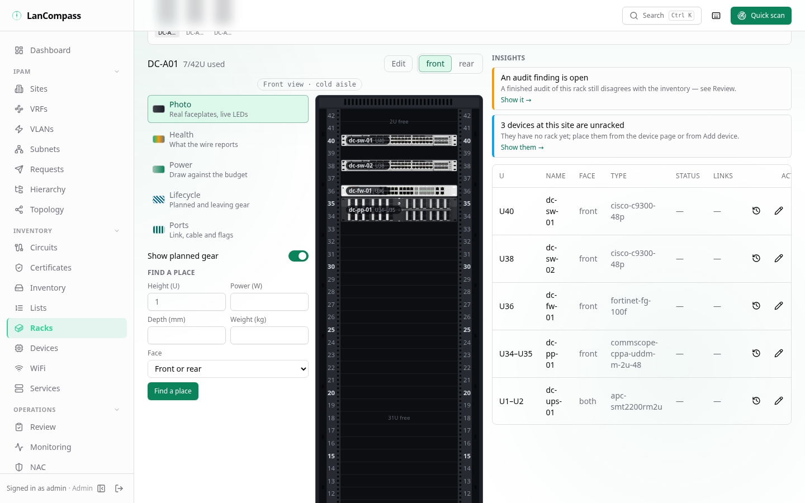
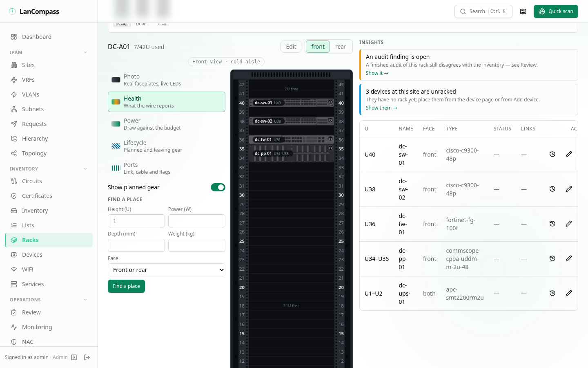
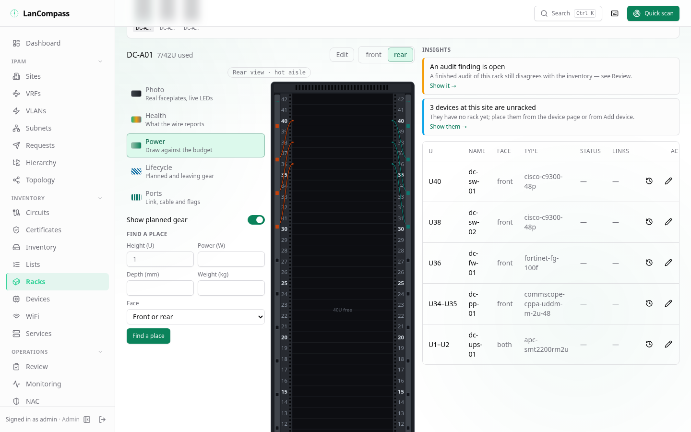
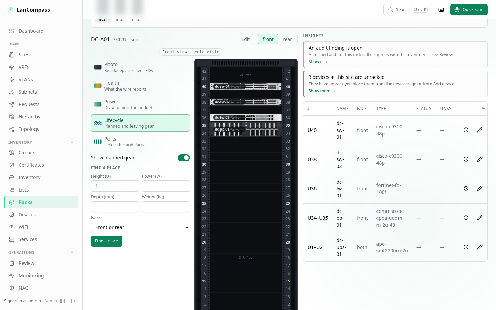
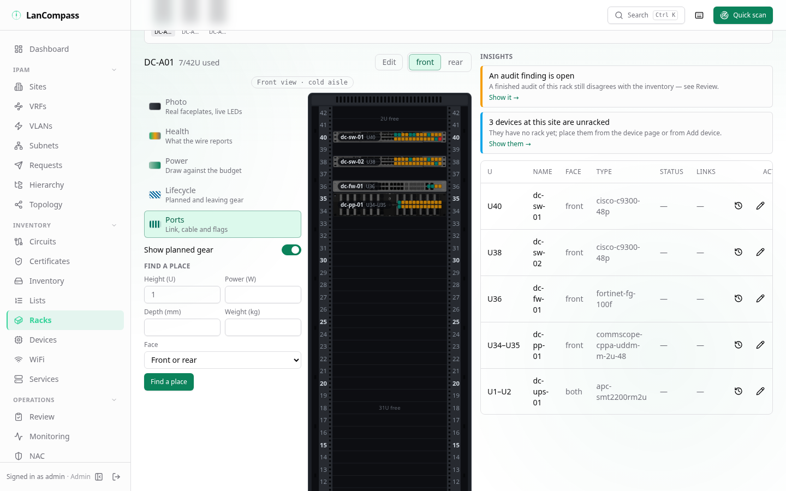

### Health rollup

Each device's status LED shows its **health rollup**: the worst status
across *all* its linked IP addresses (a server can own mgmt + service +
iLO IPs; offline beats discovered beats dhcp beats reserved beats active;
a documented address not answering counts as offline — see
[Devices](/docs/devices/)), using the same colors as the address table:

| LED | Meaning |
|---|---|
| green | `active` |
| amber | `reserved` |
| cyan | `dhcp` |
| violet | `discovered` |
| zinc | `offline` |
| grey | unmonitored — no linked IPs |

The inspector shows the health-driving IP with its status badge and
relative *last seen* ("2h ago"); **Open device** jumps to the
[device page](/docs/devices/) (all its IPs, links, placement). The device
table below lists every placement top-down, including a Status column for
the health rollup.

### Meters and the planned projection

The rack header carries three **meters** — **Space** (used U of the rack's
height), **Power** and **Weight** (against the budgets below), each with
its value, its bar and its state in words ("Near the limit · 85 %"). Planned
devices' U, watts and kilograms are drawn as a **hatched segment** after
the installed sum, and while planned gear is shown the state counts it and
says so: "Over budget · 104 % · with planned" — the rack turns red on the
screen before anyone installs the gear. A quantity without a budget shows
its sum and no bar; one with neither a budget nor any device documenting
it (no watts, no kilograms) is left out. The racks list's **Capacity** column draws the same
meters from the same numbers (`planned_u`, `planned_power_w` and
`planned_weight_kg` on the list's rack rows), so the list and the rack agree.
The same sums appear per rack in the group row view and per group in its
header, and the dashboard "Rack capacity" card charts the fleet's
used/total U with the fullest racks.

### Finding free space

The header shows a **next free U** hint for a 1U front device. In the
add/edit device dialog, **Find free U** next to the U position field asks the
API for the *lowest* or *highest* contiguous span that fits the entered
height on the chosen face — face-aware, so a front device may legally sit
opposite rear gear in the same U. To find a rack for the device rather than
a slot in a rack, the list's **Free U** filter (`min_free_u`) facets racks
by remaining capacity — or ask **Find a place** (below).

### Find a place in the rack and the row

The tools rail's **Find a place** asks the same question as the list's
(below) about the rack you are looking at and its row: give the height,
watts, depth, weight and face, and one request answers both.

- **In the rack** every free span the device fits gets one **candidate**,
  breathing inside the cabinet ("Fits · U31–U32"): gear of 20 kg or more
  takes the lowest U of its span, lighter gear the highest. No candidate is
  ever drawn where a budget, the depth or another device would refuse the
  device. When the rack has no place the rail says which budget refuses
  it — space, power, weight or depth.
- **Clicking a candidate** opens **Add device** at that U with the height,
  watts, weight and depth filled in and the lifecycle set to **Planned**.
  Saving takes the rack's placement lock like any add, and the add is a step
  on the editor's undo stack: **Ctrl+Z** unracks it (it stays in the
  inventory), **Ctrl+Shift+Z** puts it back.
- **In the row** every mini rack above the cabinet gets a verdict — "2
  places", "No space", or the first budget that refuses it ("Power 101 %")
  — from the same answer. With the Power lens on, the mini racks are tinted
  by their power (or weight) share on the same 80 % / 100 % thresholds.

The API is `GET /api/v1/racks/find-place` with `rack_id` (the rack's
`candidates`) and `group_id` (the row's `verdicts`).

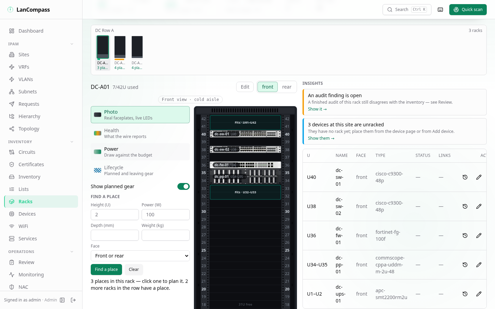

### Insights

The **Insights** rail ranks what is wrong with the rack, most severe first,
at most eight cards — each computed from the inventory on every visit,
never written by hand: devices that are **down** (their health rollup is
offline — the LED's state), a budget **over** 100 % or **near** the limit, **planned gear**
that would take a budget past 80 % or 100 %, devices whose **airflow** runs
against the rack, open **audit findings** for the rack (as in
[Review](/docs/review/), dismissals honoured), the headroom
**decommissioning** gear will free, devices with **no photo** (and how many
*Match a photo* can match), **unracked** devices at the rack's site, and
the rear's power (below): a **PDU past 80 %** of its rated output, an
**imbalance** of more than 20 points between the rack's PDUs, **single-fed**
devices and devices that draw power with **no documented feed** — each card
naming its PDUs or devices.
**Show** switches to the lens and the face the card is about, dims
everything else and outlines the devices it names for three seconds (a
steady outline, nothing flashing, under reduced motion); the photo card
opens *Match a photo* on the first device it can match, and the unracked
card opens the devices list filtered to them. The API is
`GET /api/v1/racks/{id}/insights`.

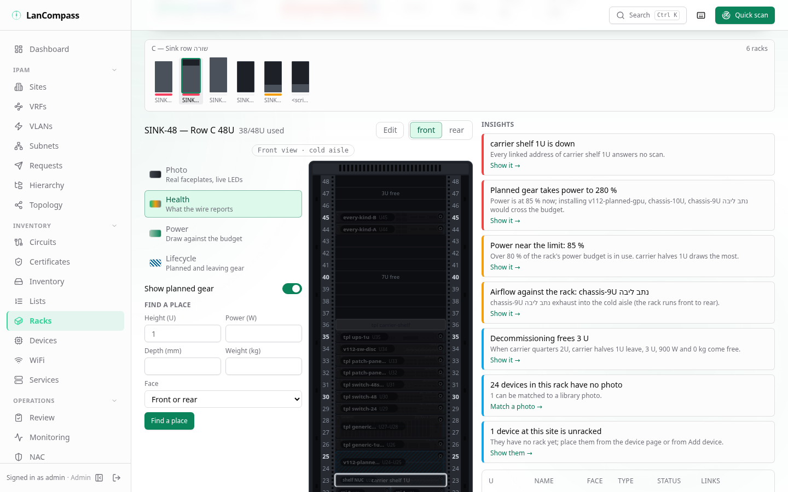

### The rear: PDUs, cords and feeds

The rear view draws the rack's power from what is documented — nothing is
assumed:

- A device of family **power** (a PDU or a UPS) can carry a **Rated output
  (W)** (`power_capacity_w`; any other family is refused with 422). A 0U PDU
  sits in its side channel with its **display** — its load as a percent of
  the rated output, in the state colour (its watts when it has no rating) —
  and its **outlets** from top to bottom: one per documented power port,
  **lit in the PDU's colour only when a documented cable uses it**. A PDU or
  UPS drawn without a photo shows exactly as many outlets as it has power
  ports.
- A **cord** is drawn for each documented power cable (both ends power
  ports) between a device of the rack and a PDU: from the device's rear to
  the outlet, in that PDU's colour. On a drawn rear the cord starts at the
  device's drawn power inlet for the port its cable names; on a photo it
  starts at the bay's edge. A device with no power cable draws no cord.
- The chain is read from the cables on every request: a device's power port
  → a PDU outlet → the PDU's inlet → the upstream device (a UPS). A device's
  watts **split evenly** across the distinct PDUs its power ports reach; a
  PDU's load is the sum of those shares, an upstream device's the sum of its
  PDUs'.
- The hero's **Feeds** meter has one bar per PDU — its load against its
  rated output; a PDU with no rating shows its load and no bar.
- On the rear the **Power** lens tints by **redundancy**: a device fed by
  one PDU is **single-fed** (amber, mark 1), a device with watts and no power
  cable has **no documented feed** (grey, mark 0) — never assumed to be on
  both feeds; a dual-fed device keeps its face. The legend names both and
  each PDU's colour.
- The inspector's **Power chain** lists device → PDU(s) → UPS with each
  hop's load and state, each opening its device, and the device's cords,
  each with **Remove** for a user who may delete — the removal is a step on
  the editor's undo stack: **Ctrl+Z** documents the cable again.

The API is `GET /api/v1/racks/{id}/power` (per PDU its load, capacity,
percent, state, outlets and upstream; per device its PDUs and redundancy;
the cords).

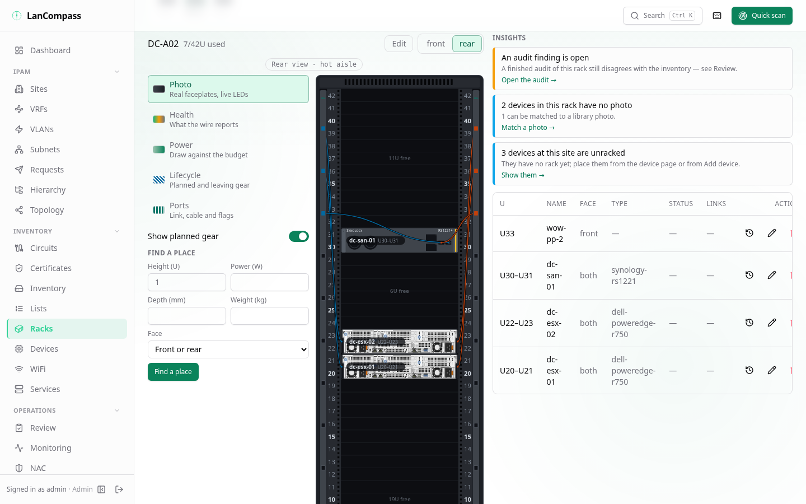

### The Ports lens

The fifth lens draws each device's documented ports as an **LED grid** over
its faceplate (greyed to 40 %). A port's state comes only from the poll's
`oper_status`, its cable and its validation flag, each with a mark besides
its colour — a filled LED is a link, a hollow one none reported; a tick
under it is a cable; a pennant is a flag:

- **Up, cabled** (green) · **Up, no cable documented** (amber) ·
  **Flagged** (red, the pennant) · **Cabled, no link reported** (hollow,
  ticked — a passive patch port always reads so) · **Empty** (hollow).
- An uncabled port whose LLDP or CDP neighbour carries the
  `lldp_neighbor` flag draws a **dashed marching line** to a chip on the top
  cap: "Gi1/0/24 → rogue-sw-07 · LLDP · no cable documented" (with "+2"
  when more ports have one). The chip names the port you picked, else the
  topmost; clicking it opens that port's ghost-link item in
  [Review](/docs/review/) (`/review?ghost_iface=`), where **Document** fills
  the cable form.
- v110's **speed** and **MAC mismatches** are flags whose tooltip names the
  documented and the observed value.
- Cable status: a **planned** cable dashes its port's outline, a
  **decommissioning** one stripes it — in the Ports lens, in the Lifecycle
  lens (which draws only those ports) and on the rear's cords. The legend
  names both.

Click a port, or press **→** / **←** on a focused device, for its
**popover**: name, kind, link, speed seen and documented, cable and far end,
neighbour; arrow keys move between the ports of the device (the drawing is
physical — left to right in every language), **Esc** returns to the device.
**Cable…** on a port with no cable opens the device page's cable dialog,
prefilled with this port and, when its LLDP or CDP neighbour resolves to
one free documented port, that port — it saves through the normal cable
write with its changelog row. **Trace** lights the path (below). The API is
`GET /api/v1/racks/{id}/ports`.

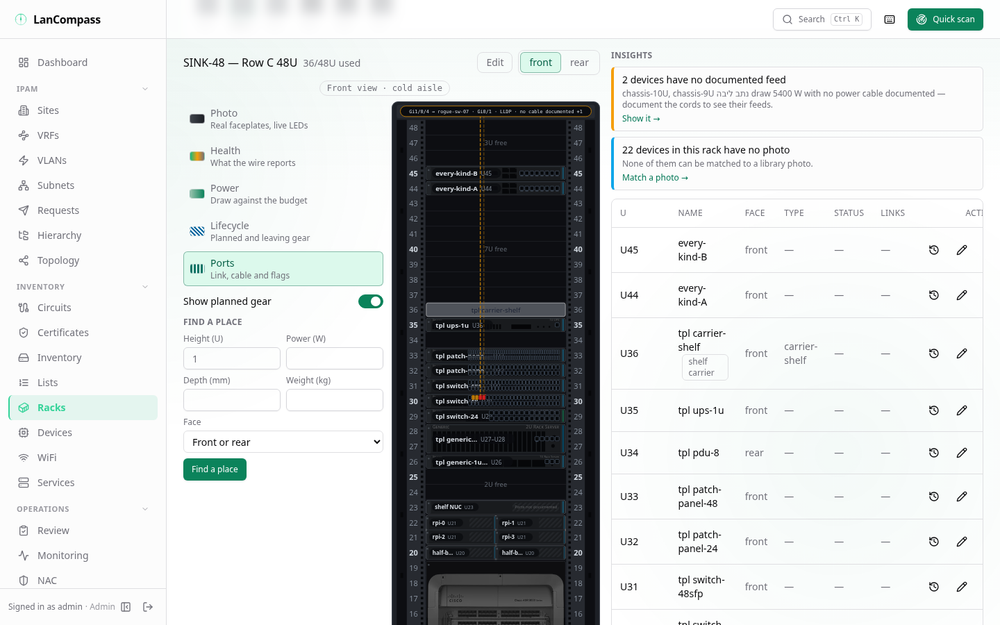

### Trace on the rack and across the row

**Trace** in a port's popover walks the documented path (the same walk as
the device page's trace, at most 64 cables) and lights every hop's port on
this rack under any lens: a ring in the trace colour, **amber** where the
wire disagrees (the hop the trace sheet marks), the path's **two end ports
pulsing** (steady under reduced motion or with effects calm or off), and a
red stop bar where a cut walk stopped. The trace bar in the tools rail says
**Complete** or where the path continues, how many hops disagree and how
many racks it crosses; **Hop list** opens the trace sheet, **Across the
row** opens the row view with the trace (`?trace=`), where every rack it
crosses lights its hops and the path is drawn across the racks — dashed
over a hop outside the row.

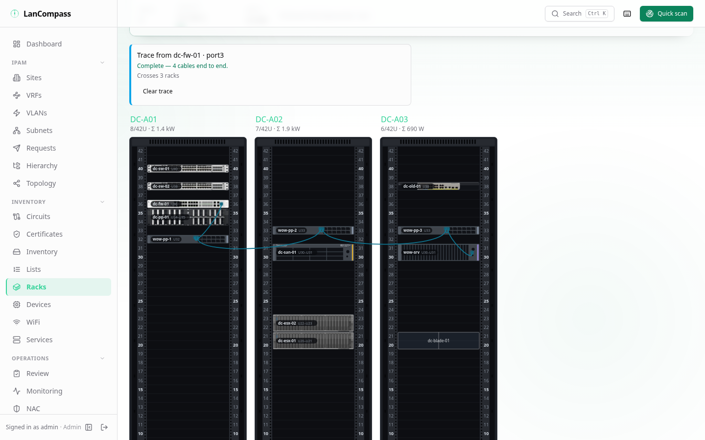

## Status legend

Every status in LanCompass is one of seven meanings, each with its own
colour and its own shape, so it still reads in black and white or with
colour-blindness:

| Shape | Meaning | For example |
|---|---|---|
| ● filled circle | OK | an active address, a completed scan |
| ▲ triangle | Needs attention | a reserved address, a certificate close to expiry |
| ■ square | Problem | a monitor that is down, a failed scan, an offline address |
| ○ ring | Information | a DHCP address, a queued scan |
| ▬ dash | Inactive or unknown | a monitor in the unknown state, a cancelled scan |
| ✦ four-point star | Discovered | an address discovery found and nobody documented |
| ◉ circle with a ring | Live | a monitor that is up, a running scan |

In the elevation each device's LED on the left ear draws its address's
mark in that shape, and the rack group's legend lists the same marks.

## Capacity

A rack can carry three budgets and its U numbering — all in the rack
dialog, all optional, none inferred: an existing rack has no budget until
someone enters one.

- **Power budget (W)** (`power_budget_w`) — the watts the rack's feed may
  carry. The rack's power is the sum of its devices' **Power (W)**,
  including 0U devices.
- **Maximum weight (kg)** (`max_weight_kg`) — the same against the sum of
  the devices' **Weight (kg)**.
- **Mounting depth (mm)** (`depth_mm`) — placing a device deeper than the
  rack is refused with both depths named ("srv-01 is 1000 mm deep — the
  rack takes 600 mm"), and the rack cannot be made shallower than a device
  already in it. A device without a depth, or a rack without one, is not
  checked.

**States.** Against each budget the rack reads **Within budget** under
80 %, **Near the limit** from 80 % to 100 %, and **Over budget** above
100 % — computed on every read, never stored. The rack header and the
list's **Capacity** column draw one bar per budget with the state in words,
so an over-budget rack reads as a warning in every theme and language. A
rack without a budget shows its watts and kilograms as before and no state.
The list's **Power budget** filter (`power_state`: `ok`, `warn`, `over`,
`none`) and its **Free watts at least** field (`min_power_free_w`, racks
with a budget only) are URL parameters like the other facets, and the
exports take them too. The dashboard's *Racks by power* list and *Rack
capacity* card show percent of budget for a rack that has one.

**Depth and airflow on devices.** A device (and a template) carries a
**Depth (mm)** (`depth_mm`) and an **Airflow** (`airflow`:
`front_to_rear`, `rear_to_front`, `side_to_rear`, `passive`). Airflow is
for reference only — it never blocks a placement. A template's depth and
airflow reach every device made from it, and the placement card on the
rack page and the device page shows both. The builtin *carrier-shelf*
template makes a carrier (one shelf slot) — a template has its own
`slot_layout`.

**0U devices.** A device with **Height 0** (`u_height: 0`) — a vertical PDU,
a cable manager — is racked with no U position: it never takes a slot and
never collides. It is drawn in the cabinet's **side channel** of its
**Side** (`mount_side`: left or right; left when unset), several on one
side stacked top to bottom, on the face it is mounted on — every 0U device
of the rack stays visible. Only a 0U device takes a side (a device with a U
height is refused with 422). Its power and weight count toward the rack's
budgets.

**U numbering.** **First U label** (`starting_unit`, default 1) and **U
numbering** (`desc_units`: counting up from the bottom, the default, or
down from the top) change only the labels — on the elevation, the printed
sheet, the downloaded SVG, the phone audit, the device page and the export's
`u_label` column. Stored positions stay physical (U1 is the bottom slot), so
a device placed before the change keeps its slot, and imports keep using
`u_position`.

**Find a place.** **Find a place** on the racks list answers "where does a
2U, 500 W, 600 mm device go at this site?" Give the site, the height (0 for a
0U device), the face (or front or rear), and any of power, weight and
depth. The answer lists every rack where the device fits on space, power,
weight and depth, most headroom first, with the lowest free U on each face
asked; **Place here** opens that rack at that U with the add form
prefilled. Racks it does not fit follow, greyed, each naming why — "power
101 % of budget", "weight 104 % of budget", "1000 mm deep, the rack takes
600 mm", "no 2U free on the face asked" — so a full 40 kW rack is explained
rather than missing. The same answer is `GET /api/v1/racks/find-place`
(`height`, `site_id`, `face`, `watts`, `weight_kg`, `depth_mm`).

**Imports.** The rack workbook and the rack CSV carry `power_budget_w`,
`max_weight_kg`, `depth_mm`, `starting_unit` and `desc_units`; the devices
sheet carries `depth_mm`, `airflow` and `u_height` 0 — your own export
re-imports with the budgets. A NetBox import keeps a rack's `max_weight`
(converted from its `weight_unit` to kg), its `mounting_depth` (else
`outer_depth` in its `outer_unit`), `starting_unit` and `desc_units`, and a
device type's `airflow`; a full-depth type still places on both faces and
keeps a depth when the file gives one.

## Export & import

A rack isn't a row — it's a tree: group → racks → devices (→ carriers →
children → interfaces → cables). The toolbar's **Export** dropdown covers
both shapes:

- **CSV (this view)** — flat rack rows for the *currently filtered* set
  (the URL's facet params ride along, so a filtered view exports exactly
  what it shows; the filename marks it `racks-filtered.csv`). Columns:
  `id, name, site, group, group_position, room, height_u, width,
  device_count, used_u, free_u, power_w, weight_kg, description, notes,
  created_at` — `columns=` whitelists them for lean exports.
- **XLSX bundle (this view)** — a multi-sheet workbook carrying the whole
  tree: `groups` (only the groups the exported racks reference), `racks`
  (the flat set above), `devices` (the device export column set — rack,
  site and carrier all by **name**), plus `interfaces` and `cables` when
  the devices have any (cable endpoints addressed by device + interface
  names — ids are meaningless across installs).

The rack detail header's **Export .xlsx** downloads a single-rack bundle
(including its group row so it re-imports cleanly); a group page's
**Export group** downloads the whole row — group, member racks in
position order, every device and its wiring — as `{group}.xlsx`.

**Import** (write permission) reuses the smart-import dialog: pick a flat
racks CSV or a bundle workbook — sheets are detected by their header
signature (unknown sheets warn and are ignored; English/Hebrew aliases
map on every sheet). **Run preview** shows each row's action grouped per
sheet — sites referenced by the bundle are created when missing (and only
when a row under them commits, so a partial commit never leaves an empty
site), groups and racks match by `name`+`site` (name alone when
unambiguous; an `id` cell only picks among same-named rows — a file from
another install never renames or re-sites one of yours), devices per the device importer's rules with names scoped
to the target rack, interfaces by device+name, cables by resolved
endpoint pair. Placement conflicts, ambiguous names and unresolvable
endpoints are error rows — never silently resolved. **When a rack
matches**: `skip` touches nothing in its subtree, `update` patches rack
fields then applies the device rows, `merge` keeps occupants and only
adds devices into free U slots. Matched *devices* follow the same mode —
`update` re-places them per the file (unracked inventory included), while
`skip`/`merge` leave them where they are; a carrier child whose tray
isn't racked then reports skip rather than an error. **Replace devices** unracks a matched
rack's current occupants first — they survive as unracked inventory,
never deleted. Commit is one transaction; `force` commits the valid rows
despite error rows. A group page's **Import into this group** posts the
same dialog with `?group_id=` — every imported rack joins that group
regardless of the file's group column. A group export re-imported into an
empty install rebuilds the identical tree.

## API sketch

```
GET    /api/v1/racks?q=&site_id=&group_id=&ungrouped=&room=&height_u=
       &occupancy=&min_free_u=&max_free_u=&power_state=&min_power_free_w=
       &audit_due=
                                   # every page facet is a param; CSV sets
                                   # (height_u=42,24), AND semantics, 422 on
                                   # bad values; occupancy/free-U/power/audit
                                   # facets after the used_u aggregate so
                                   # total stays honest
GET    /api/v1/racks/{id}           # the rack + its devices (0U apart), the
                                    #   budgets' use and states, audit_due_at
GET    /api/v1/racks/find-place?height=&watts=&weight_kg=&depth_mm=&face=
       &site_id=&rack_id=&group_id= # racks a device fits (and why not);
                                    #   candidates in one rack, a row's verdicts
GET    /api/v1/racks/{id}/insights  # the insight cards, most severe first
GET    /api/v1/racks/{id}/power     # PDUs, loads, redundancy, cords
GET    /api/v1/racks/{id}/ports     # every documented data port + its state
GET    /api/v1/racks/{id}/next-free-u?height=
GET    /api/v1/racks/export.csv     # same params + columns= whitelist
GET    /api/v1/racks/export.xlsx    # same params -> groups/racks/devices
                                    #   (+interfaces/cables) bundle
GET    /api/v1/racks/{id}/export.xlsx          # single-rack bundle
GET    /api/v1/rack-groups/{id}/export.xlsx    # the group file
GET    /api/v1/rack-groups/{id}     # the row: per-rack summaries (count,
                                    #   used U, power, weight), no device rows
GET    /api/v1/racks/elevations?ids=1,2,3   # device rows of up to 24 racks
POST   /api/v1/racks/import         # raw file + filename=; dry_run=1 (default),
                                    # on_existing=skip|update|merge,
                                    # replace_devices, group_id=, mapping=,
                                    # force, detect
```

## Placement rules

- `u_position` is the device's **bottom** U, counted from 1 — the physical
  slot, whatever the rack's labels say (*Counting down from the top* and the
  first label change only what is printed).
- Front + rear in the same U is fine; front + front (or rear + rear) in the
  same U is rejected with a conflict error (409). A `both`-face device
  conflicts with anything overlapping its span.
- Devices can't start below U1 or extend above `height_u` (422).
- A device deeper than the rack's mounting depth is refused (422, both
  depths named); either depth unknown means no check.
- A **0U** device (`u_height` 0 — a vertical PDU, a cable manager) takes no
  U and never conflicts; it has no `u_position`, sits in a side channel
  (`mount_side`, left when unset) and can be neither a carrier nor mounted
  in one.
- Carrier children skip the rack-level checks entirely — their carrier
  already occupies that U and face. They only conflict with a sibling
  sharing the same slot. Carriers don't nest, a child is never taller than
  its carrier, and its slot is inside the carrier's layout (halves 2,
  quarters 4, shelf 1).
- Two placements into the same rack at the same moment are taken one after
  the other (the rack row is locked first), so two people can never fill
  one U twice. A form that saves over a change someone made since it
  opened gets 409 *stale* and offers *Reload* or *Overwrite*.
- A device may link to an [asset](/docs/inventory/) and any number of IP
  addresses — see [Devices](/docs/devices/). Deleting a rack unracks its
  devices (they survive); deleting a *device* is done from its page.

## Rackula round-trip

LanCompass has its own drag-and-drop editor (the **Edit** toggle above). For
teams that lay racks out in [Rackula](https://github.com/RackulaLives/Rackula),
it also round-trips with it:

- **Open in Rackula** — appears on the rack page once an admin sets the
  *Rackula instance URL* under [Settings → Features](/docs/settings/). It
  opens your layout in that instance via a share URL.
- **.Rackula.zip** — downloads the rack as a Rackula layout archive (import
  it in Rackula's UI the same way).
- **Import from Rackula** — paste a Rackula share URL or upload a
  `.Rackula.zip`; a preview shows which devices will be added, which conflict
  with existing placements, and which are skipped (sub-U gear has no
  LanCompass equivalent). Rackula carriers import as carrier trays and their
  container children mount into slots — Rackula's auto-created trays arrive
  as a "shelf"-layout carrier named **Shelf**. Choose **merge** (keep
  existing, skip conflicts) or **replace** (unrack current devices first —
  they survive as unracked inventory, never deleted). Imported devices
  carry a `rackula` source badge. A device without a *device type* goes out
  under an `untyped-…` Rackula type and comes back with its type empty —
  the import never invents a type from a name.

## Printing and labels

- **Print** opens `/racks/[id]/print`: page one is the rack sheet — header,
  the **front and rear elevations side by side**, and the QR label — sized so
  a 42U or a 52U rack fits one page; the full device table (U range, face,
  type, linked asset and IP + status) starts on page two. Pick the paper
  above the sheet: **A4** (the default) or **A3**, **portrait** or
  **landscape** (`?paper=A3-landscape` links a choice). Save as PDF via the
  browser's print dialog.
- **Download SVG** saves the same sheet — header, front and rear — as one
  `.svg` file. Library photos are embedded in the file, so it opens offline
  in a browser, Inkscape or LibreOffice Draw.
- **QR** opens a dialog with a QR code pointing at the rack's live elevation
  URL. **Print label** opens a minimal sticker card (QR + name + URL) sized
  for a physical label — stick it on the rack and scan to open the live view.
  The same QR appears in the print report footer.
- **The address in the QR** is the *Public address* setting
  (`public_base_url`, under [Settings → Features](/docs/settings/)) when an
  admin sets it — the URL phones on your LAN reach LanCompass at, such as
  `https://ipam.example.lan`. Empty (the default) uses the address of the
  browser that printed the label, so a label printed from `localhost` only
  opens on that machine.

## Rack audits (physical reconciliation)

The scanner reconciles the network against inventory; an **audit** does the
same for the rack itself — desired (the database) vs observed (what's
actually bolted in). It's a walk-up flow, phone-width on purpose:

1. **Get there.** Scan the rack's QR label and tap **Start audit** on the
   label page — the audit starts right away (an audit already open on the
   rack opens instead) — or use **Start audit** on the rack detail header.
   Both land on `/racks/[id]/audit`.
2. **Walk the rack.** Top to bottom: every expected device gets a row,
   highest U first — the name, and under it the expected U and face — with
   three buttons: **✓ verified**, **⇅ moved** (opens a U
   stepper + face toggle for where it actually sits), **✗ missing**. A
   progress chip counts down (`7/12 checked`); re-tapping a result unmarks
   it. Hardware that isn't in inventory goes in the **report unexpected
   device** box at the bottom — name plus an optional U.
3. **Finish → mismatch report.** **Finish** opens the report: *moved*,
   *missing* and *unexpected* groups, each row carrying its fix:
   - **Moved** → *Apply move* patches the device's placement through the
     normal device endpoint — bounds/collision checks and the changelog
     entry included.
   - **Missing** → *Unrack* (normal rack-device delete: placement cleared,
     device survives as unracked inventory) or *Delete* (requires the
     delete permission + typed confirmation).
   - **Unexpected** → *Add as device* opens the normal device form
     prefilled with rack, U and the observed name; *Dismiss* keeps the
     sighting on the audit record but drops it from the summary counts.
4. **Close audit** stores the summary — verified/moved/missing/unexpected
   counts plus `corrections_applied`, which the server counts: the
   placement changes (moves, face changes, unracks, deletes) made to the
   audited devices between the start and the close. A number a client
   sends is ignored, and an edit that doesn't touch placement doesn't
   count.

On a phone every audit button is at least 44 px and messages appear at
the top of the screen, clear of the buttons.

Notes on semantics:

- One open audit per rack — two starts at the same moment open one audit;
  the other answers 409 naming the open audit (`audit_id`), and the page
  opens that audit instead (`?restart=1` abandons it, recorded as
  `{"aborted": true}`).
- Audits are snapshots: starting copies `expected_u_position`/`face`/name
  per item, so a device deleted later still reads correctly in history
  (its `device_id` link nulls out; the snapshot stays). Deleting the rack
  removes its audits — they describe the rack.
- Finishing never mutates devices, and nothing locks the rack mid-audit —
  an audit is a finding record, not a transaction.
- **History**: the rack detail page lists past audits (latest first) with
  summary chips and expandable items.
- **Review center**: under `/review`, *Rack audit findings* lists an audit
  left open for more than 7 days and every unresolved finding of a
  finished audit — *missing* marks that still point at racked devices,
  *unexpected* gear neither dismissed nor added as a device in the rack,
  and *moved* marks whose device still sits at its expected U. Each clears
  once inventory agrees with what was seen.
- Permissions: reading history needs `data:read`; running an audit
  (start/mark/finish) needs `data:write` — a viewer sees no *Start audit*
  button; the report's *Delete* needs `data:delete` like everywhere else.

### Audit schedules and due audits

A rack can carry an **audit interval**: in the rack's edit dialog,
**Audit interval** offers *every 30, 90, 180 or 365 days*, *Custom…*
(any number of days up to 3,650) or *No schedule* (the default). A rack
without a schedule is never due.

A scheduled rack's next audit is due its interval after its **newest
closed audit** — or after the rack was created, when it has never been
audited. An audit abandoned by a restart doesn't count, and an open audit
closes nothing. The due date is worked out every time it is read, so
closing an audit moves it at once.

When a rack's audit is due, it shows in four places:

- **Racks list** — an *Audit due* badge beside the name, and the
  **Audit due** filter (URL `?audit_due=1`, also a saved view; the CSV and
  workbook exports follow the same filter).
- **Review** — the *Rack audits due* section lists each due rack with its
  site, the due date and how many days it is overdue; the item links to the
  rack's audit page. Dismissing it holds for that due date only.
- **The rack page** — an *Audit due since {date}* insight card; its action
  opens *Start audit*.
- **Notifications** — once a day the worker sends `rack.audit_due` for
  every due rack, **once per due date** (a new due date — after the next
  closed audit — sends a new one). A channel or subscription routing
  `rack.*` or `rack.audit_due` receives it.

The rack's audit history shows the interval and the next due date at the
top — or, for a due rack, that the audit is due and since when.

### Photos on findings

Every item of a phone audit has **Add photo**: on a phone it opens the
rear camera (any image file elsewhere). The browser shrinks the picture
to at most **1,600 px** on its long side and saves it as a **JPEG at
quality 0.82** before it is uploaded — drawing it anew drops the
original's metadata, so no EXIF location is kept. The photo is an
ordinary attachment on the audit item in the install's own attachment
store (the same 6 MB cap and image types); nothing goes to an outside
service.

Thumbnails show on the audit's report, in the rack's audit history and on
the finding's item in Review; tapping one opens the full image without
leaving the page. Deleting the rack (and with it its audits) deletes their
photos. A viewer sees the photos but no *Add photo*.

### Export and print an audit

Every closed audit in the history has **Export** and **Print**:

- **Export** downloads `audit-<rack>-<id>.xlsx` with two sheets: *Items*
  (every device the audit walked, top to bottom — expected and observed U
  and face as the rack labels them, the result, the note and a link to
  each photo) and *Findings* (moved, missing and unexpected only). Text a
  spreadsheet would run as a formula is written as plain text. Photo links
  use the **Public address (URL)** setting when it is set (else the address you
  are using) and still need a signed-in session to open.
- **Print** opens a one-page A4 sheet: the rack's front and rear and the
  findings table — a 42U rack with up to 20 findings fits one page. Use
  your browser's *Print* or *Save as PDF*.

Export and print need `data:read`; adding a photo or setting the interval
needs `data:write`.

```
POST   /api/v1/racks/{id}/audits           # snapshot-start (?restart=1 abandons)
GET    /api/v1/racks/{id}/audits           # history, latest first
GET    /api/v1/audits/{id}                 # detail + items (+ each item's photos)
PATCH  /api/v1/audits/{id}/items/{item}    # set result + observed_*
POST   /api/v1/audits/{id}/unexpected      # ghost sighting (device_id NULL)
POST   /api/v1/audits/{id}/finish          # freeze {verified, moved, missing,
                                           #  unexpected, corrections_applied}
GET    /api/v1/audits/{id}/export.xlsx     # Items + Findings sheets
POST   /api/v1/attachments?entity_type=rack_audit_item&entity_id={item}
                                           # a finding's photo (raw JPEG body)
GET    /api/v1/racks?audit_due=1           # the racks whose audit is due
```

## Fields

| Field | Notes |
|---|---|
| **Name** | Searchable from the palette |
| **Site / Room** | Where the rack lives (room is free text) |
| **Rack group / Position** | Bayed-row membership; position orders left-to-right (blank appends) |
| **Height (U)** | 1–100, default 42 |
| **Rail width** | 19″ or 10″ |
| **Description / Notes** | Free text |

Devices: name, device type (free text or library slug), U position, height,
face, colour, category, manufacturer/model, linked asset/IP(s), **Power (W)**,
**Weight (kg)**, notes, **Rated output (W)** (`power_capacity_w`, power
devices only) and **Side** (`mount_side`, 0U devices only) — both travel by
name through the workbook, the devices export and import, a NetBox import
(a column or its `cf_` custom field) and a backup — plus **Mounted in**/**Slot** for carrier children
and **Carrier layout** to make the device itself a carrier. The
**Linked IP** field adds one address: the device's other addresses stay
linked and are listed under it, clearing the field unlinks only that
address, and an address another device owns moves only after you confirm;
multi-IP management lives on the [device page](/docs/devices/). A device
placed in a rack takes the rack's site. Placing two devices into the same
free U at the same moment lands one; the other gets a refusal. A save is
conditional: when someone else saved the same device, rack or group after
you opened the form, you get *Reload* / *Overwrite* instead of silently
erasing their change. Exports name Hebrew racks and rows intact, and a
cell that starts with `=`, `+`, `-` or `@` is written as plain text, never
as a formula. The **device
library** in the add dialog pre-fills common gear (servers, switches, PDUs,
blanks, carrier trays) — including power/weight where upstream publishes it.

## Device image library

The library behind the picker is a bundled subset of the NetBox
[devicetype-library](https://github.com/netbox-community/devicetype-library)
(~1,600 device types — every upstream device that ships an elevation image,
the complete Check Point / Aruba / HPE-storage families even where no image
exists, plus a curated set of generic rack gear; CC0 — see
`/rack-library/ATTRIBUTION.md` in the shipped files). Entries carry their
height (`u_height`) — depth is not stored with an entry (set the device's
own **Depth (mm)**); a full-depth entry places on
both faces (`face: both`) — product photos, and where
upstream publishes them, typical power draw and weight — picking an entry
pre-fills the form's Power/Weight fields, which persist on the device and
feed the rack/group capacity rollups.

- Picking a library entry sets the *device type* slug; the cabinet then
  draws the product's front and rear photos. A face with no photo — the
  rear of many entries, or either face of an entry without images — gets a
  drawn faceplate (see *Faceplates*), never the other face's photo. Your
  own photo for the type (*Use your own photo*) comes before the library's.
  Status LEDs, selection and editing work the same on every faceplate.
- Everything is served from `/rack-library/` inside the app — nothing is
  fetched from the internet at runtime, so it works air-gapped.
- **Refreshing** (maintainers): `cd frontend && npm run build:rack-library`
  re-pulls the curated slug list, every upstream device with an elevation
  image, and the FULL_IMPORT vendor families (Check Point, Aruba, HPE
  storage — image or not) from the upstream repo, re-encodes images as
  ≤400px WebP and rewrites the manifest (`--curated-only` skips the wide
  sweeps); `npm run check:rack-library` verifies the bundle. The generated
  files are committed — refresh them per release, like the OUI database.
