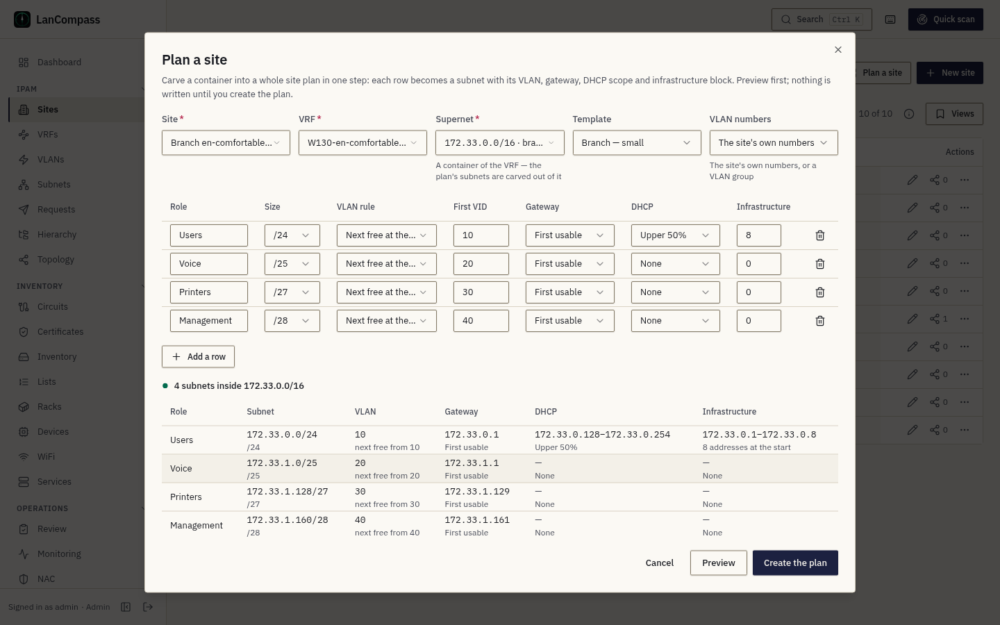

# Sites

Sites are the top of the LanCompass hierarchy — physical or logical locations
such as branches, data centers, or floors. VRFs, VLANs, prefixes, circuits,
assets, and services can all be linked to a site.

## Fields

| Field | Notes |
|---|---|
| **Name** | Display name; Hebrew is fully supported (`dir="auto"` rendering) |
| **Slug** | URL-safe identifier, auto-derived from the name |
| **Code** | Short site code (e.g. `NYC1`) — used by workbook import for sheet→site matching |
| **Site number** | Numeric identifier used by the import planner |
| **Size** | Free-text size classification |
| **Active** | Inactive sites are kept for history but excluded from import matching |
| **Contact / Address / Description** | Free-text metadata |

## Working with the list

- **New site** — needs the *data:write* permission (Contributor and up).
- **Drag to reorder** rows; **pin** important sites to the top. Ordering is
  shared for everyone.
- **Inline edit** the description directly in the table.
- Attach **tags** and set a **row color** from the row actions.
- Every change lands in the [Changelog](/docs/changelog/), and each row's
  history button shows its own audit trail.
- **Two people, one site.** Saving a site someone saved after you opened it
  is refused with **This changed since you opened it** — **Reload** shows
  their version, **Overwrite** saves your changed fields over theirs.
- **Deleting a site** keeps its prefixes and devices: they lose their site.
  The confirm dialog counts both (*N prefixes lose their site*, *N devices
  lose their site*). In the [hierarchy](/docs/hierarchy/) those prefixes
  then sit under **No site**.

## Plan a site

**Plan a site** (the Sites page, a site's row, or a container prefix's page)
carves a container into a whole site plan in one step, the way a network team
plans a new branch:

1. Pick the **site**, its **VRF** (the site's own VRF is proposed), the
   **supernet** — a container of that VRF — and a **template**.
2. Edit the rows: each row is a subnet with its role, size, VLAN rule and
   first VID, gateway (first or last usable, or none), DHCP share (the upper
   part of the subnet) and an infrastructure block reserved at its start.
3. **Preview**: each row's subnet is the next free aligned block of its size
   inside the supernet — never over a prefix already there, never outside it —
   and each rule shows beside its result. A conflict (a size that does not fit,
   no free block left, a VID the site already uses) is named on its row.
4. **Create the plan**: every subnet, its VLAN, its gateway's reserved row, its
   DHCP scope and its infrastructure block are created in one transaction —
   or nothing is.

VLAN numbers: **Next free at the site** starts from the row's first VID and
skips every number the site uses (in the VLAN group, when you pick one);
**Third octet** takes the subnet's third octet and is refused when the site
already uses it. A plan never reuses a VID at its site.

On an IPv6 supernet the sizes are nibble boundaries (/52, /56, /60, /64) and
every subnet the plan creates for hosts is a /64, without a DHCP pool or an
infrastructure block — the preview shows those rules as none.

### Templates

The planner starts from a template. Two are built in — **Branch — small**
(users /24 with the next free VLAN, gateway first usable, DHCP the upper half
and an infrastructure block of 8 at its start; voice /25; printers /27;
management /28) and **Branch — large** (users and voice doubled). An
administrator edits them, or adds the team's own, in **Settings → IPAM**; they
are stored with the install's settings, so a backup carries them.

## Related settings

The **Site codes follow site changes** feature flag (Settings → Features,
on by default) controls whether linked VRF names and circuit/service site
fields update automatically when a site's code, number, or name changes.
When off, stored mismatches are treated as deliberate manual overrides.
