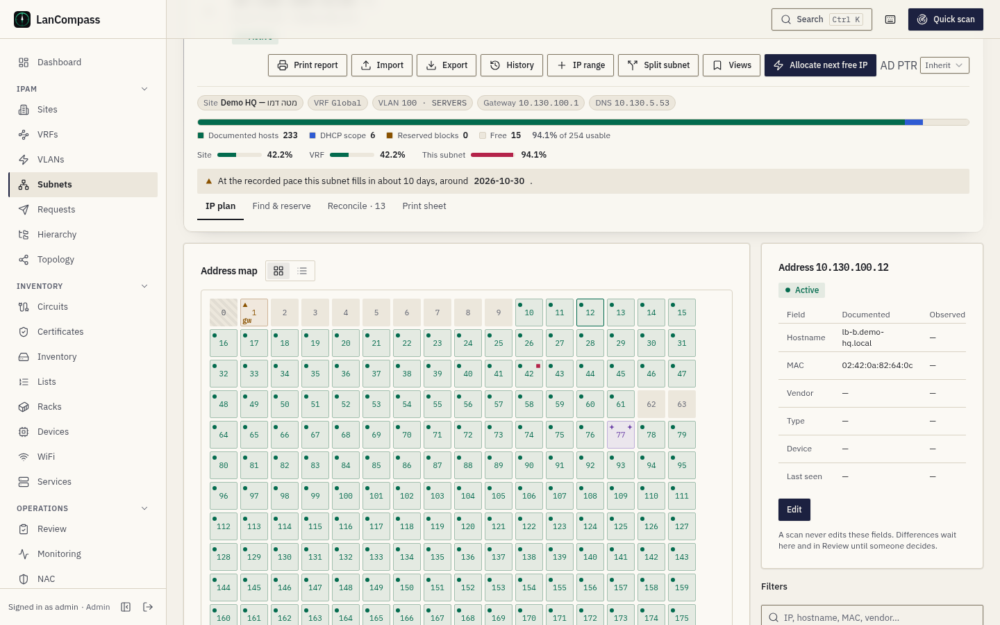
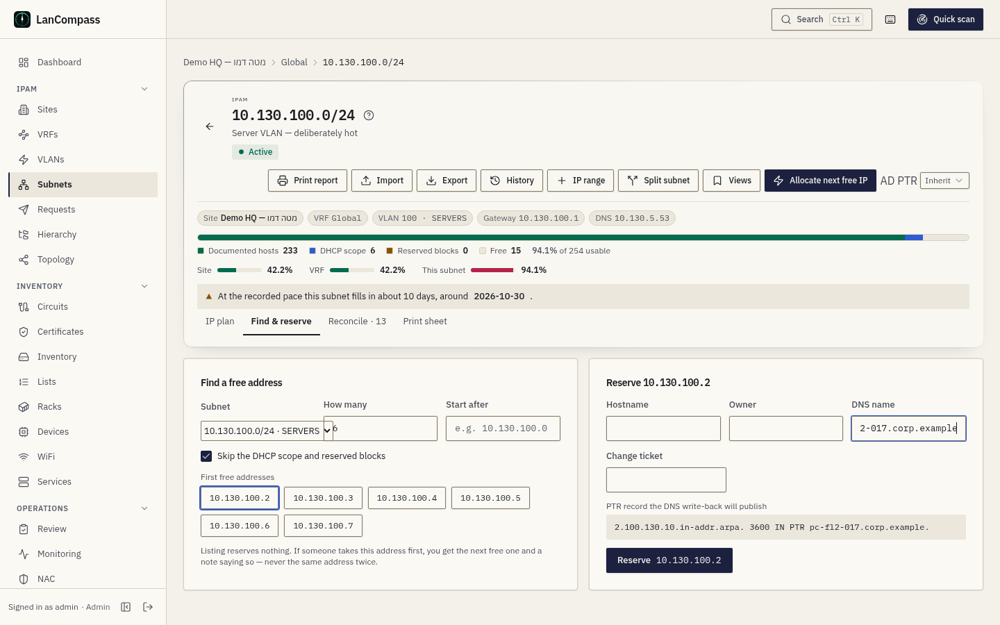
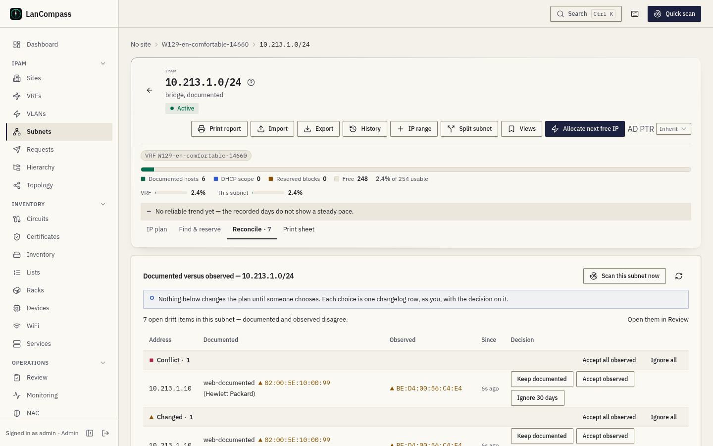

# Subnets

Subnets (prefixes) are the heart of the IPAM. Each lives inside a VRF, may
link to a site and a VLAN, and contains IP addresses — or, as a `container`,
other prefixes.

## Statuses

| Status | Meaning |
|---|---|
| `active` | Production network |
| `reserved` | Allocated, not yet deployed |
| `deprecated` | Being retired |
| `container` | Holds child subnets — exempt from overlap checks |

## Overlap safety

Within one VRF, overlapping CIDRs are rejected by a PostgreSQL GiST exclusion
constraint — the database enforces it, not app code. Across VRFs the same
CIDR is fine. `container` prefixes are exempt so `10.0.0.0/16` (container)
can hold `10.0.1.0/24` (active) as a child. Containers can't be moved under
a prefix they'd conflict with, and moving a container takes its children
along.

Three more rules keep the tree honest, each answered with a 409 that names
the prefix in the way:

- **One network once per VRF.** A second `10.0.1.0/24` in the same VRF is
  refused, whatever either one's status (a container too). Duplicates saved
  before this rule are listed under **Duplicate networks** in
  [Review](/docs/review/) — keep one, move its addresses and ranges to it,
  delete the rest.
- **A container never sits inside a subnet.** A container whose network lies
  inside an active, reserved or deprecated prefix is refused, and so is a
  subnet that would hold an existing container.
- **A container with children stays a container.** Changing its status to a
  subnet names up to five child prefixes and asks you to move or delete them
  first.

## Where an address belongs

An address is attached to the **deepest** non-container prefix of its VRF
that holds it (a container only when no subnet holds it). Naming a shallower
prefix — the container above a subnet — answers 422 with the deeper one.
When you add a child prefix, the addresses its parent container held inside
it move to the new prefix, each with a [changelog](/docs/changelog/) entry.

## The prefix detail page

Opening a subnet shows breadcrumbs (its own site → VRF → the containers above
it → prefix), the summary strip with its capacity bar, and four tabs: **IP
plan** (the map or the list below), **Find & reserve**, **Reconcile** and
**Print sheet**. The IP plan shows its address space two ways:

### Subnet matrix

A `/24`-style grid — one cell per address, banded by IP ranges. Arrow keys
move between cells, **Enter** opens an address, **drag** selects a span for
bulk actions, **Esc** clears the selection.

### List view

A sortable table of every address with aggregated **free ranges** between
used blocks, plus per-IP actions. The filter panel narrows by status, role,
hostname, and more.

### The subnet as an IP plan

The page reads top to bottom like a network plan:

- **The summary strip** — the CIDR, its status and description; the facts as
  chips (site, VRF and RD, VLAN, gateway, DNS — click one to copy it); the
  **capacity bar**, split into documented hosts, the DHCP scope, reserved
  blocks and free addresses, with each number in its legend; utilization at
  every level (the site, the VRF, the supernet that holds it, this subnet —
  each the same figure the dashboard, the hierarchy and the subnet list show);
  and the **forecast** line: the day this subnet fills at the recorded pace, no
  reliable trend, or "collecting" with the days recorded so far.
- **The tabs** — **IP plan** (the default), **Find & reserve**, **Reconcile**
  (documented versus observed for this subnet, decided right there — its
  label carries the open-item count) and **Print sheet**. The tab is in the
  address (`?tab=find`), so a link opens it.

On the **address map** every cell carries two marks: the **documented**
status at its start corner and what the **scans saw** at its end corner, each
in its own shape and colour, so a cell reads without opening it. A cell inside
a DHCP scope, pool or reserved block carries a **band** along its bottom edge,
and the legend under the map names every range with how many of its addresses
are documented. The gateway's cell is labelled **gw**. The map runs left to
right from host 0 in every language.

Picking a cell opens the **detail panel** beside the map (below it on a
phone): the documented value of every field beside the observed one, with
differences marked, and the decisions — **Keep documented**, **Accept
observed**, **Open in Review**. **Edit** opens the address form. A range in the
legend, or a free cell inside one, opens the range: its bounds, role,
description and how many addresses it holds, with its edit.

### Find & reserve

**Find & reserve** lists the first free addresses of the subnet as chips —
skipping the DHCP scope and reserved blocks unless you clear the box, after
an address you name if you want — and reserves nothing by listing them. Pick
one, fill in the host name, owner, DNS name and change ticket, and read the
**PTR record** the DNS write-back will publish for it (or why none will be:
no reverse zone covers the address, or the name is not a full DNS name). If
someone takes the address first, you get the next free one and a note saying
so — never the same address twice.

### Reconcile: documented versus observed

**Reconcile** — **Documented versus observed** for this subnet — works one
subnet from top to bottom after a scan. It lists the
subnet's open address-drift items — the same ones Review lists under
*Address drift* — in four groups, in the order a person works them, each
heading with its mark and count: **Conflict** (the MAC the scan saw is
documented on another address or a device's port), **Changed** (the observed
MAC, vendor or type differs from the documented one), **Missing** (a
documented active host that no longer answers) and **New** (a host the scan
found that nobody documented). Each row shows the address, the
**Documented** and **Observed** values side by side with the difference
marked, **Since** (when the scan last saw it — for a missing host, its last
answer; for a new one, when it was first recorded) and the decisions.

The banner above the table says it plainly: *Nothing below changes the plan
until someone chooses. Each choice is one changelog row, as you, with the
decision on it.* A scan only records what it observed; the documented plan
changes only through these decisions:

| Group | Decisions on a row | What it writes |
|---|---|---|
| Conflict, Changed | **Keep documented**, **Accept observed**, **Ignore 30 days** | Accept copies the observed MAC, vendor and type into the documented ones; Keep dismisses this observation (a different one comes back); Ignore hides it for 30 days, then it returns if the difference still stands |
| Missing | **Keep documented**, **Mark free**, **Ignore 30 days** | Mark free deletes the address record, the same delete as the address list's — it needs the delete permission |
| New | **Document**, **Ignore 30 days** | Document opens the address form filled from what the scan saw; saving makes the record yours (its source becomes `manual`), so later scans only record what they observe |

A decided row turns into a **Decided** chip until the tab loads again. Each
group heading also offers **Accept all observed** and **Ignore all**; both ask
first with the number of addresses (ten or more ask you to type the subnet),
and write one changelog row per address. For a Missing group, Accept all
observed sets the hosts offline; for a New group it confirms them as active.

**Scan this subnet now** starts a scan of the subnet and loads the tab again
when it ends. It is shown only when the scanner may scan the subnet (inside
the configured scan networks, not excluded, not too large) and you may start
a scan. **Decision history** under the table lists the subnet's last 50
decisions — made here, in Review, in the address drawer or under MAC
mismatches — with who, when, the decision and the address.

Viewers see the table and the history; contributors decide; **Mark free**
needs the delete permission. On a phone every row is a card with its
decisions under it, so nothing scrolls sideways. In the subnet list, the
**Drift** column counts each subnet's open items; sort by it to find the
subnets to reconcile first, and click a count to open its tab.

### How a large subnet loads

A subnet of any size opens at once: the page never downloads all of its
addresses. The matrix first reads a summary of every `/24` block (how many
addresses are documented, in ranges and free) and then loads the addresses
of the blocks you scroll to, one `/24` at a time. Until a block has loaded
its cells read **loading** — never free, and they cannot be reserved — so a
fully documented `/16` never shows a documented address as free.

The list view reads one page of 200 addresses at a time; the pager at its
top moves between pages, and the free ranges between rows carry across the
page edges. Search, the filters and the column sort run on the server, so
the counts in the filter panel are the whole subnet's, not the rows on
screen. On a phone the page keeps two actions (allocate the next free IP and
print) and puts the rest under **More actions**.

Reserving a free cell that someone else took a moment before answers with
what holds it now (its status, host name and device) and the cell refreshes.

### Utilization numbers

`total_ips` / `usable_ips` / `used_ips` / `free_ips` and a utilization
percentage are computed per prefix. IPv6 prefixes show `—` for capacity —
a /64 has more hosts than `Number.MAX_SAFE_INTEGER` — but `used_ips` stays
accurate. Network and broadcast addresses (`unusable_first`/`unusable_last`)
are excluded from usable counts.

**What counts as used.** Documented addresses and every DHCP, pool and
reserved range of the subnet, each address counted once: `used_ips` is the
documented addresses, `range_ips` what the ranges cover, `allocated_ips`
both, and the percentage is `allocated_ips / usable_ips`. A /24 with 25
documented hosts and a 100-address DHCP scope reads about 49 %, not 10 % —
a subnet with a scope reads fuller than its address rows alone, which is the
point. The list shows `allocated/usable · %`, and its tooltip splits the
documented addresses from the ranges.

**A container's figure.** A container's bar is the share of its space its
child prefixes hold — their union, never the sum — worded **"… allocated"**
(`allocated_pct`). Its `allocated_ips` rolls up its whole subtree: the
allocated addresses of every subnet below it, never only its own rows.

The [dashboard](/docs/dashboards/), the reports and the daily forecast series
read the same rule, so their totals match the list: usable is the IPv4
subnets' usable addresses, used is their allocated addresses plus any
address documented on a container itself. For 30 days after the rule
changed, the forecast chip says **"new rule"** — its series still holds days
counted the old way.

### Network and broadcast addresses

In an IPv4 prefix of /30 and shorter, the network and broadcast addresses
are not hosts. Documenting one asks for an override — **Document anyway** —
and the address keeps a `boundary_override` mark, like the pool override;
the CSV import needs `force=1` for such rows. A gateway on either address is
refused. Rows saved before this rule stay as they are. /31 and /32 use every
address; an IPv6 prefix shorter than /127 never hands out its subnet-router
anycast address (the all-zero interface identifier), while /127 and /128 use
every address.

## Allocating the next free IP

"Next available" uses `SELECT … FOR UPDATE` plus `UNIQUE(vrf_id, address)`:
concurrent allocations can never hand out the same address twice, network/
broadcast boundaries are skipped, and defined **IP ranges** are excluded
automatically. Every address of the VRF inside the subnet counts as taken,
whichever prefix row holds it. A **container** holds subnets, not hosts:
next-free on one answers "allocate from one of its subnets".

## IP ranges

Named ranges inside a prefix with a role of `dhcp`, `pool`, or `reserved`.
They show up as bands in the subnet matrix and are skipped by allocation.
A new range may not overlap any range of the same VRF (a container's range
covers its subnets' addresses too); two people creating overlapping ranges
at the same moment get one range and a clear refusal. The pencil on a
range's row edits its role, its description and its bounds: a DHCP scope,
pool or reserved block grows or shrinks only inside its prefix and never
over another range of its VRF, and the change log keeps one row naming the
old and the new bounds. The addresses inside the new bounds join the range.

Ranges belong to their prefix: **moving the prefix to another VRF takes its
ranges along**, and **deleting a prefix or a VRF deletes its ranges with a
changelog row each** — the delete dialog counts the ranges that will go,
beside the addresses and prefixes.

## Capacity: thresholds, alerts and the forecast

Every IPv4 subnet that is not a container, and every DHCP or pool range
inside one, has a **warning** and a **critical** threshold in percent. A
subnet's figure is its utilization as the list shows it (documented
addresses and its DHCP, pool and reserved ranges, each address once); a
range's is its documented addresses over its size. A reserved block is held
back on purpose and has no thresholds; containers and IPv6 prefixes keep
counts, not percentages.

**Thresholds.** The subnet's edit dialog and a range's dialog each have
**Warning at (%)** and **Critical at (%)**. Leave a field empty and it
inherits the install's value, shown as its placeholder: **Settings → IPAM →
Capacity thresholds**, 80 % and 95 % unless an administrator changes them.
The warning threshold stays below the critical one, whether set or
inherited. On the subnet page the capacity bar marks both thresholds, and
the line under it names them (with "(install defaults)" when the subnet has
none of its own) and whether the subnet is past one.

**Alerts.** The daily snapshot writer — the worker's tick, at most every 15
minutes, and the demo, workbook and NetBox loads — records each subnet's
and range's utilization for the day and compares it with the last day it
recorded, under today's thresholds. Rising past the warning or the critical
threshold sends one **`ipam.capacity`** notification through the
notification channels (the **IP capacity** events in a channel's routing);
falling back under the warning threshold sends one recovery. Staying above
a threshold, the same day or the next, sends nothing, and easing from
critical to warning sends nothing. A subnet's first recorded day is its
starting point, not a crossing, so an upgrade does not page for every subnet
that is already full, and moving a threshold never sends one by itself. The
message names the subnet (or the range and its subnet), its site, its
utilization and, when there is one, the day it is projected full, with
every address kept whole in Hebrew and Arabic.

**The forecast.** Each subnet and range keeps a year of daily rows (rows
older than 400 days are pruned by the same pass). Its forecast is a
least-squares line through its own days, by the dashboard forecast's rules:
"collecting" below 14 days, a confidence band of low, medium or high from
R², no date for a flat or shrinking line, nothing past a year out. The
subnet page's forecast line reads it, the list's **Runs out** column shows
the day it is projected full and sorts by it (soonest first, subnets with
no date after them), and **Review → Capacity forecast** lists every subnet
and range past its warning threshold — named "past its warning threshold" or
"past its critical threshold" — and every one projected to reach its
critical threshold within 90 days at medium confidence or better. A
dismissed warning comes back when the subnet turns critical.

**The capacity report.** **Capacity report** above the list (or
**Reports → Subnet capacity**) prints, per site and VRF, each subnet and its
ranges with the utilization, both thresholds, the daily slope, the
projected full day and the level — on the print sheet, in the reader's
language. A site's report keeps its own subnets.

## When two people edit one subnet

Every IPAM form — subnet, VRF, site, VLAN, range, and the address drawer —
sends only the fields you changed, with a token of what it loaded. If
someone saved the object after you opened it, your save is refused with
**This changed since you opened it**: **Reload** shows their version,
**Overwrite** saves your changed fields over theirs. Saving a description
therefore never resends the gateway, the DNS list or the VRF. API clients
that send no token (`expected_etag`) keep last-writer-wins; every response
carries the object's current `etag`.

## Print view

Each prefix has a print-friendly page (the print action on the detail view)
that renders the address list cleanly for audits and wall-of-ops printouts.

The sheet prints **every** documented address of the subnet, however many
there are — it reads them in pages before it draws. For a long subnet you
can choose to print only the first 1,000, 5,000 or 20,000 addresses; the
sheet's header then says so ("First 1,000 of 65,534 addresses"), so a
printed sheet never stops short without saying it.

## Gateway & DNS

A prefix can record its **gateway** and up to four **DNS resolvers** — edit
the subnet or use the *Add network* wizard. The gateway must be inside the
prefix (resolvers may live anywhere — they often do).

Each technical address that falls inside the prefix is mirrored into a real
`reserved` address row tagged `technical: gateway|dns` — it appears on the
matrix with its own glyph (⌂ gateway, ≋ resolver), is excluded from next-IP
allocation, and is fully audited in the changelog. Clearing the field removes
the row *only* while it's still exactly what the system wrote — a row anyone
edited is kept. A row you created yourself at that address is never touched.

## Pools & static assignments

Addresses inside an `ip_ranges` range automatically record membership
(`ip_range_id`) — the drawer shows "in pool …" and the address list can be
filtered by `ip_range_id`. Creating or editing an `active`/`reserved` address
inside a `dhcp`/`pool` range is rejected with a conflict naming the range —
a DHCP server may hand the address to a client. Pass `force=1` (or click
*Assign anyway* in the drawer) to allow it anyway; the override is recorded
as `custom_fields.pool_override` for auditing. `dhcp`-status rows inside a
pool are always fine, and scanner observations are never blocked.

Workbook/CSV imports document existing reality, so a deliberate import acts
as the force: statics inside a pool land with the `pool_override` marker and
the commit report notes them ("inside a pool (override marked)") instead of
rejecting the row — or the whole batch.

## Split, merge and resize

Three writes change a prefix's shape and move what it holds; each one is
refused, with nothing changed, when something is in the way, and the refusal
names it.

- **Split subnet** (the prefix page's actions) previews the children of the
  length you pick, then creates them: the prefix becomes their container, and
  each of its addresses and ranges moves to the child that holds it — one
  change-log row per move. A range that would cross a child boundary, an
  address that would land on a child's network or broadcast address, or more
  children than the split cap stops it.
- **Merge subnets** (a container's actions; it needs the delete permission)
  turns two or more aligned subnets back into their supernet, with their
  addresses and ranges: the container they were split from becomes the merged
  subnet again, else the lowest of them widens; the others are deleted.
  Subnets that do not tile one aligned supernet are refused.
- **Resize** keeps the network address and changes the size: larger only when
  nothing it may not overlap is in the way (it then takes the addresses a
  container above held), smaller only when every address, range, child and
  the gateway still fit.

The API also lists the **next free subnets** of a size inside a prefix —
`GET /prefixes/{id}/available-prefixes?size=26` (or `size=64` inside an IPv6
/48) — without reserving them; the site planner uses the same rule.

## Add network wizard

The **Add network** button on the Subnets page walks through VLAN (new or
existing) → subnet → gateway/DNS → DHCP pool → review, then creates
everything in a single transaction via `POST /networks`. If any step is
invalid, nothing is created — a half-built network is worse than none.

It completes with its defaults: the **VID** is the next free number at the
site you pick (in the group, when you pick one) and the **name** is
"VLAN 10"-style until you type your own; the **VRF** is the site's own VRF,
else Global — and picking a site's VRF first picks its site; the **DHCP pool** is the upper half of the subnet, and it starts
switched off for subnets smaller than /26. You only type the subnet.

A VLAN with no group is numbered per site, so VLAN 10 can exist at every
branch: the wizard reuses a VLAN only when it belongs to the network's own
site (or neither has a site) and carries the name you typed — another site's
VLAN 10 is never linked; a new one is created for this site. To plan a whole
site at once, use **Plan a site** (see [Sites](/docs/sites/)).
