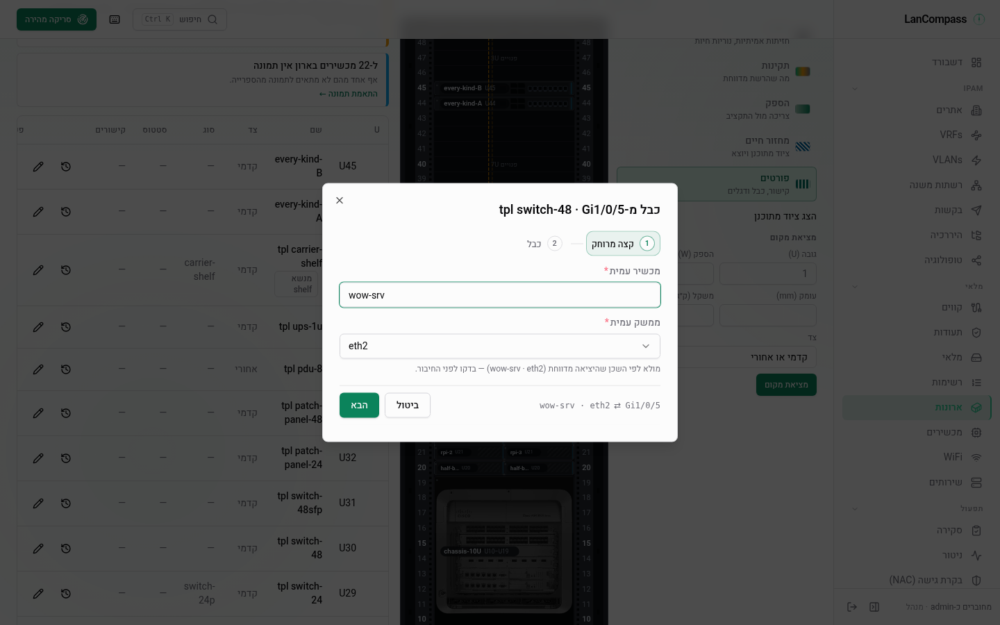

# חיווט

שכבת ה־L1 — מכשירים בעלים של **ממשקים**, ממשקים מקבלים **כבלים**, ו
"מה מחובר ל-מתג X פורט 12" הופך לשאילתה במקום זיכרון. patch panel לא
צריך ישות מיוחדת: הוא פשוט מכשיר שהממשקים שלו הם מסוג `patch`, עם כל
פורט קדמי מזווג לפורט אחורי.

## ממשקים

לכל עמוד פרטי [מכשיר](/he/docs/devices/) יש סקשן **Interfaces**: רשת פורטים
שמציגה שם, סוג (`rj45`, `sfp`, `sfp28`, `qsfp`, `console`, `patch`,
`power`, `other`), מהירות ו־MAC. פורטים מכובלים צבועים ומציגים את ה־peer
שלהם (`device · port`) — לחצו על אחד לפתיחת מגירת ה**trace**.

- **Generate** יוצר סט פורטים שלם בקריאה אחת: בחרו סוג, קידומת שם וספירה
  — `Gi1/0/` × 48 מניב `Gi1/0/1…48`. הגדרת **קידומת זוג** (`b` ל`p`)
  יוצרת בנוסף פורטים אחוריים באותו אינדקס ומקשרת כל זוג `p_i ↔ b_i` —
  קדמי+אחורי של patch panel בן 24 פורטים בלחיצה אחת.
- **Add port** יוצר ממשק בודד; דיאלוג העריכה יכול לשנות שם, לשנות סוג,
  להגדיר מהירות/MAC ולשנות את שותף הזוג (זוגות חייבים לחיות על אותו
  מכשיר — שני הצדדים של מיקום פאנל).
- `connected_ip` הוא הקשירה בצד ה־host — "ה־NIC הזה משרת את ה־IP הזה" —
  קישור שונה מבעלות ה־IP של המכשיר ומפורט המתג בקצה-הרחוק של הכתובת.

### מתועד ונצפה

ליציאה יש שתי מהירויות ושתי כתובות ⁦MAC⁩: ה**מתועדות**, שאדם הזין
(השדות של היציאה עצמה — נערכים בדיאלוג שלה, מיוצאים ומיובאים), וה**נצפות**,
ש[תשאול ⁦SNMP⁩](/he/docs/snmp/) האחרון ראה (⁦`observed_speed_mbps`⁩,
⁦`observed_mac`⁩). תשאול לעולם לא משנה את הערכים המתועדים. כששניהם קיימים
ותואמים, האריח מציג ערך אחד; כשהם שונים הוא מציג *⁦1G⁩ נצפה · ⁦10G⁩ מתועד*
והיציאה מסומנת (⁦`speed_mismatch`⁩ או ⁦`mac_mismatch`⁩). **אימוץ הערך שנצפה**
בשורה הזו מעתיק את הערך הנצפה לשדה המתועד — עריכת יציאה רגילה, ולכן היא
דורשת הרשאת כתיבה, נרשמת ב[יומן השינויים](/he/docs/changelog/) ומנקה את הדגל.
יציאה שהתשאול יצר מתחילה עם ערכים מתועדים השווים לתצפית הראשונה שלה.

## כבלים

כבל מחבר בדיוק שני ממשקים. כל ממשק מסיים **לכל היותר כבל אחד** — ניסיון
לחבר פורט תפוס מחזיר את id הכבל הקיים. כבלים נושאים `kind`
(`cat5e`/`cat6`/`cat6a`/`dac`/`fiber_sm`/`fiber_mm`/`power`/`console`/`other`),
`color`/`label` פיזי, `length_m` והערות. תוויות כבלים ניתנות לחיפוש —
חיפוש גלובלי פותר פגיעת תווית למכשירי **שני** הקצוות.

כבל `power` מחבר שני פורטי `power`, וכבל נתונים אף פעם לא נוגע בפורט
חשמל — ה־422 מציין את שני הסוגים; `other` לא מוגבל, ושינוי של הסוג נבדק
באותה דרך. מחזור החיים של כבל הוא ה־`status` שלו (`planned`, `active` או
`decommissioning` — ראו [מכשירים → מחזור חיים](/he/docs/devices/)).

חברו פורט מהכרטיס שלו: בחרו את מכשיר ה־peer (חיפוש), ואז אחד מהפורטים
**הפנויים** שלו, ואז kind/color/label. מחיקת פורט או מכשיר לוקחת את הכבל
שלה איתה.

כשהיציאה עצמה מדווחת על שכן ⁦LLDP⁩ או ⁦CDP⁩ שמוביל ליציאה מתועדת פנויה
אחת — שם השכן תואם מכשיר אחד בדיוק, ושם הפורט שלו תואם יציאה פנויה אחת
בדיוק של אותו מכשיר — הצד השני מגיע כבר בחור, והשדה אומר מאין הגיע. עדיין
בודקים ולוחצים על החיבור; הקלדת מכשיר קודם גוברת.

**מהארון.** ב**עדשת הפורטים** של הארון (ראו
[ארונות ← עדשת הפורטים](/he/docs/racks/)) פורט בלי כבל מציע **חיווט…** בחלונית
שלו: אותו דיאלוג, ממולא בפורט הזה, וכשהשכן שלו מוביל ליציאה באותה דרך — גם
בצד השני; השמירה עוברת באותה כתיבת כבל עם שורת יומן השינויים שלה. פורט
שנושא את הדגל `lldp_neighbor` (שכן על פורט בלי כבל מתועד) מצייר קו צועד אל
שבב על המכסה העליון של הארון; השבב פותח את הקישור ב[סקירה](/he/docs/review/),
שם **תיעוד** ממלא את טופס הכבל.

**כבלי חשמל.** כבל בין שתי יציאות `power` הוא כבל חשמל: יציאת החשמל של
המכשיר היא קצה ⁦A⁩, השקע בפס השקעים או ב־⁦UPS⁩ הוא קצה ⁦B⁩ (המוסכמה של
⁦NetBox⁩). גב הארון מצייר כל כבל חשמל מתועד בצבע של פס השקעים שלו וקורא
ממנו את השרשרת מכשיר ← פס ← ⁦UPS⁩ (ראו [ארונות ← הגב](/he/docs/racks/)); כבל
מתוכנן מקווקו וכבל בהוצאה משימוש מפוספס, על כבלי החשמל כמו על הפורטים.



## Trace

לחיצה על פורט מכובל פותחת את מגירת ה־trace: הנתיב ה־L1 המסודר דרך הממשק
— `device · interface` לכל hop, עם סוג/תווית הכבל על כל קצה-כבל. על פורט
`patch` ההליכה ממשיכה דרך זוג הקדמי↔אחורי של הפאנל (מוצג כ*panel
pass-through* — לא כבל) וממשיכה, כך ש`host → panel-front → panel-back →
switch` מוצג כנתיב אחד. Traces ששוגרו מאמצע שרשרת עדיין מציפים את כל
הנתיב, לולאות מסתיימות, וההליכה סופרת לכל היותר 64 כבלים (זוגות
⁦pass-through⁩ אינם נספרים) — נתיב שנקטע שם מציין מאיזה פורט הוא ממשיך.

כל ⁦hop⁩ מציג גם **מה הקו אומר**. יציאה ששכן ה־⁦LLDP⁩ או ה־⁦CDP⁩ שלה נוקב
במכשיר שהנתיב המתועד מגיע אליו דרך הכבל שלה מקבלת סימן, *הקו מאשר*; יציאה
שהשכן שלה נוקב במכשיר אחר מוצגת בענבר עם *הקו מדווח על …* (שם השכן והפורט
שלו), וראש המגירה סופר את הצעדים שאינם תואמים. ⁦patch panels⁩ הם
פסיביים, ולכן פורט מתג שמאחורי פאנל מושווה למכשיר הפעיל שמעבר לו; שמות
מושווים בלי תלות ברישיות וגם לפי התווית הראשונה של שם ה־⁦DNS⁩ (⁦LLDP⁩
מדווח לעיתים קרובות שם מלא). יציאה בלי ראיית שכן לא מקבלת סימן. הסימנים
באים מהראיות של התשאול האחרון, כמו אריחי היציאות, ושום דבר במעקב לא משנה
כבל.

**על הארון.** **מעקב נתיב** בחלונית של פורט בדף הארון מאיר את אותו נתיב על
הארון — הפורט של כל צעד בטבעת, ענבר כשהקו לא תואם (צעד אחר צעד כמו במגירה),
שני הקצוות מהבהבים, פס עצירה במקום שבו ההליכה של 64 הכבלים נקטעה — ו**לאורך
השורה** מצייר אותו לאורך הארונות של מבט השורה (ראו
[ארונות ← מעקב על הארון ולאורך השורה](/he/docs/racks/)).

## בדיקה — מה שהמתג באמת מדווח

על מכשירים מנוהלי-SNMP כל poll מבטיח ציווט מתועד מול מצב נצפה (ראו
[SNMP → cable validation](/he/docs/snmp/) לשש הבדיקות: שלוש על כבלים, שתיים על
מהירות ו־⁦MAC⁩ מתועדים מול נצפים, ואחת על כתובת שאדם קישר ליציאה אחרת). פורטים מסומנים
מציגים תג ⚠ ענברי — רחפו לסיבה ול־peer הנצפה/מתועד — והפורט שומר
blob של `validation` עם שכני ה־LLDP וה־MAC-ים שהמתג דיווח.

דגלים הם ממצאים, אף פעם לא תיקונים: שום דבר לא מוחק או כותב-מחדש כבל
מעצמו. הם מתנקים אוטומטית כש־poll מאוחר יותר סותר את התנאי, ועריכה או
מחיקה של הכבל (או עריכת הפורט) מנקה את מפתחות הדגל מיד. ממצאים ממתינים
תחת [Review → Cable mismatches](/he/docs/review/) עם קיצורי **Open trace**
ו**Edit cabling**; ביטול אחד הוא דביק לפי fingerprint.

## כבלים שהרשת מציעה

שכני ה־LLDP של מתג מציינים את רוב הכבלים שלו. אחרי כל תשאול, שכן על פורט שאין
לו כבל הופך ל**כבל מוצע** כשהקצה המרוחק שלו מתועד: הפורט המרוחק שה־MAC שלו הוא
מזהה הפורט או מזהה השלדה של השכן; אחרת המכשיר שמחזיק את ה־MAC הזה (ה־MAC שלו,
של פורט שלו, של כתובת שמקושרת אליו) או, כשרק מכשיר אחד כזה קיים, המכשיר שנקרא
בשם שהשכן קורא לעצמו — ואז הפורט שלו שנקרא כמו שהשכן קורא לו, או פורט חדש
שהכבל יוצר שם (בשם הפורט של השכן, אחרת לפי תיאור הפורט שלו). לאף אחד מהקצוות
אסור שיהיה כבר כבל: פורט שאדם חיבר בכבל לא מוצע שוב לעולם.

ההצעות ממתינות ב[גילוי](/he/docs/discovery/#יצירת-מכשירים-בכמות) כשהאפשרות
*קיבוץ לפי מה שהם יהפכו להיות* פעילה: *6 כבלים שהרשת מציעה*, עם **בדיקה
וקבלה…**. התצוגה המקדימה מציגה כל כבל כ**פורט** · **קצה מרוחק** · **נשמע כ־**
— פורט מרוחק שהכבל יוצר מסומן *פורט חדש* — וכשהן מוחלות הן אצווה אחת עם
**ביטול פעולה**: כל כבל שנוצר נעלם, אלא אם מישהו שינה אותו מאז (הוא נשאר,
ומופיע ברשימה). גם שכן שעדיין אינו מכשיר ממתין: הכתובת שלו מוצעת תחת *מכשירים
שהמתג רואה*, וכשהיא הופכת למכשיר התשאול הבא מציע את הכבל שלו. קישור בסקירה
שהרשת רואה והתיעוד לא אומר *הוצע ככבל* כשהצעה כזו ממתינה.

טבלת ה־bridge עושה אותו דבר לכתובת של אדם: הפורט שבו המתג ראה אותה מוצע,
*כתובת אחת שהמתג ראה על פורט*, ונכתב רק כשמישהו מקבל אותו. המילוי מראש של חלון
הכבל לפי השכן של פורט עדיין עובד כבל אחד בכל פעם.

## קישור IP → ממשק

למגירת ה[IP](/he/docs/addresses/) יש שדה **Connected interface** — פורט
הקצה-הרחוק (בדרך כלל של מתג) שאליו הכתובת מחוברת. הוא חי לצד הטקסט
החופשי `switch_name`/`switch_port` מדור קודם, שנשאר כרשומת הייבוא
ומוצג כ־fallback כשאין קישור מוגדר.

### מעבר מטקסט מדור קודם

`POST /api/v1/interfaces/match-free-text` הוא המתאים החד-פעמי: לכל
כתובת שעדיין חסר קישור, מכשיר ששמו שווה בדיוק ל`switch_name` **ו**בעל
ממשק בשם בדיוק `switch_port` מקושר; מועמדים מרובים מדווחים `ambiguous`
(אף פעם לא משוערים) ואפס הם `unmatched`. עמודות טקסט אף פעם לא נגעות
וכל קישור נוחת ב[יומן השינויים](/he/docs/changelog/) לביקורת.

## סקיצת API

```
GET    /api/v1/devices/{id}/interfaces
POST   /api/v1/devices/{id}/interfaces
POST   /api/v1/devices/{id}/interfaces/generate   # {kind, prefix, count,
                                                  #  start_index?, speed_mbps?,
                                                  #  pair_prefix?}
PATCH  /api/v1/devices/{id}/interfaces/{iface}  # השדות המתועדים (אימוץ הערך שנצפה)
DELETE /api/v1/devices/{id}/interfaces/{iface}
GET    /api/v1/interfaces/{id}                    # peer נרשם + IP קשור
POST   /api/v1/interfaces/match-free-text         # {matched, ambiguous, unmatched}

GET    /api/v1/cables?device_id=&site_id=&q=
POST   /api/v1/cables            # 409 כשאיזשהו קצה כבר מכובל;
                                 # 422 כשהסוג וסוגי הפורטים מתנגשים
PATCH  /api/v1/cables/{id}       # ends, kind, color, label, length_m, status, notes
DELETE /api/v1/cables/{id}
GET    /api/v1/cables/trace?interface_id=         # רשימת hops מסודרת, לכל אחד evidence
                                                  # (agrees|disagrees|none;
                                                  #  wire_name/wire_port כשאינו תואם);
                                                  # ה-hop האחרון אומר truncated: true
                                                  # כשההליכה של 64 הכבלים נקטעה

GET    /api/v1/devices/{id}      # מרוויח interface_count + cabled_count
PATCH  /api/v1/addresses/{id}    # connected_interface_id — הקישור המובנה
```
