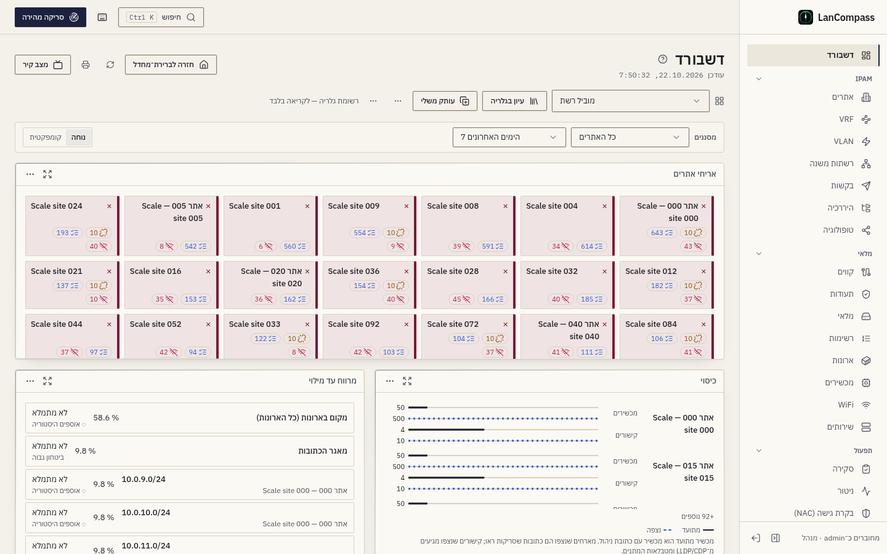
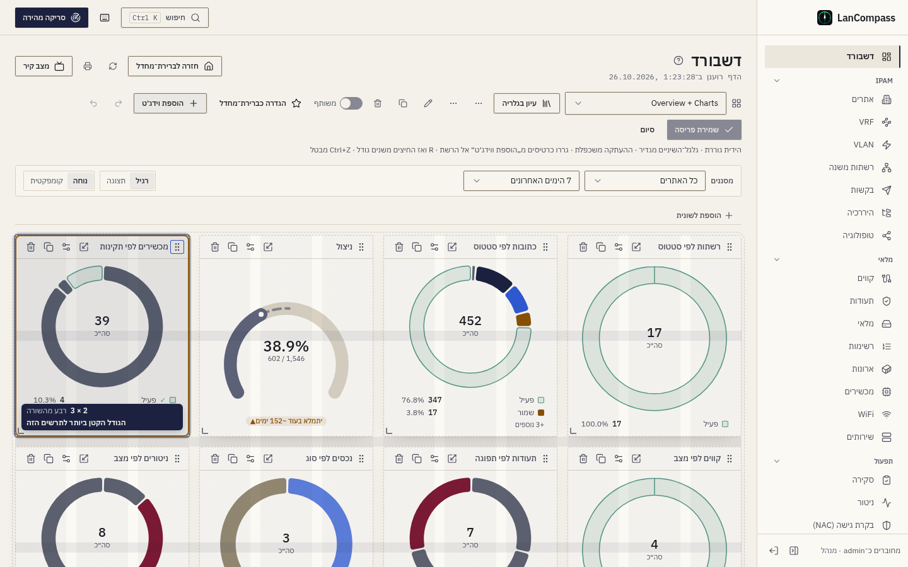
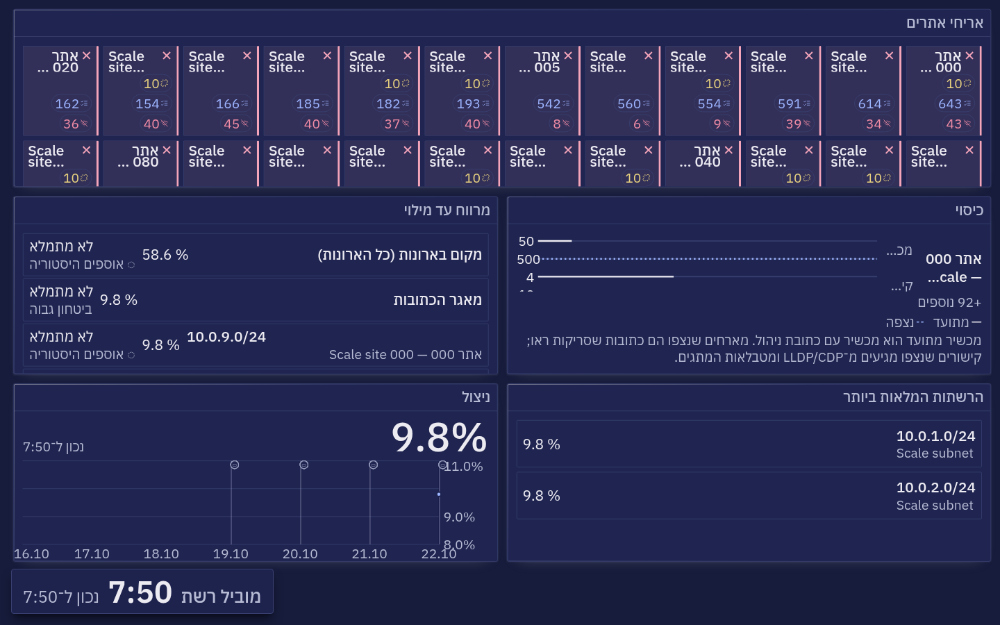

# דשבורדים

עמוד הבית הוא מערכת דשבורדים אמיתית: דשבורדים בעלי-שם בנויים מווידג׳טים על
רשת drag/resize, לכל-משתמש ומשותפים, עם סרגל סינון גלובלי ורענון
לכל-ווידג׳ט. כל נתון וידג׳ט מגיע מאותם endpoints של aggregation שהשאר
האפליקציה משתמשת בהם — דשבורדים מסדרים נתונים מחדש, הם אף פעם לא מחשבים
אותם מחדש. מאחורי התרשימים יש היסטוריה יומית (של כל הרשת ושל כל אתר);
התרשימים מסמנים מה קרה עליהם; כל גרסה שמורה של דשבורד נשמרת; ודשבורד יכול
לעלות על קיר, על נייר או לקובץ.

## על איזה דשבורד אתם נוחתים

הנתיב נרשם בסדר:

1. פרמטר **`?d=`** מפורש (דשבורדים מקושרים משתפים יפה), או **`?ref=`**
   עבור רשומת גלריה,
2. **דף הבית** שלכם — הבחירה שלכם (★ בבורר), ואם אין — דף בית שמנהל
   המערכת שייך לכם, לקבוצת הספרייה שלכם או לתפקיד שלכם,
3. **ברירת המחדל של ההתקנה** — הדשבורד המשותף או המובנה שאדמין סימן,
4. הזרע המובנה **"Overview"**, שהוא ה־layout של לפני-העורך — התקנות
   משודרגות נוחתות בדיוק איפה שהיו.

דף הבית שלכם נשמר בשרת, כך שהוא עובר איתכם לדפדפן אחר. הדשבורד האחרון
שהשתמשתם בו בדפדפן הזה לפני שהגלריה הגיעה הופך לדף הבית שלכם פעם אחת,
בביקור הראשון. **Return to default** (ימין-עליון) תמיד מחזיר אתכם לדף הבית
שלכם.

דשבורדים מוכנים, מעקב והעתקה, הצעת דשבורד משלכם ושיוך דפי בית נמצאים
ב[גלריית הדשבורדים](/he/docs/dashboard-gallery/).

## הווידג׳טים והנתונים שלהם

**הוספת וידג׳ט** פותחת את חלון ההוספה, מקובץ כמו כאן למטה. כל מספר מגיע
מהעמוד שבו הנתונים האלה חיים — ווידג׳ט אף פעם לא שומר עותק משלו. העמודה
**אתר** אומרת אם הווידג׳ט עוקב אחר סינון האתר של הדשבורד (ווידג׳ט שלא יכול
מציג שבב **כל האתרים**); העמודה **טווח** — אם הוא עוקב אחר טווח הזמן.

**נתונים**

| ווידג׳ט | מה הוא מציג | הנתונים שלו | אתר | טווח |
|---|---|---|---|---|
| **כרטיס נתון** | מספר אחד — רשתות, כתובות וניצול, מכשירים לפי תקינות או סטטוס, אתרים, VRF-ים, ארונות ו־U בארונות, אישורים, ניטורים, קווים, נכסים, שירותים, סריקות, אי־התאמות, פריטי סקירה פתוחים, ספירות Check Point, חשיפה וסטייה — עם סף סכנה אופציונלי, שבב דלתא ▲/▼ מול החלון הקודם, שבב תחזית ("‎~40 ימים למילוי"), קו מגמה וקישור לעמוד שמאחוריו | הסטטיסטיקות של הדשבורד; הדלתא וקו המגמה מההיסטוריה היומית; השבב מהתחזית | ✓ | — |
| **מד קיבולת** | תפוסת הארונות: סך הצי והארונות המלאים ביותר | הארונות | ✓ | — |
| **מצב בקרת הגישה** | בקרת הגישה לרשת במילים פשוטות: ממצאים פתוחים, פעולות ממתינות, פורטים בהסגר | סיכום בקרת הגישה | כל האתרים | — |
| **מצב חשיפה** | ממצאי שירותים חשופים פתוחים לפי חומרה, וסטיות פתוחות | הסטטיסטיקות של הדשבורד | כל האתרים | — |

**תרשימים**

| ווידג׳ט | מה הוא מציג | הנתונים שלו | אתר | טווח |
|---|---|---|---|---|
| **טבעת תקינות** | כל פילוח, כטבעת או כעמודות: תקינות או משפחת מכשירים, סטטוס או משפחת כתובות, סטטוס רשתות ו־VLAN-ים, חלונות תפוגת אישורים, מצב או סוג ניטורים, מקטעי סקירה, נכסים, קווים, שירותים, אישורים ועמיתים של Check Point | הסטטיסטיקות של הדשבורד | ✓ | — |
| **מד מחוון** | חלק אחד כטבעת — ניצול כתובות, כתובות בשימוש, U בארונות, אישורים בתוקף, ניטורים פעילים, מכשירים מקוונים, אישורים וסנכרונים של Check Point, זמינות ב־30 הימים האחרונים — עם ימים עד מילוי היכן שהתחזית מכסה | הסטטיסטיקות של הדשבורד (זמינות: היסטוריית הניטור השמורה); הכיתוב מהתחזית | ✓ | — |
| **ציר־זמן פעילות** | אירועים לאורך זמן — סריקות, שינויים, אירועי ניטור, מארחים שהתגלו, סטיות גילוי — או רמה יומית: ניצול, כתובות בשימוש, מכשירים ותקינותם, פריטי סקירה פתוחים, ספירות בקרת גישה, חשיפה ו־Check Point, הזמינות של כל יום (ריקה היום עד שהוא מסתיים); עם דגלי אירועים, השוואה אופציונלית וזנב תחזית מקווקו | סדרות ציר הזמן; רמות מההיסטוריה היומית | ✓ (ראו „סינון”) | ✓ |
| **ניצול רשתות** | עמודות של הרשתות המנוצלות ביותר | הרשתות | ✓ | — |
| **הצבת ארון** | חזית של ארון אחד, U אחרי U, תפוסה ותקינות | הארונות | ✓ | — |
| **מגמת ממצאי בקרת גישה** | ממצאי בקרת גישה פתוחים לפי יום | ההיסטוריה היומית | כל האתרים | ✓ |
| **מגמת סטיית גילוי** | סטיות בין התיעוד למציאות שהסריקות העלו, לפי יום | סדרות ציר הזמן | ✓ | — |

**רשימות**

| ווידג׳ט | מה הוא מציג | הנתונים שלו | אתר | טווח |
|---|---|---|---|---|
| **רשימת מובילים** | רשימה קצרה מדורגת: אישורים שפוקעים, אי־התאמות מסומנות, סריקות אחרונות, שינויים אחרונים, כתובות לא מקוונות, שערים, קהילות, אישורים וסנכרונים של Check Point; הרשתות המלאות ביותר, ארונות לפי הספק, אתרים לפי פריטי סקירה פתוחים ואתרים לפי קישורים לא מתועדים | העמוד שממנו כל רשימה מגיעה (כתובות, סריקות, יומן השינויים, רשתות, ארונות, סיכום האתרים) | ✓ | — |
| **סטטוס ניטור** | יעדי ניטור, הגרועים קודם | יעדי הניטור | ✓ | — |
| **תקלות פתוחות** | התקלות הפתוחות, החמורה ראשונה (הכי הרבה יעדים לא זמינים כעת, ואז הוותיקה), לכל אחת כמה יעדים אינם זמינים ומזה כמה זמן — אי־זמינות של אתר כשורה אחת; שורה רגועה כשאין תקלה פתוחה; שורה פותחת את התקלה בדף התקלות | התקלות (ראו "ניטור" ← "תקלות") | ✓ | — |
| **רצועת זמינות** | היעדים בעלי הזמינות הנמוכה ביותר ב־14 הימים האחרונים, תא לכל יום: אדום מתחת ל־⁦99%⁩, ענבר מתחת ל־⁦99.9%⁩, מקווקו כשחלון תחזוקה כיסה חלק מהיום, ריק לפני שנשמרה היסטוריה; תיאור הכלים של תא מציג את היום, הזמינות שלו ואת זמן אי־הזמינות | היסטוריית הניטור השמורה (ראו "ניטור" ← "היסטוריה וזמינות") | ✓ | — |
| **שינויי טופולוגיה** | מכשירים, כבלים וקישורי רפאים חדשים, שנפתרו ושהוסרו בכל אתר ב־7 הימים האחרונים | היסטוריית הטופולוגיה | ✓ | — |

**רשת** — ראו „איפה להסתכל קודם”

| ווידג׳ט | מה הוא מציג | הנתונים שלו | אתר | טווח |
|---|---|---|---|---|
| **אריחי אתרים** | אריח לכל אתר, הגרועים קודם | סיכום האתרים | כל האתרים | — |
| **כיסוי** | מתועד מול נצפה, בכל אתר | סיכום האתרים | ✓ | — |
| **מרווח עד מילוי** | מה ייגמר ראשון, בימים | התחזית | ✓ | — |
| **יציאות במעקב** | היציאות העמוסות ביותר מבין אלה שבמעקב ב־24 השעות האחרונות, לכל אחת קו של הניצול הגבוה בכל שעה והמהירות שלה; שורה פותחת את מגירת התעבורה של היציאה; השורה התחתונה אומרת כמה יציאות במעקב מתוך המגבלה ומה הגיל של השעה האחרונה | השורות השעתיות של היציאות במעקב (ראו "העשרת SNMP" ← "יציאות במעקב") | כל האתרים | — |

**תוכן**

| ווידג׳ט | מה הוא מציג | הנתונים שלו | אתר | טווח |
|---|---|---|---|---|
| **הערה** | טקסט מארקדאון חופשי | ההגדרות של הווידג׳ט עצמו | — | — |
| **קישורים מהירים** | קיצורים לעמודים מסוננים | ההגדרות של הווידג׳ט עצמו | — | — |

דשבורד מכיל עד 60 ווידג׳טים. על הקיר, כל הנתונים של כל הווידג׳טים בפעימה
אחת מגיעים בבקשה אחת (ראו „מצב קיר”).

## איפה להסתכל קודם

שלושה ווידג׳טים בקבוצת **רשת** בחלון ההוספה עונים על השאלה הראשונה של מוביל
הרשת, והתבנית **מוביל רשת** (וגם **איפה להסתכל קודם?** בבונה) מצרפת אותם
לרשתות המלאות ביותר ולמגמת הניצול עם האירועים שלה. שום דבר בהם לא כותב:
כל לחיצה פותחת עמוד.

- **אריחי אתרים** — אריח לכל אתר, הגרוע קודם. הצבע של אריח (עם הסימן שלו)
  הוא בריאות המכשיר הגרועה ביותר באתר; התגים בפינה סופרים את הקישורים הלא
  מתועדים (נראו ברשת, לא במלאי), את פריטי הסקירה הפתוחים ואת המכשירים הלא
  מקוונים. אריח פותח את הקנבס של האתר — הקנבס השמור של הצוות לאתר כשיש כזה —
  עם הקישורים הלא מתועדים מצוירים. שמות ארוכים נשברים לשתי שורות. עד 200
  אריחים; „+N נוספים” פותח את התצוגה במסך מלא עם כל האתרים.
- **כיסוי** — בכל אתר, שני זוגות של עמודות: המכשירים המתועדים (מכשירים עם
  כתובת ניהול) מול המארחים שסריקות ראו, והקישורים המתועדים מול אלה שנצפו
  (⁨LLDP/CDP⁩ וטבלאות המתגים). המספרים הם המספרים של קנבס הטופולוגיה של
  אותו אתר. הפער הגדול ביותר קודם; מסנן האתר משאיר אתר אחד.
- **מרווח עד מילוי** — מה ייגמר ראשון: כל רשת שהתחזית עוקבת אחריה, המקום
  בארונות ומאגר הכתובות, עם הרמה של היום, הימים עד מילוי ומידת הביטחון של
  התחזית. שורה בביטחון נמוך אומרת זאת במילים, ליד ◌.

ספירות הקישורים הלא מתועדים והנצפים מגיעות מאותו מעבר ראיות של מפת
הטופולוגיה הכוללת, כך שהאריחים והמפה תמיד מסכימים.

## מכשירים וכתובות

שתי משפחות של מספרים נראות דומות ואומרות דברים שונים:

- **מכשירים** — שורות בטבלת המכשירים. *מכשירים פעילים* סופר מכשירים
  שתקינותם פעילה (התקינות היא הסטטוס הגרוע ביותר מבין הכתובות המקושרות
  למכשיר, וכתובת מתועדת שהפסיקה לענות נספרת כלא מקוונת); *מכשירים לא
  מקוונים* את אלה שתקינותם לא מקוונת; *מכשירים* את כולם. אלה המספרים
  שעמוד המכשירים מציג, וכרטיס "מכשירים פעילים" ב־Overview המובנה הוא הזה.
- **כתובות** — שורות IP לפי סטטוס: *כתובות פעילות*, *כתובות לא מקוונות*,
  *כתובות שהתגלו*, *כתובות שמורות*. לרשת של כמה מאות מכשירים יש בקלות
  עשרות אלפי כתובות פעילות. אלה נשארות ספירות לפי סטטוס: סריקה לעולם לא
  משנה את הסטטוס של כתובת שאדם תיעד, כך שמארח מתועד שהסריקות הפסיקו למצוא
  הוא עדיין כתובת פעילה. *כתובות שלא עונות* סופר אותם — פריטי ה**חסר**
  של [Review](/he/docs/review/) → סטייה בכתובות.

וידג׳טים שנשמרו לפני השינוי שומרים על המדד שלהם; רק התווית אומרת עכשיו
"כתובות" במקום שבו המספר תמיד היה כתובות.

הכרטיס *מכשירים לא מקוונים* אומר מתחת למספר שלו למה: "**⁦3⁩ לא נראו
בסריקות · ⁦40⁩ נכשלים בבדיקות**". הראשון הוא הספירה של הסריקות (המספר עצמו,
ללא שינוי); השני סופר את המכשירים שהניטור המופעל שלהם — על המכשיר או על
אחת הכתובות שלו — אינו זמין בבדיקה שאינה ישנה, כך שמכשיר שנכשל בבדיקות
מופיע בסקירה הכללית גם כשהסריקות עדיין מוצאות אותו.

**בן כמה המספר.** מה שדשבורד מציג נצפה כשהמסלול שלו רץ לאחרונה, לא כשהדף
נטען. הנתונים, סדרות התרשימים ווידג׳טי הניטור נושאים את הרגע הזה
(`observed_at`): סוף סבב הניטור, התשובה האחרונה של ⁦SNMP⁩, הסריקה האחרונה
שהסתיימה, מעבר הגילוי האחרון. תרשים שאין בו כלום בחלון הזמן שלו אומר
„הכול תקין · נבדק ב־{time}” עם השעה הזו — אף פעם לא השעה של הדפדפן — וסדרה
של רשומות מתועדות (שינויים, בקשות) לא מציינת שעה בכלל. כשהעבודה ברקע של
המתזמן נעצרת, שורת מצב אומרת זאת בכל דף ועל הקיר (ראו
[ניטור](/he/docs/monitoring/)).

## תמונות-מצב יומיות

ה־worker כותב שורת `dashboard_snapshots` אחת לכל יום — את מטען
הסטטיסטיקות (ספירות + מילוני התפלגות, בלי רשימות-דוגמה), נשמר 400 ימים. זה
הופך כל סקלר למגמה: ציר הפעילות מצייר **ניצול**, **כתובות בשימוש**,
היסטוריית **מכשירים**, **כתובות** ו**תור הסקירה**, ושבבי דלתא משווים מול
החלון הקודם באותו אורך.

**היום תמיד חי.** הנקודה של היום בכל מגמה, שבב מד ותחזית מחושבת מהנתונים
הנוכחיים ולא נקראת מהשורה של היום; השורה עצמה נכתבת מחדש לכל היותר כל 15
דקות (ומיד אחרי ייבוא או טעינת סביבת ההדגמה), כך שיום נגמר בערך האחרון שלו.
מגמה אף פעם לא צונחת לאפס רק כי תמונת-המצב הראשונה של התקנה צולמה לפני
שמשהו יובא.

מדדים מתמונת-מצב הוגנים לגבי פערים: ימים שלפני התמונה הראשונה מוצגים
כשברים בקו, ודשבורד על התקנה טרייה מציג מצב "אוספים היסטוריה יומית" עד
שההיסטוריה נוחתת — אף פעם לא קו אפס שטוח שמעמיד פנים שהוא היסטוריה.

### היסטוריה לכל אתר

אותה כתיבה שומרת גם שורה אחת לכל אתר לכל יום (`site_snapshots`): כתובות
וניצול, מכשירים ובריאותם, U בארונות ותעודות פוקעות — נספרים כמו שהדשבורד
המסונן לאתר סופר אותם, ולפי אותו גבול יום. דשבורד מסונן לאתר מצייר את
המגמות האלה מהשורות של האתר עצמו, והיום חי. ההיסטוריה לכל אתר מתחילה ביום
שבו השדרוג נוחת — ימים קודמים נשארים פערים, ואף פעם לא נלקחים מכל הרשת.
סביבת ההדגמה מביאה חודש מתוסרט לכל אחד מחמשת האתרים שלה.

## אזור זמן

היכן מתחיל יום נקבע לפי **אזור הזמן של דשבורדים** בהתקנה
(**הגדרות ← תכונות ← שפה ואזור ← אזור הזמן של דשבורדים**, שם
‏IANA כמו `Asia/Jerusalem`; ‏UTC כברירת מחדל, ו־Asia/Jerusalem בהתקנה
שהוגדרה לראשונה בעברית). הוא קובע גבול אחד לכל מה שיומי: באיזה יום נספרים
סריקה או שינוי, הנקודות השעתיות של תרשים 24 שעות, היום שאליו שייכת כל שורת
תמונת-מצב (של כל הרשת ושל כל אתר), "היום" של התחזיות, והיום או השעה שעליהם
עומד דגל אירוע. הנתונים עדיין נשמרים ב־UTC, כך ששינוי האזור מזיז את
הגבולות — אף פעם לא את הנתונים.

## תחזית קיבולת

אותה טבלת תמונות-מצב, הפעם נקראת *קדימה*: ‏`/dashboard/forecast` מריץ
מגמת ריבועים-מזעריים על כל מדד יומי ועונה "מתי זה יתמלא?" — ניצול
כתובות של כל הרשת, קיבולת U בארונות, כתובות בשימוש מול הסך החי, ובנוסף
מגמות כיוון-בלבד על עומק הביקורת, ספירת מכשירים ותעודות פוקעות. כל
תמונת-מצב נושאת גם את הניצול של **20 הקידומות החמים ביותר**, שאותו
קוראים הווידג׳טים של הקידומות בהדשבורד (Runway, שבבי המילוי).
לצדו, אותו כותב רושם את הניצול היומי של **כל רשת משנה IPv4 וכל טווח DHCP או
מאגר** בשורה משלהם, והתחזית של כל רשת משנה — יום המילוי הצפוי, הספים, פריטי
הקיבולת בסקירה ודוח הקיבולת — מותאמת לימים שלה עצמה, לפי הכללים שלהלן
([רשתות משנה ← קיבולת](/he/docs/subnets/)).

כל תחזית מצהירה על רמת הביטחון שלה: **insufficient** מתחת ל־14 ימי
היסטוריה — התשובה היא "אוספים", אף פעם לא ניחוש — ואז **low**, ‏**medium**
או **high** לפי R². סדרה שטוחה אומרת *יציב*, סדרה יורדת אומרת זאת, ודבר
לא מוקרן מעבר לשנה קדימה: "אין מגמה אמינה" היא תשובה, ומוצגת ככזו.

**הרצועה.** סביב ההשלכה יושבת רצועה מוצללת — **טווח סביר (95%)**: שגיאת
מכשיר של השאריות בהתאמה × 1.96. רצועה צרה היא קו שעוקב אחר ההיסטוריה שלו;
רצועה רחבה אומרת כמה הימים סוטים ממנו. התאמה בביטחון **low** מציירת את
הרצועה לבדה, בלי קו מקווקו — אי-הוודאות היא התשובה.

**לכל אתר.** תחת סינון אתר התחזית מותאמת להיסטוריה של האתר בלבד,
והקידומות החמות הם של האתר; תור הסקירה נשאר של כל הרשת.

איפה זה מופיע: **שבב תחזית** על כרטיסי נתון ("▲ ‎~40 ימים למילוי"), **זנב
השלכה מקווקו** על צירי פעילות — אזור התחזית נראה שונה בבירור מן המדידה —
כיתוב **ימים-למילוי** על מדי-מחוון, ושבבי מילוי על קידומות חמים ברשימת
הרשתות ובעמוד הקידומת. מפעילים לכל-ווידג׳ט במגירת ההגדרות (**תחזית** →
*הצג תחזית*); מדי-מחוון על מדדים מכוסים מציגים אותה אוטומטית. מקטע
**Operations → Review → תחזית קיבולת** מסמן כל מה שמוקרן לתוך 90 יום
בביטחון בינוני ומעלה — ביטולים נועצים את צמד הישות+מדד ושורדים את
סחיפת התאריך — וכל רשת משנה או טווח שעברו את סף האזהרה או שצפויים להגיע
לסף הקריטי בתוך 90 יום.

## עריכה

**Edit layout** פותח את הרשת: גררו ווידג׳ט בכותרת שלו כדי לסדר מחדש,
גררו את הקצה או הפינה שלו כדי לשנות את גודלו (או בחרו גודל מהיר — קטן,
רחב, גדול, ענק, שורה מלאה, הגודל המועדף שלו — מתפריט שינוי הגודל), הגדירו
אותו באייקון ה־sliders, או הסירו אותו. **Add widget** פותח את פלטת הקטלוג;
גררו ממנה כרטיס אל הרשת, או לחצו עליו כדי להוסיף אותו בסוף. שינויי layout
הם *לא-שמורים* עד שתלחצו **Save layout** — סמן ה־messy הוא הוגן. איך
שינוי גודל והזזה עובדים — בסעיף *סידור ווידג׳טים* שלמטה.

כל עריכה — הוספה, הזזה, שינוי גודל, הגדרה, הסרה, לשוניות — אפשר לבטל
ב־**⁨Ctrl+Z⁩** (או בכפתור „ביטול פעולה”) ולבצע שוב ב־**⁨Ctrl+Shift+Z⁩**.
היסטוריית הביטול נשמרת עד שמירה או ביטול השינויים. כשיש שינויים שלא
נשמרו, מעבר בקישור, החלפת דשבורד או יציאה ממצב עריכה שואלים קודם.

### לשוניות

דשבורד ארוך אפשר לחלק ללשוניות. במצב עריכה לחצו **הוספת לשונית**: הלשונית
הראשונה שמוסיפים מפעילה את הלשוניות — הווידג׳טים הקיימים נשארים בלשונית
ראשונה, והחדשה מתחילה ריקה. שנו שם או הסירו את הלשונית הפעילה בכפתורים
שלידה (הווידג׳טים של לשונית שהוסרה עוברים ללשונית הראשונה), והעבירו
ווידג׳ט ללשונית אחרת בכפתור התיקייה שבכותרת שלו. הכתובת נושאת את הלשונית
הפתוחה (⁨`?tab=`⁩), כך שקישור נפתח באותה לשונית. דשבורד בלי לשוניות נראה
בדיוק כמו קודם.

מגירת ההגדרות של וידג׳ט מציעה תצוגה מקדימה חיה בתוספת אפשרויות לכל-סוג:
מדד או רשימה, מגבלת שורות, **דריסת אתר** (עקוב אחר סינון הדשבורד, כל
האתרים, או אתר ננעץ), **טווח זמן**, **סף סכנה**, דריסת **כותרת**, ומרווח
**רענון אוטומטי** שמסקר רק את הווידג׳ט הזה. פילוחים בוחרים **עדשה** (איזו
התפלגות) ו**תצוגה** (טבעת או סרגלים); מדי-מחוון בוחרים **מדד** וסף
אופציונלי; כרטיסי-נתון מקבלים **שבב דלתא**, **קו מגמה** ו**שבב תחזית** על מדדים עם
סדרת מגמה הוגנת — השדות מושבתים עם הסבר כשלמדד אין כזו.

## סידור ווידג׳טים

כל שורות הרשת באותו גובה — *יחידת שורה* אחת, 152 פיקסלים (120 בצפיפות
הדחוסה) — כך שכרטיס גבוה בדיוק כמו השורות שהוא תופס, מה שלא יהיה בתוכו.
רשימה ארוכה מהכרטיס שלה נגללת בתוך הכרטיס, עם דהייה רכה בקצה החתוך;
תרשים בכרטיס נמוך עובר לפריסה קומפקטית (טבעת שמה את המקרא לצדה, ואחר כך
מציגה את הסך ואת הפרוסות הגדולות כשבבים) במקום לצייר שטח מעוך. הווידג׳טים
מונחים לפי הסדר, כל אחד במקום הפנוי הראשון מלמעלה ומתחילת השורה (מימין
בעברית ובערבית); המסך, ההדפסה ומצב הקיר מניחים אותם אותו דבר, תא אחר תא.
ברוחב של פחות מ־1024 פיקסלים לרשת יש 6 עמודות (הרוחבים נחצים), ומתחת
ל־640 — עמודה אחת.

**שינוי גודל.** במצב עריכה כרטיס מציג שלוש ידיות כשמצביעים עליו או
כשהמיקוד עליו: בקצה הסוף שלו, בתחתית ובפינה. גררו אחת, ומתאר עוקב אחרי
המצביע תא שלם בכל פעם בזמן שהכרטיס עצמו נשאר במקומו; תווית מראה את הגודל
(„6 × 2”) ואת החלק מהשורה („חצי רוחב”). לכל סוג ווידג׳ט יש גודל קטן
ביותר וגדול ביותר — טבעת לפחות 3 × 2, כרטיס-נתון 2 × 1, גרף קו 4 × 2,
רשימה 3 × 2. בקצה התווית אומרת *הגודל הקטן ביותר לתרשים הזה* או *הגודל
הגדול ביותר*, והמתאר נמתח רק כמה פיקסלים וחוזר. כשמשחררים, הכרטיס מקבל
את הגודל החדש; הכרטיסים שהוא מזיז גולשים למקומם. לחיצה כפולה על הפינה
נותנת לווידג׳ט את הגודל המועדף שלו.

**הזזה.** גררו כרטיס בכותרת שלו (במסך מגע — לחיצה קצרה ממושכת; הכפתורים
בכותרת שומרים על הלחיצה שלהם). תמונה של הכרטיס מתרוממת ועוקבת אחרי
המצביע, מתאר מקווקו מסמן את המקום שבו הוא ינחת, והכרטיסים האחרים גולשים
מדרכו — הכרטיס נוחת בדיוק במקום שהמתאר מראה. שחררו מחוץ לרשת, או לחצו
**⁨Escape⁩**, כדי להחזיר אותו. ליד ראש החלון או תחתיתו הדף נגלל, מהר יותר
ככל שמתקרבים לקצה. כרטיסים מפלטת **Add widget** נגררים אל הרשת באותה דרך.

**מקלדת.** העבירו את המיקוד לידית הגרירה של כרטיס ולחצו **⁨Space⁩** או
**⁨Enter⁩** כדי להרים אותו; החיצים מזיזים אותו ממקום למקום, **⁨Space⁩** או
**⁨Enter⁩** מניחים אותו ו־**⁨Escape⁩** מבטל — כל הזזה מוכרזת עם כותרת הכרטיס
והמיקום שלו. לשינוי גודל, העבירו את המיקוד לכרטיס ולחצו **⁨R⁩**: כל חץ מגדיל
או מקטין אותו בתא אחד (**⁨Shift⁩** + חץ קופץ ישר לקצה), **⁨Enter⁩** שומר את
הגודל ו־**⁨Escape⁩** מחזיר את הקודם; כל צעד מוכרז. בעברית ובערבית החיצים
ימינה ושמאלה הולכים לפי כיוון הקריאה.

כל הזזה וכל שינוי גודל הם צעד אחד של **⁨Ctrl+Z⁩**. ווידג׳ט שנשמר לפני
שהגבולות האלה היו קיימים מצויר בגודל הקרוב ביותר שהוא מרשה; ה־layout
השמור שלו נכתב מחדש רק כששומרים.

## שיתוף וברירת מחדל של ההתקנה

- כל תפקיד מחובר — כולל viewers — יכול ליצור, לערוך ולמחוק את הדשבורדים
  *שלהם*; הם העדפות אישיות, לא נתונים משותפים.
- מתג ה**Shared** (בעלים בלבד) מפרסם דשבורד לקריאה-בלבד לכולם; הבעלים או
  אדמין עדיין יכולים לערוך אותו.
- **Set as default** היא פעולת אדמין ועובדת רק על דשבורד משותף או מובנה —
  דשבורד פרטי לא יכול להיות ברירת המחדל של ההתקנה. הגדרת ברירת מחדל חדשה
  מנקה את הישנה אוטומטית.
- ה"Overview" המובנה ניתן לעריכה על ידי אדמינים כמו כל שורה משותפת;
  משתמשים שרוצים וריאנט אישי משתמשים ב**Duplicate**.
- שורה מובנית נוספת, **"Overview + Charts"**, מגיעה לצידו — אותם
  וידג׳טים באותו סדר, כשכל סקלר מוצג כגרף-התאים שלו (דונאטים של פילוג,
  מד הניצול, שירותים לפי שם).

## סינון

סרגל הסינון מגדיר **אתר** ו**טווח זמן** לכל הדשבורד. הם כתובים לתוך ה־URL
(`?site=&range=`), כך שדשבורד מסונן מקשר נקי. וידג׳טים שהם מודעי-אתר עוקבים
אחר הסינון אלא אם הקונפיג שלהם יוצא; וידג׳טי timeline עוקבים אחר הטווח אלא
אם הם נועצים את שלהם.

**כל האתרים.** וידג׳ט שלא יכול לעקוב אחר סינון האתר אומר זאת: שבב **כל
האתרים** בכותרת שלו מסמן שהוא מציג את כל הרשת. סריקות, מארחים שהתגלו
וסטיות גילוי עוקבים אחר האתר (דרך הרשת או הכתובת שהם שייכים להן), וכך גם
המגמות היומיות של כתובות, ניצול, מכשירים, U בארונות ותעודות (ההיסטוריה של
האתר עצמו); יומן השינויים, אירועי הניטור, תור הסקירה וסדרות ה־NAC, החשיפה
ו־Check Point הם של כל הרשת.

**24 השעות האחרונות.** צירי אירועים (סריקות, שינויים, אירועי ניטור, מארחים
שהתגלו, סטיות) מציירים 24 נקודות שעתיות. מגמות תמונת-מצב הן יומיות: ב־24
שעות הכרטיס מציג את הערך החי של היום ומבקש 7 ימים או יותר כדי לראות מגמה.

## קריאת התרשימים

כל תרשים יושב באותה מסגרת: כותרת הכרטיס, **ערך מרכזי** (הרמה האחרונה, או
הסך בחלון עבור סדרת אירועים) עם **שבב שינוי** ▲/▼ ושעת "נכון ל־", התרשים
עצמו, ומקרא מתחתיו. המספרים טבלאיים, כך שהספרות לא זזות בזמן שערך מתגלגל;
ערכים גדולים נכתבים בקיצור על צירים ובערך המרכזי (12.3K) ובמלואם
בתיבות-המידע ובטבלאות; אחוזים נכתבים עם ספרה אחת אחרי הנקודה.

- **קווים** חלקים אבל אף פעם לא חורגים מהנתונים. יום חסר שובר את הקו, וקו
  מנוקד דק מגשר על הפער — דבר לא מומצא; תיבת-המידע אומרת "אין נתונים ליום
  הזה". רק לנקודה האחרונה יש נקודה; מגודל 2×2 ומעלה מסומן גם השיא של
  התקופה.
- **צירי Y** יושבים בקצה הסוגר, עם ארבע שנתות לכל היותר. ספירות וחלקים
  מתחילים מאפס; רמת אחוזים (ניצול) רשאית להתקרב, והציר מראה מאיפה הוא
  מתחיל.
- **ריחוף** מצייר קו-כוונת ברוחב 1 פיקסל; תרשימים שחולקים את טווח הדשבורד
  מרחפים יחד. תיבת-המידע מציגה את התאריך, את הערך, את השינוי מהנקודה
  הקודמת ואת הצבע והסמל של הסדרה.
- **תחזיות** מוסיפות קו מקווקו ואת **הטווח הסביר (95%)** המוצלל; התאמה
  בביטחון נמוך מציגה את הטווח בלבד.
- **פילוחים** מצוירים כטבעת דקה עם הסך במרכזה (ריחוף או פוקוס על פרוסה —
  או על שורת המקרא שלה — מציגים את ערכה ואת חלקה); המקרא מציג ארבע שורות,
  ו־"+N נוספים" פותח מסך מלא. לחיצה על שורת מקרא מבודדת את הקטגוריה (לתצוגה
  בלבד, אף פעם לא נשמר; לחיצה נוספת או Escape). פילוח סטטוס שהסיפור שלו
  הוא קטגוריה אחת — סל תקול יחיד — מציג אותה בצבעה ואת השאר מעומעם.
- **עמודות** נשארות ישרות בבסיס; עד שמונה עמודות כל אחת נושאת את ערכה,
  ועמודה שעוברת את הסף הופכת לכתומה או לאדומה **עם ▲** — הצבע אף פעם לא
  נושא את המשמעות לבדו.
- **כרטיסים קטנים** מתפשטים: ברוחב מתחת ל־240 פיקסלים תרשים מציג רק את
  הערך המרכזי וקו-מגמה; עד 360 פיקסלים הוא מוותר על ציר Y ושומר שלושה
  תאריכים.

לכל ערכת נושא פלטה מכוונת משלה (כחול, כתום, תכלת, צהוב, מג׳נטה, ירוק,
סגול, אדום — מהשמינית והלאה הכול מתקפל ל״אחר״), כל צבע לפחות 3:1 על
הכרטיס שלו. בארבע ערכות הנושא הכהות, כשהאפקטים על מלא, קווים ומדי-מחוון
מקבלים זוהר רך. התנועה עוקבת אחר **הגדרות ← מראה**: במלא תרשים מצויר פעם
אחת בטעינת העמוד ואחר כך מחליק בין שינויים; רגוע, כבוי ותנועה מופחתת
משאירים הכול דומם.

## קריאת התרשימים החדשים

אחד-עשר ווידג׳טים של תרשימים עונים על שאלות שקו או טבעת לא יכולים לענות
עליהן. כל אחד יושב באותה מסגרת כמו האחרים: ריחוף או מיקוד על סימון מציגים
את המספרים שלו, **הצג כטבלה** מציג את כולם, ומקשי החצים עוברים מסימון
לסימון (Enter פותח את מה שהסימון מקשר אליו). צבע אף פעם לא נושא מספר
לבדו — חלונית המידע, הטבלה והמקרא אומרים אותו.

| ווידג׳ט | איך לקרוא אותו |
|---|---|
| **מפת חום לפי ימים** | תא לכל יום, עד שנה. השבועות רצים משמאל לימין בכל שפה; השורות עוקבות אחרי השבוע שלכם (ראשון קודם בעברית). ככל שהתא כהה יותר, יותר קרה באותו יום — סריקות, שינויים, אירועי ניטור, שינויי גילוי או מארחים שנמצאו. סדרה קדימה (תפוגות תעודות, תחזוקה) מתחילה היום ומכסה את השנה הקרובה. המספר הגדול במסגרת הוא הסך של התקופה. יום ישן יותר ממה ש־LanCompass שומרת מצויר כמתאר מקווקו ונקרא **לא נשמר** — אף פעם לא כיום שקט: שינויי גילוי נשמרים לפי **הגדרות ← גילוי מעמיק ← ימי שמירת ראיות** (90 כברירת מחדל), וסריקות, שינויים ואירועי ניטור כל עוד **הגדרות ← תכונות ← שמירת נתונים** מאפשרת (לתמיד כברירת מחדל). הגדילו את ההגדרה כדי לשמור שנה שלמה. |
| **כרטיס ניקוב** | שבוע של שעות: שורה לכל יום, עמודה לכל שעה, עיגול שה**שטח** שלו גדל עם הספירה. המשפט שלו מציין את השעה העמוסה ביותר ואת השקטה ביותר — מקום טוב לחפש בו חלון תחזוקה. |
| **מפת עץ** | היררכיה כמלבנים מקוננים. השטח הוא תמיד הגודל (כתובות, יחידות ארון, מכשירים); הצבע הוא כמה הוא מלא. מעבר ל־500 פריטים הקטנים ביותר מתקפלים ל**אחר (N)**. הפעלת מלבן פותחת אותו. |
| **טבעות היררכיה** | אותה היררכיה בעד שלוש טבעות: ⁦VRF⁩, מכיל, קידומת — או אתר, קבוצת ארונות, ארון. המרכז מציג את מה שמצביעים עליו ואת חלקו מהכלל. הקשתות צבועות כמו במפת העץ: לפי כמה הן מלאות כשיש להיררכיה מילוי (קידומות, ארונות), ולפי הענף העליון שלהן כשהיא רק סופרת (מכשירים). |
| **זרימה (סנקי)** | לאן דברים הולכים, וכל רצועה רחבה כמו הספירה שלה: מחזור החיים של הגילוי (התגלו ← זוהו או בהתעלמות ← מתועדים ← מנוטרים), רשתות ⁦VLAN⁩ לקידומות לאתרים, משפחות מכשירים לאתרים. לכל היותר 40 צמתים; השאר מתקפלים ל**אחר**. |
| **גרפים קטנים** | מגמה קטנה לכל אתר, כל התאים על **סקלה אחת משותפת** כדי שההשוואה תהיה הוגנת, ממוינים לפי הערך האחרון. עד 24 מוצגים, ואז **+N**. סדרה שאין לה קשר לאתר נדחית במקום לחזור על עצמה בכל אתר. |
| **רדאר אתרים** | הפרופיל של כל אתר בשישה אחוזים: כיסוי, ניצול, ניטורים זמינים, תעודות תקינות, עמידה בתאימות וקישורים מתועדים. עד שישה אתרים חופפים; השאר נפתחים כרדארים קטנים במסך מלא. אחוז שאין מה למדוד בו מסומן **אין נתונים**. |
| **מדד מול יעד** | מספר מול היעד שלו ועד שלוש רצועות שמגדירים בהגדרות הווידג׳ט (הפס הוא הערך, הקו הקצר הוא היעד). הוא אומר במילים **עומד ביעד** או **לא עומד ביעד**. |
| **וופל** | רשת של 10 × 10: כל משבצת היא אחוז אחד, מעוגלות כך שהמשבצות תמיד מסתכמות ב־100. |
| **עמודות מעגליות** | הארונות או הקידומות המלאים ביותר כטבעות, לכל היותר 12, הגדול ביותר בחוץ, כולם על אותה קשת של ⁦0–100 %⁩. |
| **מפת כתובות** | ⁦/16⁩ כ־256 בלוקים על עקומת הילברט — בלוקים סמוכים במספר נשארים סמוכים על המפה — בצבע לפי כמה כתובות כל ⁦/24⁩ מנצל; לבלוק עם מסגרת מוגדר קידומת. הפעלת בלוק מתקרבת ל־256 הכתובות שלו (בצבע לפי מצב); פירורי הלחם מובילים חזרה. בלי בלוק בהגדרות מוצג ה־⁦/16⁩ עם הכי הרבה כתובות בשימוש. המפה אף פעם לא מתהפכת. |

מפות החום, המפות ומפות העץ צובעים לפי סולם של שש דרגות מצבע הכרטיס אל
צבע ההדגשה של ערכת הנושא; דרגות סמוכות נשארות נבדלות גם לעיוורי צבעים,
והסולם מודפס עם התרשים.

### מראה תצוגה

דשבורד שנועד להסתכל עליו — על קיר, בישיבה — יכול לעבור ל**תצוגה** עם
המתג **רגיל / תצוגה** בסרגל הסינון (לעורכים בלבד). הכרטיסים מאבדים את
המסגרת ויושבים על רקע רך בצבע ההדגשה של ערכת הנושא, כותרות הכרטיסים
גדלות, המספרים גדלים ל־40 פיקסלים והכרטיסים נחשפים בזה אחר זה בפעם
הראשונה שהעמוד נפתח (באפקטים מלאים בלבד). ערכות הנושא הבהירות שומרות קו
דק סביב הכרטיס, וההדפסה משמיטה את הרקע. המראה נשמר עם הדשבורד כמו כל
שינוי אחר, כך שההיסטוריה יכולה להחזיר את הקודם. רשומות בגלריה שמסומנות
✦ מגיעות במראה התצוגה; עותק שומר עליו עד שמחליפים.

## אירועים, השוואות וזום

תרשימי הזמן (קווי פעילות, ממצאי NAC לאורך זמן, שינויי גילוי לאורך זמן)
מסמנים את מה שקרה על ציר הזמן שלהם, כך שקפיצה מגיעה עם הסיבה שלה:

- **דגלים** עומדים על היום (או על השעה, בטווח 24 שעות) שבו אירוע קרה —
  ייבוא שאושר ◆, סריקה ○ או ריצת גילוי ◎ (כמה באותה שעה באותו אתר חולקים
  דגל אחד שסופר אותן), תצורה של מכשיר שהשתנתה ✎, סביבת ההדגמה
  שנטענה או הוסרה ★. **חלון תחזוקה** הוא טווח מוצלל מתחילתו ועד סופו ▭.
  דגלים וטווחים יושבים מתחת לקו, אף פעם לא מעליו, ולכל סוג יש סמל משלו
  ולא רק צבע.
- ריחוף או Tab לדגל מציגים אותו ("hq-subnets.csv יובא על ידי admin");
  לחיצה או Enter פותחים את מה שהוא מצביע עליו. דגל שאין לכם הרשאה לפתוח
  את היעד שלו עדיין מציג את הסוג ואת הזמן. אפשר לכבות את הדגלים בכל
  ווידג׳ט בהגדרות שלו (**הערות על ציר הזמן**); כברירת מחדל הם מופעלים.
  תרשים מציג את 200 האירועים האחרונים.
- **הצגה כטבלה** מציגה כל אירוע בשורה משלו, בזמן שלו בין שורות הנתונים;
  במסך מלא טבלת אירועים (זמן, סוג, אירוע, קישור) מופיעה אחרי טבלת התרשים.
- **השוואה עם** (קווי פעילות, בהגדרות הווידג׳ט) מוסיפה סדרה שנייה,
  מקווקוות, על אותו ציר: **התקופה הקודמת** — אותו מדד טווח אחד קודם, כך
  ש״השבוע״ יושב על "שבוע שעבר" — או **אתר אחר**, לסדרות שעוקבות אחר אתר
  (סריקות, גילויים, כתובות, ניצול, מכשירים; האחרות לא מציעות את זה). המקרא
  נותן שם לשתי הסדרות. יום שאין בו נתונים בסדרה השנייה הוא פער, אף פעם לא
  אפס.
- **זום:** גררו לאורך תרשים זמן כדי להתקרב לטווח הזה; השבב **איפוס הזום**
  (או Escape) מחזיר את הטווח המלא. מהמקלדת, Shift+חץ מרחיב בחירה מהיום
  שבפוקוס, ושחרור Shift מתקרב. הזום הוא תצוגה בלבד — הוא אף פעם לא נשמר
  ולא שולח דבר לשרת.

## נגישות

- לכל תרשים יש **משפט סיכום** כשם — הערך האחרון והשינוי שלו, הערך הנמוך
  והגבוה ביותר וכל יום ללא נתונים.
- **הצגה כטבלה** (אייקון הטבלה בכרטיס התרשים, ותמיד מתחת לתרשים במסך מלא)
  מציגה את המספרים המצוירים כטבלה עם כותרת.
- **מקלדת:** Tab לתרשים, ואז מקשי החצים נעים לאורכו; תיבת-המידע עוקבת
  ואזור חי מקריא את הערך. Shift+חץ בוחר טווח להתקרבות ו־Escape מאפס
  אותו; Tab ממשיך לדגלי האירועים של התרשים, וכל אחד מוקרא עם הסוג, הזמן
  והתיאור שלו.
- **דוגמאות מילוי בתרשימים** (הגדרות ← מראה) מוסיף מילוי בקווים ובנקודות
  לפרוסות ולעמודות, כך שהקטגוריות נבדלות לא רק בצבע. בהדפסה הן תמיד
  מופעלות.
- הזמן זורם משמאל לימין בכל שפה; בעברית ובערבית הכרטיס, המקרא ותיבת-המידע
  מתהפכים סביב התרשים.
- גם לווידג׳טים של **רשת** יש משפטי סיכום: אריחי האתרים מונים את האתרים
  שצריך להסתכל עליהם ולמה, הכיסוי מציין את הפער הגדול ביותר עם המספרים
  שלו, והמרווח עד מילוי מציין מה ייגמר ראשון ובעוד כמה ימים (ואומר "ביטחון
  נמוך" כשזה המצב). הצבע של אריח תמיד מגיע עם הסמל שלו.
- **ייצוא ← טבלת CSV** נותן את המספרים של כל תרשים או רשימה כקובץ, לגיליון
  אלקטרוני או לקורא מסך שמעדיף כזה.
- על **הקיר** שום דבר לא מגיב ללחיצה והשעון נשאר קריא מקצה החדר; **Esc**
  מראה את הדרך החוצה.

## הדפסה

אייקון המדפסת פותח את `/print` — הדשבורד הפעיל מוצג שטוח: אותם וידג׳טים,
אותו סינון, בלי chrome, בפלטת "נייר" בהירה. את הנייר בוחרים מעל התצוגה
המקדימה: **⁨A4⁩** או **⁨A3⁩**, **לרוחב** או **לאורך** (⁨A4⁩ לרוחב אם לא
בוחרים אחרת; התצוגה המקדימה נפרשת ברוחב של הנייר הזה). הוא מודפס עם רשת
12 העמודות של הדשבורד עצמו, כרטיס אף פעם לא נחצה בין עמודים, ו — בראש כל
עמוד — כותרת שמציינת את הדשבורד, האתר, הטווח, זמן ההפקה ומי הדפיס. בהדפסה
אין אנימציה ואין זוהר, והתרשימים משתמשים בדוגמאות מילוי.

## מצב קיר

**מצב קיר** (כפתור הטלוויזיה ליד המדפסת) מציג את הדשבורד במסך מלא לקיר או
לטלוויזיה: בלי סרגל צד, כותרת או כלי עריכה, ושום דבר עליו לא מגיב ללחיצה.
שעון קטן בפינה מציין את שם הדשבורד, מראה את השעה בגודל שאפשר לקרוא מקצה
החדר, ונותן שתי שעות: **הנתונים נכונים ל־** — מתי הנתונים של הווידג׳ט
הוותיק ביותר נצפו ברשת (סבב ניטור, תשאול ⁦SNMP⁩, סריקה) — ו**הדף רוענן
ב־**, מתי המסך הזה ביקש אותם לאחרונה. כשהעבודה ברקע נעצרה, הראשונה נשארת
ברגע העצירה בזמן שהשנייה ממשיכה לזוז, ושורת מצב לרוחב החלק העליון אומרת
**העבודה ברקע נעצרה לפני …**.

- **כתובת:** ⁨`/?d=<id>&kiosk=1`⁩. הוסיפו ⁨`&rotate=<id>,<id>`⁩ כדי
  לסובב בין כמה דשבורדים, ו־⁨`&every=<seconds>`⁩ לכמה זמן כל אחד מוצג (30
  עד 3,600 שניות; 60 כברירת מחדל). דשבורד ברשימה שהמשתמש המחובר לא רואה
  מדולג — הקיר אף פעם לא מציג דף שגיאה.
- **רענון:** כל הווידג׳טים מתרעננים יחד בפעימה של הקיר — הרענון הקצר ביותר
  שווידג׳ט כלשהו מבקש, אבל לא בתדירות גבוהה מכל 30 שניות (כל 60 שניות
  כשאף ווידג׳ט לא קובע רענון). נתוני הדשבורד של כל פעימה — הסטטיסטיקות, כל
  סדרות התרשימים, התחזית ודגלי האירועים — מגיעים בבקשה אחת.
- **הגנה מצריבה:** כל 10 דקות כל הפריסה זזה בפיקסל־שניים (לא יותר מ־4)
  והשעון עובר לפינה הבאה. הוסיפו ⁨`&static=1`⁩ כדי להשאיר את שניהם במקום.
- **התאמה:** השורות נמתחות למלוא גובה המסך, כך ששום דבר לא מוקטן; רק
  דשבורד עם יותר מדי שורות לכך מוקטן כדי להיכנס. לשעון יש פס משלו בקצה
  המסך, ורשימה מציגה רק את השורות שהכרטיס שלה מכיל בשלמותן.
- **קריאה מקצה החדר:** כל תווית על הקיר היא לפחות ⁨24 px⁩ וכל מספר לפחות
  ⁨72 px⁩ במסך ⁨1080p⁩ (גדול יותר במסך גבוה יותר). השורה השנייה של מספר
  מופיעה מתחתיו, או לצדו כשאין מקום מתחת; שום דבר לא נחתך בקצה כרטיס,
  ושום דבר על הקיר לא חוזר בלולאה — ערך שהשתנה מסמן את עצמו פעם אחת.
- **ערכת נושא:** הקיר נפתח ב־⁨Night chart⁩, בלי קשר לערכת הנושא של הדפדפן.
  הוסיפו ⁨`&theme=<theme>`⁩ כדי לבחור אחרת לקיר (⁨`survey`⁩,
  ⁨`night-chart`⁩, ⁨`survey-hc`⁩, ⁨`night-chart-hc`⁩, ⁨`cyberpunk`⁩ או
  ⁨`indigo`⁩).
- **הכול תקין:** תרשים שאין בו כלום בחלון הזמן שלו אומר זאת, ומציין את
  החלון ואת שעת הבדיקה — „הכול תקין · 24 השעות האחרונות · נבדק ב־⁨07:30⁩” —
  במקום לעמוד ריק. "נבדק" הוא מתי המסלול של הסדרה רץ לאחרונה (הסריקה, מעבר
  הגילוי או סבב הניטור האחרונים), כך שעבודה ברקע שנעצרה אף פעם לא נקראת
  כ„הכול תקין” טרי.
- **יציאה:** לחצו **⁨Esc⁩** — או, במסך מגע, לחצו והחזיקו בכל מקום — כדי
  להציג **יציאה ממצב קיר**.
- **כניסה:** הקיר רץ תחת התחברות רגילה; חשבון צופה במחשב של הקיר מספיק. אם
  ההתחברות מסתיימת, הקיר מציג כרטיס **כניסה מחדש** במסך מלא במקום להחשיך,
  ואחרי הכניסה הוא חוזר לאותם דשבורדים.

## ייצוא ווידג׳ט

תפריט ה־**⋯** של ווידג׳ט מציע **ייצוא**: **תמונת PNG** ו**תמונת SVG**
לתרשים, **טבלת ⁨CSV⁩** לכל ווידג׳ט שיש בו שורות (המספרים של תרשים, השורות
של רשימה).

- התמונה היא התרשים כפי שהוא מצויר, בצבעי ערכת הנושא שלכם, מתחת לכותרת עם
  שם הווידג׳ט, הדשבורד, האתר והטווח, ו„נכון ל־” — בשפה ובכיוון הקריאה
  שלכם. הקובץ עומד בפני עצמו: פתיחתו לא מורידה שום דבר.
- קובץ ה־⁨CSV⁩ הוא ⁨UTF-8⁩ עם סימן סדר בתים, כמו קובצי ה־⁨CSV⁩ של הדוחות,
  כך שעברית ושפות אחרות נפתחות נכון בגיליון אלקטרוני.
- שמות הקבצים הם ⁨`<dashboard>-<widget>-<site>-<range>-<date>`⁩, למשל
  ⁨`Network-lead-Utilization-Demo-HQ-30d-2026-10-15.png`⁩.

## שני עורכים, דשבורד אחד

כל שמירה נושאת את הגרסה שהעמוד קרא לאחרונה. אם מישהו אחר שמר את הדשבורד
בינתיים (אדם אחר, או אתם בלשונית אחרת), השמירה נעצרת ושואלת: **טעינה מחדש
(הגרסה שלי תישמר כלוח חדש)** שומרת את הגרסה שלכם כעותק פרטי ומציגה את
שלו; **דריסה** מחליפה את שלו בשלכם — החלון מציין את השמירה שלו (מי ומתי),
והיא נשארת ב**היסטוריה**. שום דבר לא הולך לאיבוד בשקט.

## היסטוריה ושחזור

כל שמירה של הפריסה, המסננים, הלשוניות או השם של דשבורד שומרת את הגרסה
שהיא החליפה. פתחו **היסטוריה…** מתפריט הדשבורד (**⋯**): כל שורה מציגה
מתי הגרסה נשמרה, על ידי מי, כמה ווידג׳טים היו בה, ואת התווית שלה. פתחו
שורה לתצוגה מקדימה לקריאה בלבד — הפריסה כמפה של תיבות עם כותרות — ואז
**שחזור הגרסה הזו**. שחזור הוא שמירה רגילה: מה שהדשבורד מציג עכשיו נשמר
בהיסטוריה בתורו, כך שגם שחזור אפשר לבטל, ואם מישהו שמר בינתיים תקבלו את
אותה שאלה של טעינה מחדש / דריסה.

תנו לגרסה חשובה **תווית** (עד 80 תווים, למשל „לפני הפיילוט”). נשמרות 50
הגרסאות האחרונות, וכל גרסה שיש לה תווית. מי שרואה את הדשבורד יכול לקרוא
את ההיסטוריה שלו; שחזור ותיוג דורשים הרשאת עריכה. הגיבויים כוללים את
ההיסטוריה.

## ייצוא וייבוא

**ייצוא לקובץ** (בתפריט הדשבורד) מוריד את הדשבורד כקובץ
⁨`.lancompass-dashboard.json`⁩: השם, הפריסה, הלשוניות והמסננים — בלי בעלים
ובלי מזהים של ההתקנה הזו. אתרים עוברים לפי שם, וכך גם ארונות בווידג׳ט
ארון.

**ייבוא מקובץ…** הופך קובץ כזה לדשבורד פרטי חדש שלכם (אפשר לשתף אותו
אחר כך). כל ווידג׳ט נבדק מול קטלוג הווידג׳טים של ההתקנה הזו: סוג ווידג׳ט
שהיא לא מכירה, או הגדרות שהיא דוחה, מושמטים. שמות אתרים וארונות מותאמים
לאתרים ולארונות של ההתקנה הזו (בלי תלות באותיות גדולות וקטנות); שם בלי
התאמה מנוקה — הווידג׳ט עוקב אז אחרי מסנן האתר של הדף. דוח מפרט כל מה
שלא הועבר כפי שהיה.
