# ארונות

אלציוני ארון פיזיים — אילו מכשירים יושבים באילו חריצי U, על איזה face.

## הרשימה

Racks עובד כמו עמודי הישויות האחרים: מיון עמודות, נעיצה, גרירה
לסידור, צבעי שורות, היסטוריה. כל שורה מציגה את ספירת המכשירים ובר U-מנוצל
(`used_u / height_u` — ציוד קדמי ואחורי שחולק U נספר פעם אחת), בתוספת
עמודת **Capacity** שסוכמת `watts`/`weight_kg` של מכשירים (קווים מקווקווים
כשאף מכשיר לא מספק ערך).

כפתור ה**Filters** פותח פאנל מפולח (Sheet במסכים צרים) עם ספירות חיות —
חיפוש בראש (שם, חדר, תיאור, שמות אתר וקבוצה — מקופל-עברית), ואז facets
לאתר, קבוצה (עם רשומת *ungrouped*), חדר, גובה (ערכים נפרדים קיימים),
תפוסה (empty / partial / full על גבי ה־rollup של used-U), וטווח U-פנוי.
facets פעילים מוצגים כ־chips נשלפים בסרגל הכלים, וכל facet הוא פרמטר URL
(`?site_id=58&occupancy=partial&min_free_u=4`), כך שתצוגה מסוננת ניתנת
לסימנייה, שורדת טעינה-מחדש, וניתנת לשם דרך **Saved views** (מובנים:
*Ungrouped*, *Nearly full*, *Empty*). `min_free_u=4` הוא שאילתת ה״איפה
הקופסה ה־4U הזו יכולה ללכת״ — היא מפולחת על ה־aggregate המחושב
`height_u − used_u`.

## קבוצות ארונות (שורות bayed)

שורת datacenter אף פעם לא ארון אחד. **קבוצות ארונות** אוספות ארונות שעומדים
צד-אל-צד — הפאנל "קבוצות ארונות" בראש עמוד הארונות מציג אותן עם ספירות
חברים; לחיצה על שם פותחת את **תצוגת השורה** (`/racks/groups/[id]`):
ארונות החברים נמשכים שמאל-לימין, מיושרים-לתחתית כמו שורה bayed אמיתית, כל
אחד עם נקודות הבריאות שלו. הסטריפ גולל אופקית לשורות רחבות; הכותרת מצטברת
סכומי קבוצה (U בשימוש/פנוי, Σ וואט, Σ ק״ג). שורה ארוכה מציירת רק את
הארונות שבתצוגה: האחרים מופיעים כמתאר עם שורת הסיכום שלהם ומתמלאים כשהם
נגללים פנימה, כך ששורה של 200 ארונות נפתחת מהר כמו שורה של שניים.

- הקצו ארון לקבוצה בדיאלוג שלו — בחרו את הקבוצה ואופציונלית **מיקום**
  (שמאל-לימין; ריק מצרף בקצה הימני של השורה). החזרת הקבוצה ל*None* מסירה
  אותו.
- שורות קבוצה מסננות כמו קבוצות VLAN: כפתור הסינון על שורת קבוצה מגדיר
  את טבלת הארונות לחבריה (מגדיר את facet ה`group_id`).
- עם גישת כתיבה, מתג ה**Edit** של תצוגת השורה נותן לכם לגרור מכשיר הצידה
  על שורת U של ארון אחר — מעבר אמיתי בין ארונות מאומת על ידי ה־API. ילד
  מורכב שנזרק על שורת U מוסר-מהרכבה; carrier נושא את ילדיו בין ארונות
  איתו.

## פרטי ארון

פתחו ארון כדי לראות אותו מצויר כ**ארון**: פלדה כהה, מכסה עליון ותחתון עם
פתחי אוורור, שתי מסילות עם שלושה חורים מרובעים לכל U, מספרי ה־U על שתי
המסילות (כל חמישי מודגש, במספור של הארון עצמו — ראו *קיבולת*) ותעלת
⁦0U⁩ צדדית מחוץ לכל מסילה. הארון נראה אותו דבר בכל ערכת נושא; רק העמוד
שסביבו עוקב אחרי שלכם. U1 בתחתית, והציור פיזי בכל שפה: עמוד בעברית או
בערבית משקף את העמוד שסביבו, לעולם לא את הארון.

הכותרת מציגה את הארון עם תווית לאתר, לחדר ולמידות (גובה · רוחב מסילה ·
עומק), ומד מקום. כשארון עומד בקבוצה (שורה bayed, למעלה),
**מפת השורה** מעל הארון מציירת את כל השורה כארונות קטנים, לכל אחד פס
מילוי — ואם יש לו תקציב הספק, גם פס הספק; לחיצה על אחד פותחת אותו (הארון
הנוכחי מסומן).


### בעיצוב

אפשר לצייר ארון גם בעיצוב בסטודיו העיצוב (*מפת טופולוגיה ← מה סטודיו העיצוב
יודע לעשות היום*). ארון מהמלאי מופיע שם כאותו ארון עם המכשירים שלו, נקרא מחדש
בכל פעם שהעיצוב נפתח ולעולם אינו משתנה מהקנבס — **פתיחת הארון** מחזירה אתכם
לכאן כדי לערוך אותו. **ארון מתוכנן** מצויר בעיצוב עצמו, יחידה אחר יחידה, עם
מכשירים מהקטלוג; כללי המיקום שלמטה חלים עליו כמו שהם חלים כאן, ו**קידום
למלאי** יוצר אותו, עם המכשירים שלו ביחידות שלהם, באתר של העיצוב אחרי התצוגה
המקדימה שלו.

### חזיתות

כל מכשיר ממלא את תיבת ה־U שלו בחזית:

- **תמונה** — התמונה שלכם לסוג המכשיר אם הוספתם אחת, אחרת זו של הספרייה
  (ראו *ספריית תמונות מכשירים*). תמונה ממלאת את התיבה מקצה לקצה; תמונה
  שהיחס שלה רחוק יותר מ־15 % מהתיבה מוצגת שלמה על מסגרת כהה במקום
  להימתח. תצוגה אחורית משתמשת רק בתמונה אחורית — היא לא שואלת את הקדמית.
- **חזית מצוירת** כשלצד הזה אין תמונה: ציור אחד לכל סוג (מתג, חומת אש,
  שרת, אחסון, ⁦UPS⁩, ⁦PDU⁩, פאנל ניתוב, מדף, ⁦KVM⁩, ניהול כבלים, פאנל ריק,
  אחר), לפי קטגוריית הספרייה ואחרת לפי משפחת המכשיר. מתג, חומת אש או פאנל
  ניתוב מצוירים מראים בדיוק את היציאות שתועדו למכשיר — שקעי ⁦RJ45⁩ בשתי
  שורות, כלובי ⁦SFP⁩ ו־⁦QSFP⁩, יציאת קונסולה; מכשיר בלי יציאות מתועדות
  מציג **יציאות לא מתועדות** ולא מצייר אף אחת. שרתים ואחסון מראים מפרצי
  דיסקים ופס הפעלה/זיהוי — קישוט בלבד, אף פעם לא ספירה. גב מצויר מראה
  שקע חשמל אחד לכל יציאת חשמל מתועדת, מאווררים, ובשרתים, אחסון ו־⁦UPS⁩
  גם את יציאות הנתונים. היצרן והדגם מודפסים כטקסט (אף פעם לא לוגו), הגימור
  שטוח בלי הברק של תמונה, והחלונית אומרת *אין תמונה — מצויר מהיציאות שלו*.
- **נורית סטטוס** על האוזן השמאלית בצבע הבריאות (למטה — נורית של מכשיר
  שנפל מהבהבת כשהאפקטים במצב מלא והמערכת שלכם מאפשרת תנועה) ו**תווית שם**
  משמאל עם השם וטווח ה־U. התווית תופסת לכל היותר 60 % מהחזית ומקצרת שם
  ארוך; השם המלא הוא תמיד השם הנגיש של הבלוק.

מתג ה**קדמי / אחורי** הופך את הארון (מעבר עמעום באפקטים רגועים או בתנועה
מופחתת, מיידי כשהאפקטים כבויים), והתווית מעליו מציינת איזה צד מצויר:
*מבט קדמי · מעבר קר* או *מבט אחורי · מעבר חם*. מכשירים קדמיים ואחוריים
חולקים חריצי U באופן לגיטימי, אז כל תצוגה מציגה רק את הצד שלה, בתוספת
ציוד `both`-face כמו מדפים. הכתובת שומרת `?face=rear`, כך שטעינה מחדש או
קישור משותף פותחים את אותו צד. כל טווח ריק של ⁦2U⁩ ומעלה מסומן
**⁦{n}U⁩ פנויים**. ברוחב מתחת ל־640 פיקסלים טבלת המכשירים הופכת לרשימת
כרטיסים.

### החלונית

לחצו על מכשיר, או הקישו **⁦Enter⁩** או **רווח** עליו, כדי לפתוח את
**החלונית** — מעוגנת בפס לצד הארון בחלון רחב (⁦1,081⁩ פיקסלים ומעלה),
ומגירה תחתונה מתחת לזה. היא מראה את החזית של המכשיר, את שמו, הסטטוס (עם
התאריך שבו קיבל אותו, מתוך ההיסטוריה שלו) והבריאות, המיקום (טווח U וצד),
הדגם, ההספק וחלקו מתקציב ההספק של הארון, המשקל, העומק וזרימת האוויר (והאם
היא נוגדת את זו של הארון), היציאות (מחוברות ופעילות), הכתובת ומתי נראה
לאחרונה, הנכס, ה־carrier
וההערות — כל אחד רק כשיש למכשיר — ואת **פתיחת המכשיר**, **מעקב אחר
יציאה** (לשונית היציאות בעמוד המכשיר, כשיש לו יציאות), **הזזה…**,
**עריכה** ו**היסטוריה**. בחירת מכשיר אף פעם לא עוזבת את עמוד הארון.
**⁦Esc⁩** או **סגירה** מחזירים את הפוקוס למכשיר בציור; המגירה שומרת את
הפוקוס בתוכה כל עוד היא פתוחה.

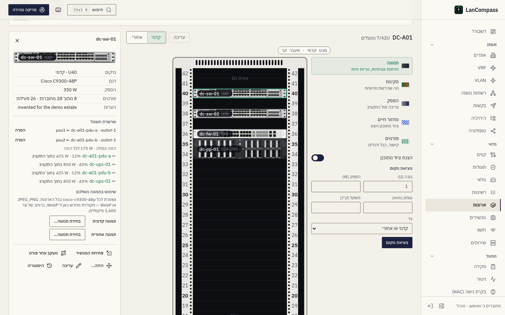

עם גישת כתיבה החלונית מציעה גם:

- **התאמת תמונה** — למכשיר בלי סוג מהספרייה: סוגי ספרייה מדורגים לפי
  היצרן והדגם שלו, כל אחד עם התמונה שלו (דגם זהה קודם, לכל היותר חמישה).
  בחירה באחד מגדירה את סוג המכשיר דרך השמירה הרגילה; **ביטול** מחזיר אותו.
- **שימוש בתמונה משלכם** — בוחר לחזית ובוחר לגב (⁦PNG⁩, ⁦JPEG⁩ או
  ⁦WebP⁩). הדפדפן כותב ⁦WebP⁩ חדש ברוחב של עד ⁦1,600⁩ פיקסלים, כך שאף
  מטא-דאטה מהקובץ המקורי לא עובר איתו, והשרת שומר רק ⁦WebP⁩ קטן מ־⁦1 MB⁩
  במאגר הקבצים המצורפים. תמונה שייכת ל**סוג** המכשיר: כל מכשיר מאותו סוג,
  בכל ארון, מציג אותה מיד, והסרתה חוזרת לתמונת הספרייה ואז לציור. מכשיר
  בלי סוג מקבל קודם סוג מותאם שנקרא לפי היצרן והדגם שלו
  (`custom-<maker>-<model>`), כך שכל מכשיר מאותו יצרן ודגם חולק את התמונה.

### עריכת האלציון

עם גישת כתיבה, מתג ה**Edit** (נזכר לכל דפדפן) הופך את הארון לעורך, עם
**לוח הספרייה** לצידו:

- **גררו** מכשיר: צל עוקב אחרי הסמן, ירוק איפה שהמכשיר נכנס ואדום איפה
  שהוא מתנגש, נצמד ל־U שלם. שחרור על התצוגה האחורית ממקם אותו על הצד
  האחורי (תצוגה קדמית → קדמי) אלא אם הוא `both`. שחרור שלא יכול לנחות לא
  שולח כלום — המכשיר קופץ בחזרה והודעה מציינת מה חוסם. הזזה שנחתה מתיישבת
  בקפיצה קטנה ובהודעה (*⁦sw-1⁩ moved to ⁦U4–U5⁩*) עם **ביטול**.
- **ביטול וביצוע שוב**: העורך זוכר את 50 הצעדים האחרונים — הזזות,
  הרכבות, שינויי גובה וסוג שנקבע ב*התאמת תמונה*. **⁦Ctrl+Z⁩** (⁦⌘Z⁩
  במק) מבטל, **⁦Ctrl+Shift+Z⁩** או **⁦Ctrl+Y⁩** מבצעים שוב, ובסרגל יש
  כפתורי **ביטול** ו**ביצוע שוב**. כל ביטול הוא שמירה אמיתית: אם מישהו
  אחר שינה את המכשיר אחריכם, מקבלים את השאלה *טעינה מחדש / דריסה* במקום
  לבטל את השינוי שלו בשקט. בתוך שדה טקסט ⁦Ctrl+Z⁩ נשאר של השדה.
- **שינוי גובה**: למכשיר בלי סוג מהספרייה, או לפאנל ריק, יש ידית בקצה
  התחתון כשהוא נבחר או במוקד — גררו אותה למטה כדי להגביה את המכשיר, למעלה
  כדי להנמיך אותו (הקצה העליון נשאר במקומו). הגובה החדש עובר את אותה
  בדיקת מיקום, ו־carrier אף פעם לא מתכווץ מתחת לילד הגבוה ביותר שלו.
- **לוח הספרייה** מציג את הספרייה המצורפת ואת תבניות המכשירים שלכם בחיפוש
  אחד (שם, יצרן, דגם — כל מילה שתקלידו), מועדפים קודם (סמנו כוכב על
  רשומה; הכוכבים נזכרים בדפדפן הזה), כל אחד עם התמונה, הגובה והעומק שלו.
  גררו רשומה אל U פנוי, או בחרו בה כדי להוסיף אותה ב־U הפנוי הראשון
  שהיא נכנסת בו: בשני המקרים טופס **הוספת מכשיר** נפתח ממולא מראש עם
  הרשומה וה־U, והשמירה היא השמירה הרגילה (תבנית מוסיפה גם את היציאות
  שלה). ריחוף מעל U פנוי מציג **+ הוספה ב־⁦U{n}⁩**; לחיצה עליו מסננת את
  הלוח לציוד שנכנס שם. **מכשיר מותאם…** פותח טופס ריק באותו U.
- **חריצי carrier**: שחרור מכשיר על חריץ של carrier מרכיב אותו שם (קווי
  חריץ מופיעים בזמן גרירה); גרירת ילד מורכב על שורת U פשוטה מסירה אותו
  מההרכבה.

### מקלדת

הארון הוא עצירת **⁦Tab⁩** אחת. **↑**/**↓** עוברים בין מכשירים (ילדי
carrier מיד אחריו), **⁦Home⁩** ו־**⁦End⁩** קופצים למכשיר העליון והתחתון,
ו־**⁦Enter⁩** או **רווח** פותחים את החלונית. במצב עריכה, **רווח** או
**⁦Enter⁩** מרימים את המכשיר שבמוקד, **↑**/**↓** מזיזים אותו (מדלגים על
חריצים שהוא לא נכנס בהם — אותו צל כמו בגרירה), **⁦F⁩**/**⁦B⁩** קובעים את
הצד, **⁦Enter⁩** מניח אותו ו־**⁦Esc⁩** מחזיר אותו למקום; **הזזה…**
בחלונית מרימה מכשיר באותה דרך. קורא מסך משמיע כל צעד לפי שם המכשיר וה־U,
אף פעם לא מזהה. בתצוגת השורה כל ארון הוא עצירת ⁦Tab⁩ אחת.

### Carriers (מדפים ומגשים)

ארונות אמיתיים מחזיקים ציוד שהוא לא קופסת U-מלאה ברוחב-מלא — מתגים
חצי-רוחב, מגשי RPi, brackets מרובעים. **carrier** הוא מכשיר ארון רגיל
מסומן ב*slot layout*; מכשירים אחרים מורכבים לתוך החריצים שלו:

| Layout | חריצים | מוצג כ |
|---|---|---|
| `halves` | 2 | פיצול אנכי — שמאל / ימין |
| `quarters` | 4 | רשת 2×2 |
| `shelf` | 1 | מגש אחד ברוחב-מלא (שימושי לקיבוץ) |

- ה־carrier תופס את כל טווח ה־U וה־face שלו כמו כל מכשיר; ילדים יורשים את
  מיקום ה־U וה־face שלו (השדות האלה מסתתרים בטופס המכשיר).
- ילד אחד לחריץ; ילד אף פעם לא מתנגש עם מכשירים ברמת הארון — ה־carrier כבר
  שריין את המקום הזה. ילדים מתנגשים רק עם אח באותו חריץ.
- רמה אחת בלבד: carrier לא יכול להורכב בתוך carrier אחר, וילד לא יכול
  להיות גבוה מ־carrier שלו.
- הוצאת carrier מהארון מרימה את כל המגש מחוץ לארון — ילדיו המורכבים עוזבים
  את הארון גם הם אבל נשארים מורכבים עליו (המגש עדיין מחזיק אותם פיזית).
  מכשירים הם שורות מדרגה-ראשונה: הסרת אחד מארון אף פעם לא מוחקת אותו —
  הוא הופך למלאי unracked על עמוד הDevices.
- ספריית המכשירים כוללת starters של **1U dual shelf**, **1U quad bracket**
  ו**Rack shelf**; כל מכשיר יכול להפוך ל־carrier דרך שדה ה*Carrier layout*.

להרכבת מכשיר: בחרו אותו בבחירת ה**Mounted in** של הטופס ובחרו **Slot**, או
גררו אותו על חריץ של carrier בעורך. ילדים מורכבים לא מקבלים את ההרמה
מהמקלדת — החריצים שלהם אינם טווח לינארי.

### עדשות

פס הכלים שליד הארון נפתח ב**עדשה** — חמש דרכים לקרוא את אותן חזיתות,
וכל אחת צובעת אותן בלי להסתיר אותן. העדשה נשמרת בכתובת (`?lens=health`,
והצד כ־`?face=rear`) ונזכרת לכל דפדפן, כך שקישור משותף נפתח בעדשה שבה נלקח.

- **תמונה** — הארון כפי שמצויר למעלה: חזיתות אמיתיות ונוריות חיות.
- **תקינות** — כל חזית מואפרת ל־40% ונצבעת לפי ה־health rollup שלה (בהמשך),
  עם סימן הסטטוס על האוזן הימנית (● פעיל, ◆ שמור, ≈ ⁦DHCP⁩, ✦ התגלה, ✕ לא
  מקוון, ○ לא במעקב): הצבע אף פעם אינו האות היחיד, והסימן של מכשיר שלמטה
  פועם. מכשיר ש**זרימת האוויר** שלו נוגדת את מוסכמת הארון מלפנים לאחור נושא
  חץ כתום שמצביע אל המעבר הקר — ציוד מאחור-לפנים בצד הקדמי, או ציוד
  מלפנים-לאחור ומהצד-לאחור שהופך בצד האחורי; גם החלונית מציינת את ההתנגשות.
- **הספק** — חזיתות צבועות בארבע רצועות של **הספק (W)**: פחות מ־⁦200 W⁩,
  ⁦200–600 W⁩, ⁦600–1,200 W⁩ ויותר מ־⁦1,200 W⁩, וכל רצועה מסומנת גם בפס
  אחד עד ארבעה, עם הוואטים בתווית. מכשיר בלי וואטים נשאר לא צבוע והתווית
  שלו אומרת "אין נתוני הספק".
- **מחזור חיים** — מכשירים מתוכננים מקווקווים בכחול עם מתאר מקווקו, מכשירים
  בהוצאה משימוש מפוספסים בכתום, והסטטוס בתווית. הקווקוו והפסים מופיעים,
  חלשים יותר, גם בכל עדשה אחרת; מכשירים שהוצאו משימוש אינם מצוירים לעולם
  (ההוצאה משימוש מוציאה אותם מהארון).
- **פורטים** — רשת נוריות על כל חזית: קישור, כבל ודגל לכל פורט מתועד (ראו
  *עדשת הפורטים* בהמשך).

ה**מקרא** שמתחת לארון עוקב אחרי העדשה ומונה כל צבע, דוגמה וסימן שהארון
יכול לצייר בה. **הצגת ציוד מתוכנן** (דולק כברירת מחדל; `?planned=0` כשהוא
כבוי) מסתיר מכשירים מתוכננים מהציור ומההשלכה של המדדים — בדיקות המיקום
עדיין רואות אותם.

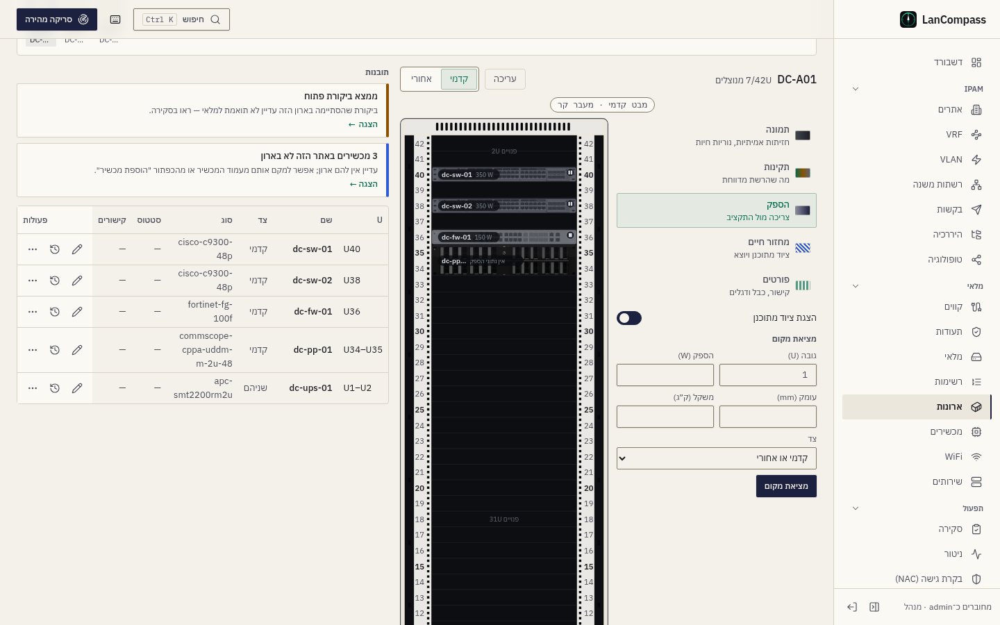

כל עדשה על ⁦DC-A01⁩ של ההדגמה — תמונה, תקינות, מחזור חיים ופורטים מלפנים,
והספק מאחור, איפה שפסי השקעים והכבלים שלהם:

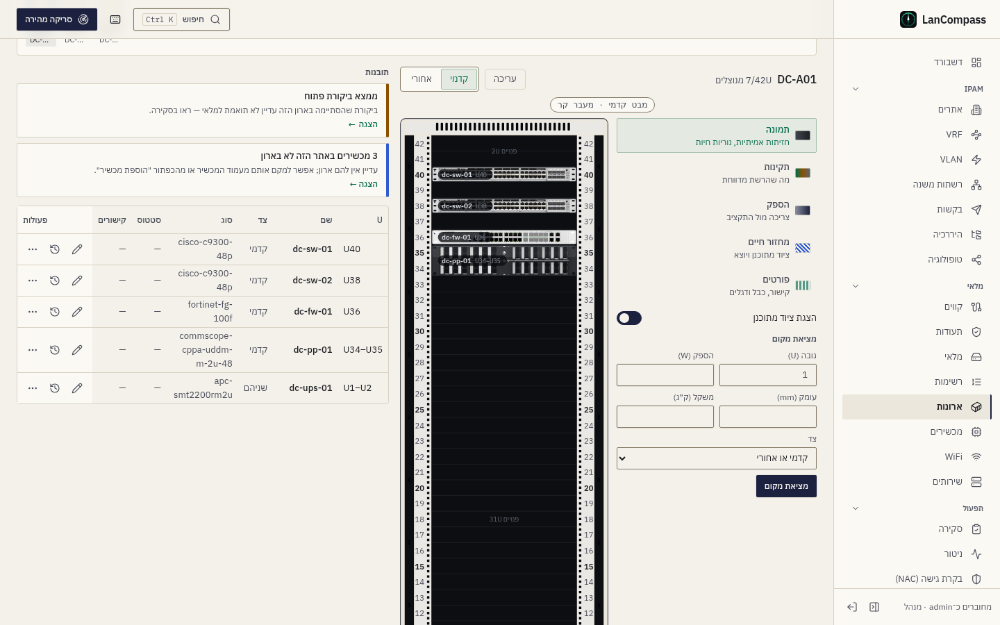
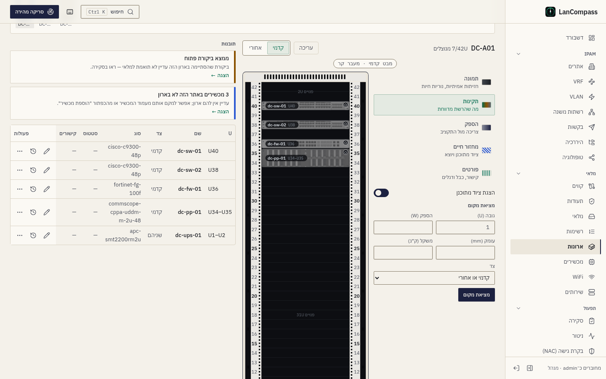

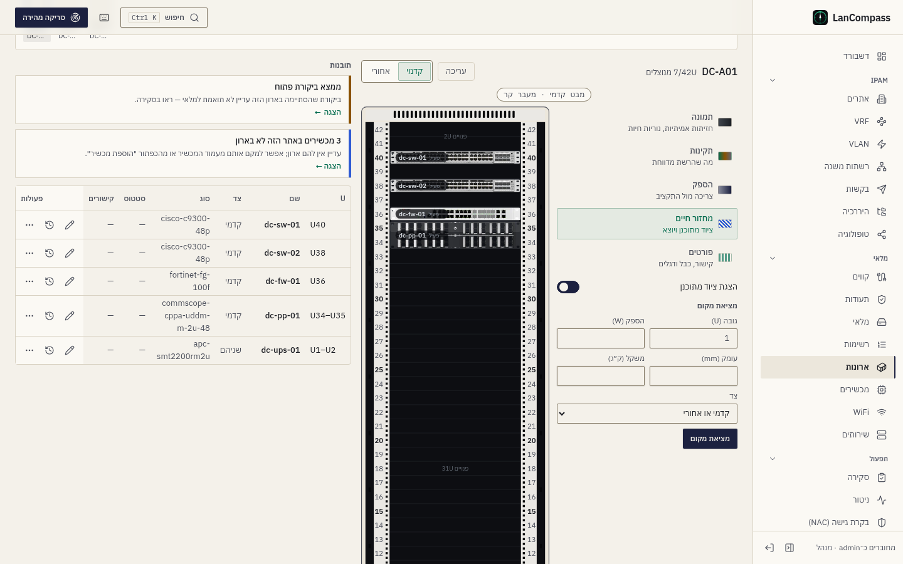
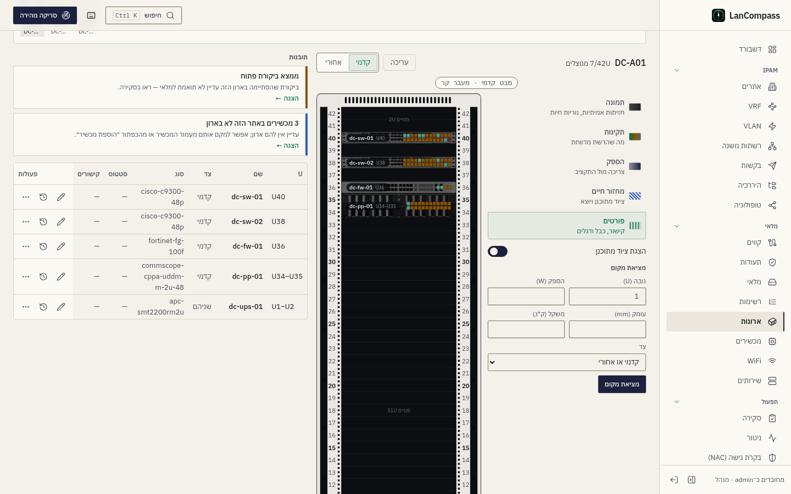

### Health rollup

נורית הסטטוס של כל מכשיר מציגה את ה**health rollup** שלו: הסטטוס הגרוע
ביותר על פני *כל* כתובות ה־IP המקושרות שלו (שרת יכול להיות בעל IP-ים של
mgmt + service + iLO; offline מנצח discovered מנצח dhcp מנצח reserved
מנצח active; כתובת מתועדת שלא עונה נספרת כ־offline — ראו
[מכשירים](/he/docs/devices/)), באותם צבעים כמו טבלת הכתובות:

| נורית | משמעות |
|---|---|
| ירוק | `active` |
| ענבר | `reserved` |
| cyan | `dhcp` |
| violet | `discovered` |
| zinc | `offline` |
| אפור | unmonitored — בלי IP-ים מקושרים |

החלונית מראה את ה־IP שמניע את הבריאות עם תג הסטטוס שלו ו*last seen* יחסי
("לפני שעתיים"); **פתיחת המכשיר** קופצת ל[עמוד המכשיר](/he/docs/devices/) (כל
ה־IP-ים, הקישורים, המיקום שלו). טבלת המכשירים למטה מציגה כל מיקום
מלמעלה-למטה, כולל עמודת Status ל־health rollup.

### מדדים וההשלכה המתוכננת

כותרת הארון נושאת שלושה **מדדים** — **מקום** (ה־U המנוצלים מגובה הארון),
**הספק** ו**משקל** (מול התקציבים שבהמשך), כל אחד עם הערך, הפס והמצב
במילים ("קרוב לגבול · 85%"). ה־U, הוואטים והקילוגרמים של מכשירים מתוכננים
מצוירים כ**קטע מקווקו** אחרי הסכום המותקן, וכשהציוד המתוכנן מוצג המצב
סופר אותו ואומר זאת: "מעל התקציב · 104% · כולל המתוכנן" — הארון מאדים על
המסך לפני שמישהו מתקין את הציוד. כמות בלי תקציב מציגה את הסכום שלה בלי
פס; כמות שאין לה תקציב ואף מכשיר לא מתעד אותה (אין וואטים, אין קילוגרמים)
לא מוצגת. עמודת **קיבולת** ברשימת הארונות מציירת את אותם מדדים מאותם מספרים
(`planned_u`, `planned_power_w` ו־`planned_weight_kg` בשורות הארון של הרשימה), כך
שהרשימה והארון מסכימים. אותם סכומים מופיעים לכל ארון בתצוגת שורת הקבוצה
ולכל קבוצה בכותרת שלה, וכרטיס "קיבולת ארונות" בדשבורד משרטט את
ה־U המנוצל/כולל של הצי עם הארונות המלאים ביותר.

### מציאת מקום פנוי

הכותרת מציגה רמז **next free U** למכשיר קדמי של 1U. בדיאלוג הוסף/ערוך
מכשיר, **Find free U** ליד שדה מיקום ה־U שואל את ה־API על הטווח הרציף
*הנמוך* או *הגבוה* ביותר שמתאים לגובה שהוזן על ה־face הנבחר — מודע-face,
כך שמכשיר קדמי יכול לגיטימית לשבת מול ציוד אחורי באותו U. כדי למצוא ארון
למכשיר במקום חריץ בארון, סינון ה**Free U** של הרשימה (`min_free_u`)
מפלח ארונות לפי קיבולת נותרת — או שאלו את **מציאת מקום** (בהמשך).

### מציאת מקום בארון ובשורה

**מציאת מקום** בפס הכלים שואלת את אותה שאלה כמו זו שברשימה (בהמשך) על
הארון שמולכם ועל השורה שלו: הזינו גובה, וואטים, עומק, משקל וצד, ובקשה אחת
עונה על שניהם.

- **בארון** כל טווח פנוי שהמכשיר נכנס אליו מקבל **מועמד** אחד שנושם בתוך
  הארון ("מתאים · ⁦U31–U32⁩"): ציוד של 20 ק״ג ומעלה תופס את ה־U הנמוך
  בטווח שלו, ציוד קל יותר את הגבוה. מועמד אף פעם אינו מצויר במקום שתקציב,
  העומק או מכשיר אחר היו דוחים בו את המכשיר. כשאין מקום בארון, הפס אומר איזה
  תקציב דוחה אותו — מקום, הספק, משקל או עומק.
- **לחיצה על מועמד** פותחת את **הוספת מכשיר** ב־U הזה עם הגובה, הוואטים,
  המשקל והעומק ממולאים ומחזור החיים **מתוכנן**. השמירה לוקחת את נעילת
  המיקום של הארון כמו כל הוספה, וההוספה היא צעד במחסנית הביטול של העורך:
  **⁦Ctrl+Z⁩** מוציא אותו מהארון (הוא נשאר במלאי), **⁦Ctrl+Shift+Z⁩** מחזיר
  אותו.
- **בשורה** כל ארון מוקטן מעל הארון מקבל פסיקה — "2 מקומות", "אין מקום",
  או התקציב הראשון שדוחה אותו ("הספק 101%") — מאותה תשובה. כשעדשת ההספק
  דולקת, הארונות המוקטנים נצבעים לפי חלק ההספק (או המשקל) שלהם באותם ספי
  80% / 100%.

ה־API הוא `GET /api/v1/racks/find-place` עם `rack_id` (ה־`candidates` של
הארון) ו־`group_id` (ה־`verdicts` של השורה).

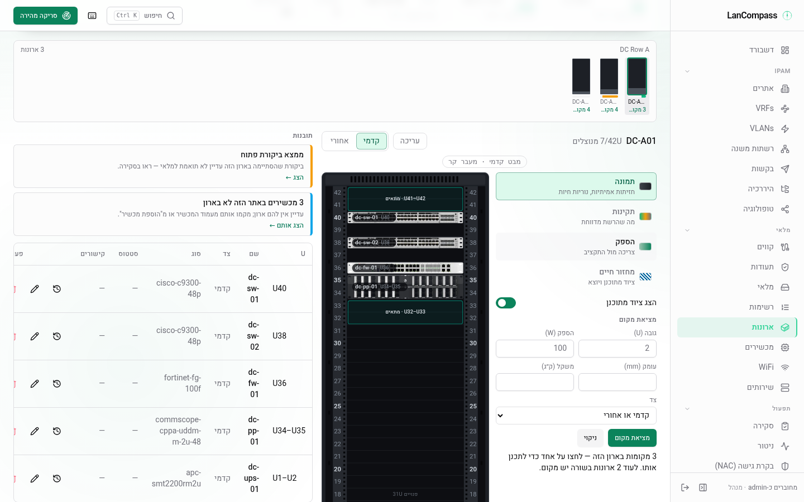

### תובנות

פס ה**תובנות** מדרג מה לא בסדר בארון, החמור ביותר קודם, לכל היותר שמונה
כרטיסים — כל אחד מחושב מהמלאי בכל ביקור, אף פעם לא נכתב ביד: מכשירים
ש**למטה** (ה־health rollup שלהם לא מקוון — המצב של הנורית), תקציב **מעל** 100% או **קרוב**
לגבול, **ציוד מתוכנן** שהיה מעביר תקציב את 80% או 100%, מכשירים ש**זרימת
האוויר** שלהם נוגדת את הארון, **ממצאי ביקורת** פתוחים של הארון (כמו
ב[סקירה](/he/docs/review/), כולל ההתעלמויות), המקום שציוד **בהוצאה משימוש**
יפנה, מכשירים **בלי תמונה** (וכמה מהם *התאמת תמונה* יכולה להתאים), מכשירים
**שאינם בארון** באתר של הארון, והחשמל שבגב הארון (למטה): **פס שקעים מעל
80%** מההספק המדורג שלו, **חוסר איזון** של יותר מ־20 נקודות בין פסי השקעים
של הארון, מכשירים ב**הזנה יחידה** ומכשירים שצורכים חשמל **בלי הזנה מתועדת** —
כל כרטיס נוקב בפסי השקעים או במכשירים שלו. **הצגה** עובר לעדשה ולצד שהכרטיס עוסק בהם,
מעמעם כל השאר ומקיף את המכשירים שהוא מונה לשלוש שניות (מתאר קבוע, בלי
הבהוב, כשמבקשים פחות תנועה); כרטיס התמונות פותח את *התאמת תמונה* על
המכשיר הראשון שהוא יכול להתאים, וכרטיס המכשירים שאינם בארון פותח את רשימת
המכשירים מסוננת אליהם. ה־API הוא `GET /api/v1/racks/{id}/insights`.

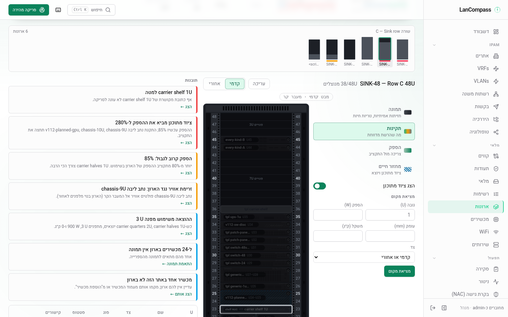

### הגב: פסי שקעים, כבלים והזנות

מבט הגב מצייר את החשמל של הארון ממה שמתועד — שום דבר לא מונח:

- מכשיר ממשפחת **power** (פס שקעים או ⁦UPS⁩) יכול לשאת **הספק מדורג (⁨W⁩)**
  (`power_capacity_w`; כל משפחה אחרת נדחית ב־⁦422⁩). פס שקעים ⁦0U⁩ יושב
  בתעלת הצד שלו עם **צג** — העומס שלו באחוזים מההספק המדורג, בצבע המצב
  (הוואטים שלו כשאין דירוג) — ו**שקעים** מלמעלה למטה: אחד לכל יציאת חשמל
  מתועדת, **מוארים בצבע של פס השקעים רק כשכבל מתועד משתמש בהם**. פס שקעים
  או ⁦UPS⁩ שמצוירים בלי תמונה מראים בדיוק כמה שקעים שיש להם יציאות חשמל.
- **כבל חשמל** מצויר לכל כבל חשמל מתועד (שני הקצוות יציאות חשמל) בין מכשיר
  בארון לפס שקעים: מגב המכשיר אל השקע, בצבע של פס השקעים. בגב מצויר הכבל
  יוצא משקע הכניסה המצויר של היציאה שהכבל נוקב בה; על תמונה הוא יוצא משולי
  התא. מכשיר בלי כבל חשמל לא מצייר כבל.
- השרשרת נקראת מהכבלים בכל בקשה: יציאת החשמל של מכשיר ← שקע בפס ← הכניסה
  של הפס ← המכשיר שמעליו (⁦UPS⁩). הוואטים של מכשיר **מתחלקים שווה** בין פסי
  השקעים השונים שיציאות החשמל שלו מגיעות אליהם; העומס של פס הוא סכום החלקים
  האלה, ושל מכשיר שמעליו — סכום הפסים שלו.
- מד ה**הזנות** בכותרת מצייר פס אחד לכל פס שקעים — העומס שלו מול ההספק
  המדורג; פס בלי דירוג מראה את העומס שלו בלי פס.
- בגב, עדשת **הספק** צובעת לפי **יתירות**: מכשיר שמוזן מפס אחד הוא ב**הזנה
  יחידה** (ענבר, סימן 1), מכשיר עם וואטים ובלי כבל חשמל הוא **בלי הזנה
  מתועדת** (אפור, סימן 0) — אף פעם לא מונחים על שתי ההזנות; מכשיר בהזנה
  כפולה שומר על החזית שלו. המקרא נוקב בשניהם ובצבע של כל פס.
- **שרשרת החשמל** במפקח מונה מכשיר ← פס(ים) ← ⁦UPS⁩ עם העומס והמצב של כל
  צעד, כל אחד פותח את המכשיר שלו, ואת כבלי המכשיר, כל אחד עם **הסרה** למי
  שמורשה למחוק — ההסרה היא צעד במחסנית הביטול של העורך: **⁦Ctrl+Z⁩** מתעד
  את הכבל שוב.

ה־API הוא `GET /api/v1/racks/{id}/power` (לכל פס העומס, ההספק, האחוז, המצב,
השקעים ומה שמעליו; לכל מכשיר הפסים והיתירות שלו; הכבלים).

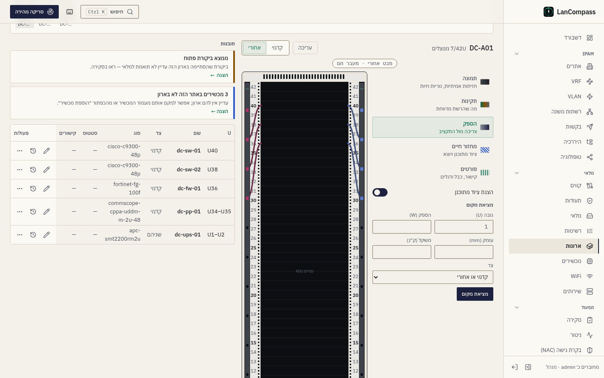

### עדשת הפורטים

העדשה החמישית מציירת את הפורטים המתועדים של כל מכשיר כ**רשת נוריות** מעל
החזית שלו (מעומעמת ל־40%). המצב של פורט בא רק מ־`oper_status` של התשאול,
מהכבל שלו ומדגל הבדיקה שלו, כל מצב עם סימן מלבד הצבע — נורית מלאה היא
קישור, חלולה — לא דווח קישור; קו מתחתיה הוא כבל; דגלון הוא דגל:

- **בקישור, מחווט** (ירוק) · **בקישור, אין כבל מתועד** (ענבר) · **מסומן
  בדגל** (אדום, הדגלון) · **מחווט, לא דווח קישור** (חלולה, עם קו — פורט
  ⁦patch⁩ פסיבי תמיד נראה כך) · **ריק** (חלולה).
- פורט בלי כבל ששכן ה־⁦LLDP⁩ או ה־⁦CDP⁩ שלו נושא את הדגל `lldp_neighbor`
  מצייר **קו מקווקו צועד** אל שבב על המכסה העליון: "⁦Gi1/0/24⁩ ←
  ⁦rogue-sw-07⁩ · ⁦LLDP⁩ · אין כבל מתועד" (עם "+2" כשליותר פורטים יש כזה).
  השבב נוקב בפורט שבחרתם, אחרת בעליון; לחיצה עליו פותחת את פריט הקישור
  הנסתר של אותו פורט ב[סקירה](/he/docs/review/) (`/review?ghost_iface=`), שם
  **תיעוד** ממלא את טופס הכבל.
- **אי-התאמות מהירות ו־⁦MAC⁩** של ⁦v110⁩ הן דגלים שה־tooltip שלהם נוקב בערך
  המתועד ובערך שנצפה.
- מצב הכבל: כבל **מתוכנן** מקווקו את מתאר הפורט, כבל **בהוצאה משימוש**
  מפוספס — בעדשת הפורטים, בעדשת מחזור החיים (שמציירת רק את הפורטים האלה)
  ועל כבלי החשמל בגב. המקרא נוקב בשניהם.

לחיצה על פורט, או **→** / **←** על מכשיר במוקד, פותחת את ה**חלונית** שלו:
שם, סוג, קישור, מהירות שנצפתה ומתועדת, כבל והצד השני, שכן; מקשי החיצים
עוברים בין הפורטים של המכשיר (הציור פיזי — משמאל לימין בכל שפה), **⁦Esc⁩**
חוזר למכשיר. **חיווט…** על פורט בלי כבל פותח את דיאלוג הכבל של דף המכשיר,
ממולא בפורט הזה, וכשהשכן שלו מוביל ליציאה מתועדת פנויה אחת — גם בה; השמירה
עוברת בכתיבת הכבל הרגילה עם שורת יומן השינויים שלה. **מעקב נתיב** מאיר את
הנתיב (למטה). ה־API הוא `GET /api/v1/racks/{id}/ports`.

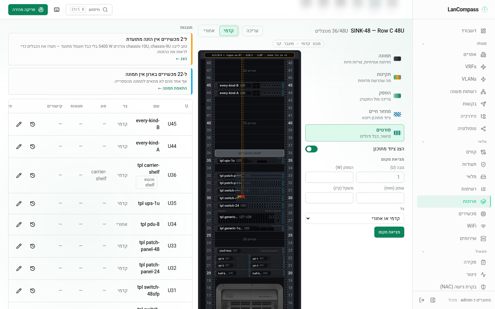

### מעקב על הארון ולאורך השורה

**מעקב נתיב** בחלונית של פורט הולך בנתיב המתועד (אותה הליכה של מעקב דף
המכשיר, לכל היותר 64 כבלים) ומאיר את הפורט של כל צעד בארון הזה בכל עדשה:
טבעת בצבע המעקב, **ענבר** כשהקו לא תואם (הצעד שגיליון המעקב מסמן), **שני
פורטי הקצה מהבהבים** (קבועים כשמבקשים פחות תנועה או כשהאפקטים רגועים או
כבויים), ופס עצירה אדום במקום שבו הליכה קטועה נעצרה. פס המעקב בסרגל הכלים
אומר **שלם** או מאיפה הנתיב ממשיך, כמה צעדים לא תואמים ובכמה ארונות הוא
עובר; **רשימת הצעדים** פותחת את גיליון המעקב, **לאורך השורה** פותח את מבט
השורה עם המעקב (`?trace=`), שם כל ארון שהוא עובר בו מאיר את הצעדים שלו
והנתיב מצויר לאורך הארונות — מקווקו מעל צעד שמחוץ לשורה.

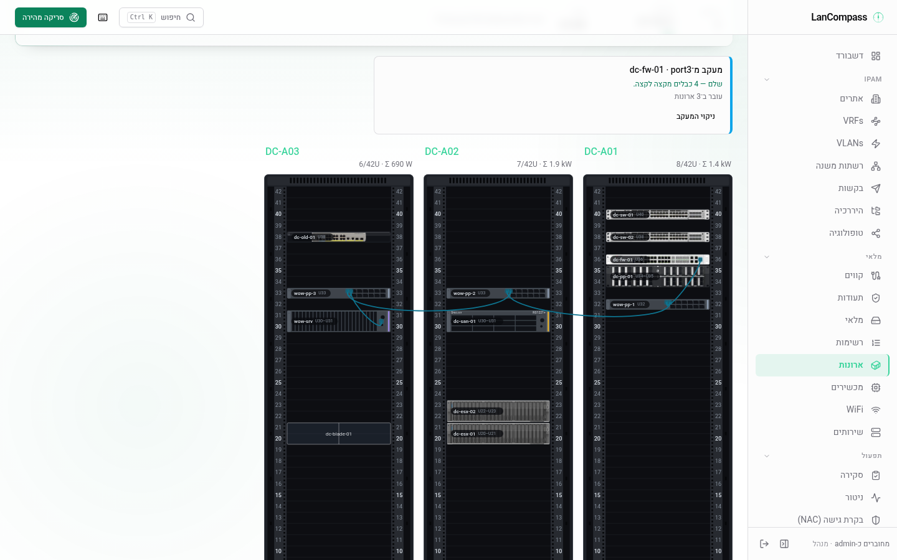

## מקרא סטטוסים

כל סטטוס ב־LanCompass הוא אחת משבע משמעויות, ולכל אחת צבע משלה וצורה
משלה, כך שהוא נקרא גם בהדפסה בשחור-לבן וגם בעיוורון צבעים:

| צורה | משמעות | לדוגמה |
|---|---|---|
| ● עיגול מלא | תקין | כתובת פעילה, סריקה שהושלמה |
| ▲ משולש | דורש תשומת לב | כתובת שמורה, תעודה שתוקפה עומד לפוג |
| ■ ריבוע | תקלה | ניטור במצב למטה, סריקה שנכשלה, כתובת לא מקוונת |
| ○ טבעת | מידע | כתובת DHCP, סריקה בתור |
| ▬ קו | לא פעיל או לא ידוע | ניטור במצב לא ידוע, סריקה שבוטלה |
| ✦ כוכב בן ארבע קצוות | התגלה | כתובת שהגילוי מצא ואיש לא תיעד |
| ◉ עיגול עם טבעת | חי | ניטור במצב למעלה, סריקה שרצה |

בתצוגת הארון נורית ה־LED של כל מכשיר באוזן השמאלית מציירת את הסימן של
הכתובת שלו בצורה הזו, והמקרא של קבוצת ארונות מציג את אותם סימנים.

## קיבולת

לארון יכולים להיות שלושה תקציבים ומספור U — כולם בדיאלוג הארון, כולם
רשות, ואף אחד לא מנוחש: לארון קיים אין תקציב עד שמישהו מזין אחד.

- **תקציב הספק (W)** (`power_budget_w`) — הוואטים שההזנה של הארון יכולה
  לשאת. ההספק של הארון הוא סכום ה־**Power (W)** של המכשירים בו, כולל
  מכשירי 0U.
- **משקל מרבי (ק״ג)** (`max_weight_kg`) — אותו דבר מול סכום ה־**Weight
  (kg)** של המכשירים.
- **עומק התקנה (מ״מ)** (`depth_mm`) — מיקום מכשיר עמוק מהארון נדחה ושני
  העומקים נקובים בשמם ("srv-01 is 1000 mm deep — the ארון takes 600 mm"),
  ואי אפשר להפוך ארון לרדוד ממכשיר שכבר נמצא בו. מכשיר בלי עומק, או ארון
  בלי עומק, לא נבדק.

**מצבים.** מול כל תקציב הארון מוצג **בתוך התקציב** מתחת ל־80%, **קרוב
לגבול** מ־80% עד 100%, ו**מעל התקציב** מעל 100% — מחושב בכל קריאה, אף
פעם לא נשמר. הכותרת של הארון ועמודת **קיבולת** ברשימה מציירות פס אחד לכל
תקציב עם המצב במילים, כך שארון מעל התקציב נקרא כאזהרה בכל ערכת נושא ובכל
שפה. ארון בלי תקציב מציג וואטים וקילוגרמים כמו קודם ובלי מצב. הסינון
**תקציב הספק** ברשימה (`power_state`: `ok`, `warn`, `over`, `none`)
והשדה **לפחות וואט פנויים** (`min_power_free_w`, רק ארונות עם תקציב) הם
פרמטרים ב־URL כמו שאר הסינונים, וגם הייצואים מקבלים אותם. הרשימה *ארונות לפי
הספק* והכרטיס *קיבולת ארונות* בדשבורד מציגים אחוז מהתקציב לארון שיש לו
תקציב.

**עומק וזרימת אוויר במכשירים.** למכשיר (ולתבנית) יש **עומק (מ״מ)**
(`depth_mm`) ו**זרימת אוויר** (`airflow`: `front_to_rear`,
`rear_to_front`, `side_to_rear`, `passive`). זרימת האוויר לידיעה בלבד —
היא אף פעם לא חוסמת מיקום. העומק וזרימת האוויר של תבנית מגיעים לכל מכשיר
שנוצר ממנה, וכרטיס המיקום בעמוד הארון ובעמוד המכשיר מציג את שניהם. תבנית
ה־*carrier-shelf* המובנית יוצרת carrier (חריץ מדף אחד) — לתבנית יש
`slot_layout` משלה.

**מכשירי 0U.** מכשיר עם **גובה 0** (`u_height: 0`) — פס שקעים אנכי, מנהל
כבלים — ממוקם בארון בלי מיקום U: הוא אף פעם לא תופס חריץ ואף פעם לא
מתנגש. הוא מצויר ב**תעלת הצד** של הארון לפי ה**צד** שלו (`mount_side`:
שמאל או ימין; שמאל כשלא נקבע), כמה באותו צד זה מתחת לזה, בפן שעליו הוא
מותקן — כל מכשירי ה־⁦0U⁩ של הארון נשארים גלויים. רק מכשיר ⁦0U⁩ מקבל צד (מכשיר
עם גובה ⁦U⁩ נדחה ב־⁦422⁩). ההספק והמשקל שלו נספרים בתקציבים של הארון.

**מספור U.** **תווית ה־U הראשונה** (`starting_unit`, ברירת מחדל 1)
ו**מספור U** (`desc_units`: סופרים כלפי מעלה מלמטה, ברירת המחדל, או כלפי
מטה מלמעלה) משנים רק את התוויות — באלציון, בגיליון המודפס, ב־SVG שמורידים,
בביקורת בטלפון, בעמוד המכשיר ובעמודת `u_label` של הייצוא. המיקומים השמורים
נשארים פיזיים (U1 הוא החריץ התחתון), כך שמכשיר שמוקם לפני השינוי שומר את
החריץ שלו, וייבואים ממשיכים להשתמש ב־`u_position`.

**מציאת מקום.** **מציאת מקום** ברשימת הארונות עונה על "לאן הולך מכשיר של
2U, ‏500 W, ‏600 mm באתר הזה?" בחרו אתר, גובה (0 למכשיר 0U), צד (או קדמי
או אחורי), ואיזה מבין הספק, משקל ועומק שיש. התשובה מונה כל ארון שבו המכשיר
נכנס במקום, בהספק, במשקל ובעומק, הכי הרבה מרווח קודם, עם ה־U הפנוי הנמוך
בכל צד שנשאל; **למקם כאן** פותח את הארון ב־U הזה עם טופס ההוספה ממולא
מראש. הארונות שהוא לא נכנס בהם באים אחריהם, באפור, וכל אחד אומר למה —
"הספק 101% מהתקציב", "משקל 104% מהתקציב", "עומק 1000 mm, הארון מקבל 600
mm", "אין 2U פנויים בצד המבוקש" — כך שארון מלא של 40 kW מוסבר במקום
להיעלם. אותה תשובה היא `GET /api/v1/racks/find-place` (`height`,
`site_id`, `face`, `watts`, `weight_kg`, `depth_mm`).

**ייבואים.** חוברת הארונות וה־CSV של הארונות נושאים `power_budget_w`,
`max_weight_kg`, `depth_mm`, `starting_unit` ו־`desc_units`; גיליון
המכשירים נושא `depth_mm`, `airflow` ו־`u_height` של 0 — הייצוא שלכם חוזר
עם התקציבים. ייבוא NetBox שומר את ה־`max_weight` של ארון (מומר מה־`weight_unit`
שלו לק״ג), את ה־`mounting_depth` שלו (אחרת `outer_depth` ב־`outer_unit`
שלו), `starting_unit` ו־`desc_units`, ואת ה־`airflow` של סוג מכשיר; סוג
בעומק מלא עדיין ממוקם על שני ה־faces ושומר עומק כשהקובץ נותן אחד.

## ייצוא וייבוא

ארון הוא לא שורה — הוא עץ: קבוצה → ארונות → מכשירים (→ carriers → ילדים →
ממשקים → כבלים). תפריט ה**Export** של סרגל הכלים מכסה את שתי הצורות:

- **CSV (this view)** — שורות ארון שטוחות לסט *המסונן הנוכחי* (פרמטרי
  facet ה־URL רוכבים יחד, כך שתצוגה מסוננת מייצאת בדיוק מה שהיא מציגה;
  שם הקובץ מסמן אותו `racks-filtered.csv`). עמודות:
  `id, name, site, group, group_position, room, height_u, width,
  device_count, used_u, free_u, power_w, weight_kg, description, notes,
  created_at` — `columns=` מרשים אותן לייצואים רזים.
- **XLSX bundle (this view)** — workbook רב-גיליוני שנושא את כל העץ:
  `groups` (רק הקבוצות שהארונות המיוצאים מפנים אליהן), `racks` (הסט השטוח
  למעלה), `devices` (סט עמודות ייצוא המכשירים — ארון, אתר ו־carrier כולם
  לפי **שם**), בתוספת `interfaces` ו`cables` כשלמכשירים יש (נקודות קצה של
  כבל מכובתבות לפי שמות מכשיר + ממשק — ids חסרי-משמעות בין התקנות).

**Export .xlsx** של כותרת פרטי הארון מוריד חבילה של ארון בודד (כולל
שורת הקבוצה שלו כך שהוא מיובא-מחדש נקי); **Export group** של עמוד קבוצה
מוריד את כל השורה — קבוצה, ארונות חברים בסדר מיקום, כל מכשיר והציווט שלו —
כ`{group}.xlsx`.

**Import** (הרשאת כתיבה) משתמש מחדש בדיאלוג הייבוא-החכם: בחרו CSV שטוח
של ארונות או workbook של bundle — גיליונות מזוהים לפי חתימת הכותרת שלהם
(גיליונות לא-מוכרים מזהירים ומתעלמים; כינויי אנגלית/עברית ממופים על כל
גיליון). **Run preview** מציג את הפעולה של כל שורה מקובצת לכל גיליון —
אתרים מופנים על ידי ה־bundle נוצרים כשחסרים (ורק כששורה תחתיהם נשמרת, כך
ששמירה חלקית לעולם לא משאירה אתר ריק), קבוצות וארונות מתאימים לפי
`name`+`site` (שם לבד כשלא-דו-משמעי; תא `id` רק בוחר בין שורות באותו שם —
קובץ ממערכת אחרת לעולם לא משנה שם או אתר של שורה שלכם), מכשירים לפי כללי יבואן
המכשירים עם שמות מצומצמים לארון היעד, ממשקים לפי device+name, כבלים לפי
צמד נקודות-קצה נרשות. התנגשויות מיקום, שמות דו-משמעיים ונקודות-קצה
לא-נרשות הן שורות שגיאה — אף פעם לא נרשות בשקט. **כשארון מתאים**: `skip`
לא נוגע בכלום בתת-העץ שלו, `update` מטאל שדות ארון ואז מחיל את שורות
המכשירים, `merge` שומר יושבים ורק מוסיף מכשירים לחריצי U פנויים. *מכשירים*
מתאימים עוקבים אותו מצב — `update` ממקם-מחדש אותם לפי הקובץ (מלאי unracked
כלול), בעוד `skip`/`merge` משאירים אותם במקום; ילד carrier שהמגש שלו לא
מאורגן מדווח skip במקום שגיאה. **Replace devices** מוציא מהארון את היושבים
הנוכחיים של ארון מתאים קודם — הם שורדים כמלאי unracked, אף פעם לא נמחקים.
Commit הוא טרנזקציה אחת; `force` מבצע את השורות התקפות למרות שורות שגיאה.
**Import into this group** של עמוד קבוצה שולח את אותו דיאלוג עם
`?group_id=` — כל ארון מיובא מצטרף לקבוצה הזו בלי קשר לעמודת הקבוצה של
הקובץ. ייצוא קבוצה מיובא-מחדש להתקנה ריקה בונה מחדש את העץ הזהה.

## סקיצת API

```
GET    /api/v1/racks?q=&site_id=&group_id=&ungrouped=&room=&height_u=
       &occupancy=&min_free_u=&max_free_u=&power_state=&min_power_free_w=
       &audit_due=
                                   # כל facet של עמוד הוא פרמטר; סטי CSV
                                   # (height_u=42,24), סמנטיקת AND, 422 על
                                   # ערכים גרועים; facets של תפוסה/U פנוי/הספק/
                                   # ביקורת אחרי aggregate ה-used_u כך שהסך נשאר הוגן
GET    /api/v1/racks/{id}           # הארון + המכשירים שלו (0U בנפרד), ניצול
                                    #   התקציבים ומצבם, audit_due_at
GET    /api/v1/racks/find-place?height=&watts=&weight_kg=&depth_mm=&face=
       &site_id=&rack_id=&group_id= # הארונות שמכשיר נכנס אליהם (ולמה לא);
                                    #   מועמדים בארון אחד, הכרעות לשורה
GET    /api/v1/racks/{id}/insights  # כרטיסי התובנות, החמור ביותר ראשון
GET    /api/v1/racks/{id}/power     # פסי שקעים, עומסים, יתירות, כבלים
GET    /api/v1/racks/{id}/ports     # כל פורט נתונים מתועד והמצב שלו
GET    /api/v1/racks/{id}/next-free-u?height=
GET    /api/v1/racks/export.csv     # אותם פרמטרים + columns= whitelist
GET    /api/v1/racks/export.xlsx    # אותם פרמטרים -> bundle של groups/racks/devices
                                    #   (+interfaces/cables)
GET    /api/v1/racks/{id}/export.xlsx          # bundle של rack-בודד
GET    /api/v1/rack-groups/{id}/export.xlsx    # קובץ הקבוצה
GET    /api/v1/rack-groups/{id}     # השורה: סיכום לכל ארון (ספירה,
                                    #   U בשימוש, הספק, משקל), בלי שורות מכשירים
GET    /api/v1/racks/elevations?ids=1,2,3   # שורות המכשירים של עד 24 ארונות
POST   /api/v1/racks/import         # קובץ גולמי + filename=; dry_run=1 (ברירת מחדל),
                                    # on_existing=skip|update|merge,
                                    # replace_devices, group_id=, mapping=,
                                    # force, detect
```

## כללי מיקום

- `u_position` הוא ה־U **התחתון** של המכשיר, נספר מ־1 — החריץ הפיזי, מה
  שלא תגיד הספירה של הארון (*סופרים כלפי מטה מלמעלה* והתווית הראשונה משנים
  רק את מה שמודפס).
- קדמי + אחורי באותו U בסדר; קדמי + קדמי (או אחורי + אחורי) באותו U נדחה
  עם שגיאת התנגשות (⁦409⁩). מכשיר `both`-face מתנגש עם כל דבר שחופף את הטווח שלו.
- מכשירים לא יכולים להתחיל מתחת ל־⁦U1⁩ או להתרחב מעל `height_u` (⁦422⁩).
- מכשיר עמוק מעומק ההרכבה של הארון נדחה (⁦422⁩, שני העומקים בהודעה); כשאחד
  העומקים לא ידוע — אין בדיקה.
- מכשיר **⁦0U⁩** (`u_height` 0 — פס שקעים אנכי, מנהל כבלים) לא תופס U ואף
  פעם לא מתנגש; אין לו `u_position`, הוא יושב בתעלת צד (`mount_side`, שמאל
  כשלא נקבע) והוא לא יכול להיות carrier ולא להיות מורכב בתוך אחד.
- ילדי carrier מדלגים לגמרי על הבדיקות ברמת הארון — ה־carrier שלהם כבר תופס
  את ה־U וה־face ההם. הם מתנגשים רק עם אח שחולק אותו חריץ. carriers לא
  מקוננים, ילד אף פעם לא גבוה מה־carrier שלו, והחריץ שלו בתוך הפריסה של
  ה־carrier (חצאים 2, רבעים 4, מדף 1).
- שתי הצבות באותו ארון באותו רגע נלקחות אחת אחרי השנייה (שורת הארון ננעלת
  קודם), כך ששני אנשים אף פעם לא ממלאים U אחד פעמיים. טופס ששומר מעל שינוי
  שמישהו עשה מאז שנפתח מקבל ⁦409⁩ *stale* ומציע *טעינה מחדש* או *דריסה*.
- מכשיר יכול לקשר ל[נכס](/he/docs/inventory/) וכל מספר של כתובות IP — ראו
  [מכשירים](/he/docs/devices/). מחיקת ארון מוציאה מהארון את המכשירים שלו (הם
  שורדים); מחיקת *מכשיר* נעשית מעמוד שלו.

## round-trip של Rackula

ל־⁦LanCompass⁩ יש עורך drag-and-drop משלו (מתג ה־**Edit** שלמעלה). לצוותים
שמסדרים ארונות ב־[Rackula](https://github.com/RackulaLives/Rackula), הוא גם
עושה איתו round-trip:

- **Open in Rackula** — מופיע על עמוד הארון ברגע שאדמין מגדיר את *Rackula
  instance URL* תחת [Settings → Features](/he/docs/settings/). הוא פותח את
  ה־layout שלכם באותו instance דרך share URL.
- **.Rackula.zip** — מוריד את הארון כארכיון layout של Rackula (ייבאו אותו
  ב־UI של Rackula באותה דרך).
- **Import from Rackula** — הדביקו share URL של Rackula או העלו
  `.Rackula.zip`; תצוגה מקדימה מציגה אילו מכשירים יתווספו, אילו מתנגשים עם
  מיקומים קיימים, ואילו מדולגים (ציוד תת-U אין לו שקילות ב־⁦LanCompass⁩).
  carriers של Rackula מיובאים כמגשי carrier וילדי המכולה שלהם מורכבים
  לחריצים — מגשים נוצרים-אוטומטית של Rackula מגיעים כ־carrier ב־layout
  "shelf" בשם **Shelf**. בחרו **merge** (שמור קיימים, דלג על התנגשויות) או
  **replace** (קודם מוציא מהארון את המכשירים הנוכחיים — הם שורדים כמלאי unracked,
  אף פעם לא נמחקים). מכשירים מיובאים נושאים תג מקור `rackula`. מכשיר בלי
  *סוג מכשיר* יוצא תחת סוג Rackula מסוג `untyped-…` וחוזר עם סוג ריק —
  הייבוא לעולם לא ממציא סוג מתוך שם.

## הדפסה ותוויות

- **Print** פותח `/racks/[id]/print`: העמוד הראשון הוא גיליון הארון —
  כותרת, **אלציונים קדמי ואחורי זה לצד זה** ותווית ה־QR — במידה שבה ארון של
  42U או של 52U נכנס בעמוד אחד; טבלת המכשירים המלאה (טווח U, face, סוג,
  נכס מקושר ו־IP + סטטוס) מתחילה בעמוד השני. בחרו נייר מעל הגיליון: **A4**
  (ברירת המחדל) או **A3**, **לאורך** או **לרוחב** (`?paper=A3-landscape`
  מקשר לבחירה). שמרו כ־PDF דרך דיאלוג ההדפסה של הדפדפן.
- **הורדת SVG** שומרת את אותו גיליון — כותרת, קדמי ואחורי — כקובץ `.svg`
  אחד. תמונות הספרייה מוטמעות בקובץ, כך שהוא נפתח גם בלי רשת בדפדפן,
  ב־Inkscape או ב־LibreOffice Draw.
- **QR** פותח דיאלוג עם קוד QR שמצביע ל־URL האלציון החי של הארון.
  **Print label** פותח כרטיס מדבקה מינימלי (QR + שם + URL) מדוד לתווית
  פיזית — הדביקו אותה על הארון וסרקו לפתיחת התצוגה החיה. אותו QR מופיע
  ב־footer דוח ההדפסה.
- **הכתובת שב־QR** היא ההגדרה *כתובת ציבורית* (`public_base_url`, תחת
  [Settings → Features](/he/docs/settings/)) כשמנהל מגדיר אותה — הכתובת שבה
  טלפונים ברשת שלכם מגיעים ל־⁦LanCompass⁩, למשל `https://ipam.example.lan`.
  ריקה (ברירת המחדל) — נעשה שימוש בכתובת של הדפדפן שהדפיס את התווית, כך
  שתווית שהודפסה מ־`localhost` נפתחת רק באותו מחשב.

## ביקורות ארון (ריקונסיליאציה פיזית)

הסורק מיישב את הרשת מול המלאי; **ביקורת** עושה את אותו הדבר לארון עצמו —
רצוי (מסד הנתונים) מול נצפה (מה שבאמת מוברג בפנים). זהו תהליך walk-up,
ברוחב-טלפון בכוונה:

1. **להגיע לשם.** סרקו את תווית ה־QR של הארון והקישו **התחלת ביקורת**
   בדף התווית — הביקורת מתחילה מיד (ביקורת שכבר פתוחה על הארון נפתחת
   במקומה) — או **התחלת ביקורת** בכותרת פרטי הארון. שתיהן מובילות
   ל־`/racks/[id]/audit`.
2. **ללכת לאורך הארון.** מלמעלה למטה: כל מכשיר צפוי מקבל שורה, ה־U הגבוה
   ראשון — השם, ומתחתיו ה־U וה־face הצפויים — עם שלושה כפתורים: **✓ אומת**,
   **⇅ הוזז** (פותח משנה U + בורר face של
   איפה שהוא באמת יושב), **✗ חסר**. צ׳יפ התקדמות סופר
   (`7/12 checked`); הקשה חוזרת על תוצאה מנקה אותה. חומרה שלא במלאי הולכת
   לתיבת **דיווח על מכשיר בלתי צפוי** בתחתית — שם ו־U אופציונלי.
3. **סיום ← דוח אי-התאמות.** **Finish** פותח את הדוח: קבוצות *הוזזו*,
   *חסרים* ו־*בלתי צפויים*, כל שורה נושאת את התיקון שלה:
   - **הוזז** ← *יישום ההזזה* מטאל את מיקום המכשיר דרך נקודת הקצה הרגילה —
     בדיקות גבול/התנגשות ורשומת changelog כלולים.
   - **חסר** ← *הוצאה מהארון* (ההוצאה הרגילה של מכשיר מהארון: המיקום מתרוקן,
     המכשיר שורד כמלאי לא-מאורגן) או *מחיקה* (דורש הרשאת מחיקה + אישור
     מוקלד).
   - **בלתי צפוי** ← *הוספה כמכשיר* פותח את טופס המכשיר הרגיל ממולא מראש
     עם ארון, U והשם הנצפה; *התעלמות* משאירה את התצפית ברשומת הביקורת אך
     מוציאה אותה מספירות הסיכום.
4. **סגירת הביקורת** שומרת את הסיכום — ספירות אומת/הוזז/חסר/בלתי-צפוי
   ועוד `corrections_applied`, שהשרת סופר: שינויי המיקום (הזזות, שינויי
   face, הוצאות מהארון, מחיקות) שנעשו במכשירי הביקורת בין ההתחלה לסגירה.
   מספר שלקוח שולח נדחה, ועריכה שאינה נוגעת במיקום אינה נספרת.

בטלפון כל כפתור בביקורת הוא לפחות 44 פיקסלים, והודעות מופיעות בראש המסך,
הרחק מהכפתורים.

הערות על הסמנטיקה:

- ביקורת פתוחה אחת לארון — שתי התחלות באותו רגע פותחות ביקורת אחת; השנייה
  עונה 409 עם שם הביקורת הפתוחה (`audit_id`), והעמוד פותח את הביקורת הזו
  במקום (`?restart=1` נוטש אותה, נרשם כ־`{"aborted": true}`).
- ביקורות הן סנאפשוטים: ההתחלה מעתיקה `expected_u_position`/`face`/שם לכל
  פריט, כך שמכשיר שנמחק אחר-כך עדיין קריא בהיסטוריה (קישור ה־`device_id`
  מתאפס; הסנאפשוט נשאר). מחיקת הארון מוחקת את ביקורותיו — הן מתארות אותו.
- סיום לעולם אינו משנה מכשירים, ושום דבר לא נועל את הארון באמצע ביקורת —
  ביקורת היא רשומת ממצאים, לא טרנזקציה.
- **היסטוריה**: דף פרטי הארון מציג ביקורות קודמות (האחרונה ראשונה) עם
  צ׳יפים של סיכום ופריטים מתרחבים.
- **מרכז הסקירה**: תחת `/review`, *ממצאי ביקורת ארון* מציג ביקורת שנשארה
  פתוחה מעל 7 ימים וכל ממצא לא פתור של ביקורת שהסתיימה — סימני *חסר* שעדיין
  מצביעים על מכשירים בארון, ציוד *בלתי צפוי* שלא נדחה ולא נוסף כמכשיר
  בארון, וסימני *הוזז* שהמכשיר שלהם עדיין יושב ב־U הצפוי. כל אחד נעלם
  כשהמלאי מסכים עם מה שנראה.
- הרשאות: קריאת היסטוריה דורשת `data:read`; הרצת ביקורת
  (התחלה/סימון/סיום) דורשת `data:write` — צופה לא רואה כפתור *התחלת
  ביקורת*; ה*מחיקה* בדוח דורשת `data:delete` כמו בכל מקום.

### לוחות זמנים לביקורת וביקורות שהגיע מועדן

לארון אפשר לקבוע **מרווח ביקורת**: בחלון העריכה של הארון, **מרווח ביקורת**
מציע *כל 30, 90, 180 או 365 ימים*, *מותאם אישית…* (כל מספר ימים עד 3,650)
או *ללא לוח זמנים* (ברירת המחדל). ארון ללא לוח זמנים אף פעם לא מגיע למועד.

הביקורת הבאה של ארון מתוזמן נדרשת בתום המרווח שלו מאז **הביקורת הסגורה
האחרונה** — או מאז שהארון נוצר, אם מעולם לא נערכה בו ביקורת. ביקורת שננטשה
בהתחלה מחדש אינה נספרת, וביקורת פתוחה אינה סוגרת דבר. המועד מחושב בכל
קריאה, כך שסגירת ביקורת מזיזה אותו מיד.

כשמגיע מועד הביקורת של ארון, הדבר מופיע בארבעה מקומות:

- **רשימת הארונות** — תג *נדרשת ביקורת* ליד השם, והמסנן **נדרשת ביקורת**
  (בכתובת `?audit_due=1`, וגם תצוגה שמורה; ייצוא ה־⁦CSV⁩ וחוברת העבודה
  מכבדים את אותו מסנן).
- **סקירה** — המדור *ביקורות ארון שהגיע מועדן* מציג כל ארון כזה עם האתר
  שלו, מועד הביקורת וכמה ימים עברו ממנו; הפריט מוביל לדף הביקורת של הארון.
  התעלמות ממנו תקפה רק לאותו מועד.
- **דף הארון** — כרטיס תובנה *נדרשת ביקורת מאז {תאריך}*; הפעולה שלו פותחת
  את *התחלת ביקורת*.
- **התראות** — פעם ביום תהליך הרקע שולח `rack.audit_due` לכל ארון שהגיע
  מועדו, **פעם אחת לכל מועד** (מועד חדש — אחרי הביקורת הסגורה הבאה — שולח
  התראה חדשה). ערוץ או מינוי שמנתבים `rack.*` או `rack.audit_due` מקבלים
  אותה.

בראש היסטוריית הביקורות של הארון מופיעים המרווח ומועד הביקורת הבאה — או,
בארון שמועדו הגיע, שנדרשת ביקורת ומאז מתי.

### תמונות של ממצאים

לכל פריט בביקורת בטלפון יש **הוספת תמונה**: בטלפון היא פותחת את המצלמה
האחורית (במקום אחר — כל קובץ תמונה). הדפדפן מקטין את התמונה לכל היותר
ל־**1,600 פיקסלים** בצלע הארוכה ושומר אותה כ־**⁦JPEG⁩ באיכות 0.82** לפני
ההעלאה — הציור מחדש משמיט את המטא-נתונים של המקור, כך שלא נשמר מיקום
⁦EXIF⁩. התמונה היא קובץ מצורף רגיל על פריט הביקורת, במאגר הקבצים המצורפים
של ההתקנה עצמה (אותה תקרה של ⁦6 MB⁩ ואותם סוגי תמונות); שום דבר לא נשלח
לשירות חיצוני.

תמונות ממוזערות מופיעות בדוח הביקורת, בהיסטוריית הביקורות של הארון ובפריט
של הממצא בסקירה; הקשה על אחת פותחת את התמונה המלאה בלי לעזוב את הדף. מחיקת
הארון (ואיתו הביקורות שלו) מוחקת את התמונות שלהן. צופה רואה את התמונות אך
לא את *הוספת תמונה*.

### ייצוא והדפסה של ביקורת

לכל ביקורת סגורה בהיסטוריה יש **ייצוא** ו**הדפסה**:

- **ייצוא** מוריד את `audit-<rack>-<id>.xlsx` עם שני גיליונות: *⁦Items⁩* (כל
  מכשיר שהביקורת עברה, מלמעלה למטה — ה־U וה־face הצפויים והנצפים כפי
  שהארון ממספר אותם, התוצאה, ההערה וקישור לכל תמונה) ו־*⁦Findings⁩* (רק
  הוזזו, חסרים ובלתי צפויים). טקסט שגיליון אלקטרוני היה מריץ כנוסחה נכתב
  כטקסט רגיל. קישורי התמונות משתמשים בהגדרה **כתובת ציבורית (URL)** כשהיא
  קבועה (אחרת — בכתובת שבה אתם משתמשים), ופתיחתם עדיין דורשת כניסה למערכת.
- **הדפסה** פותחת גיליון ⁦A4⁩ של עמוד אחד: החזית והגב של הארון וטבלת
  הממצאים — ארון של ⁦42U⁩ עם עד 20 ממצאים נכנס בעמוד אחד. השתמשו ב*הדפסה* או
  ב*שמירה כ־⁦PDF⁩* של הדפדפן.

ייצוא והדפסה דורשים `data:read`; הוספת תמונה וקביעת המרווח דורשות
`data:write`.

```
POST   /api/v1/racks/{id}/audits           # התחלת-סנאפשוט (?restart=1 נוטש)
GET    /api/v1/racks/{id}/audits           # היסטוריה, האחרונה ראשונה
GET    /api/v1/audits/{id}                 # פרטים + פריטים (+ התמונות של כל פריט)
PATCH  /api/v1/audits/{id}/items/{item}    # קביעת result + observed_*
POST   /api/v1/audits/{id}/unexpected      # תצפית רפאים (device_id NULL)
POST   /api/v1/audits/{id}/finish          # הקפאת {verified, moved, missing,
                                           #  unexpected, corrections_applied}
GET    /api/v1/audits/{id}/export.xlsx     # גיליונות Items + Findings
POST   /api/v1/attachments?entity_type=rack_audit_item&entity_id={item}
                                           # תמונה של ממצא (גוף JPEG גולמי)
GET    /api/v1/racks?audit_due=1           # הארונות שמועד הביקורת שלהם הגיע
```

## שדות

| שדה | הערות |
|---|---|
| **Name** | ניתן לחיפוש מהפלטה |
| **Site / Room** | איפה הארון חי (חדר הוא טקסט חופשי) |
| **Rack group / Position** | חברות בשורה-bayed; מיקום מסדר שמאל-לימין (ריק מצרף) |
| **Height (U)** | 1–100, ברירת מחדל 42 |
| **Rail width** | 19″ או 10″ |
| **Description / Notes** | טקסט חופשי |

מכשירים: שם, סוג מכשיר (טקסט חופשי או slug ספרייה), מיקום U, גובה, face,
צבע, קטגוריה, יצרן/דגם, נכס/IP(ים) מקושרים, **Power (W)**, **Weight
(kg)**, הערות, **הספק מדורג (⁦W⁩)** (`power_capacity_w`, למכשירי חשמל בלבד)
ו**תעלת צד** (`mount_side`, למכשירי ⁦0U⁩ בלבד) — שניהם עוברים בשמם בחוברת
העבודה, בייצוא וייבוא המכשירים, בייבוא ⁦NetBox⁩ (עמודה או השדה המותאם `cf_`
שלה) ובגיבוי — בתוספת **Mounted in**/**Slot** לילדי carrier ו**Carrier
layout** להפיכת המכשיר עצמו ל־carrier. שדה ה**Linked IP** מוסיף כתובת אחת:
שאר הכתובות של המכשיר נשארות מקושרות ומוצגות מתחתיו, ניקוי השדה מנתק רק את
הכתובת הזו, וכתובת של מכשיר אחר עוברת רק אחרי אישור; ניהול רב-IP חי על
[עמוד המכשיר](/he/docs/devices/). מכשיר שמוצב בארון מקבל את האתר של הארון.
שתי הצבות לאותו U פנוי באותו רגע — אחת נכנסת, והשנייה מקבלת סירוב. שמירה
היא מותנית: כשמישהו אחר שמר את אותו מכשיר, ארון או קבוצה אחרי שפתחתם את
הטופס, מוצגות האפשרויות *טעינה מחדש* / *דריסה* במקום למחוק בשקט את השינוי
שלו. ייצוא שומר שמות עבריים של ארונות ושורות, ותא שמתחיל ב־`=`, `+`, `-` או
`@` נכתב כטקסט רגיל, אף פעם לא כנוסחה.
**ספריית המכשירים** בדיאלוג ההוספה ממלאת-מראש ציוד נפוץ (שרתים, מתגים,
PDUs, blanks, מגשי carrier) — כולל הספק/משקל איפה שהמקור מפרסם אותו.

## ספריית תמונות מכשירים

הספרייה מאחורי הבורר היא תת-סט מצורף של ה־NetBox
[devicetype-library](https://github.com/netbox-community/devicetype-library)
(~1,600 סוגי מכשירים — כל מכשיר מקור ששולח תמונת אלציון, משפחות Check Point
/ Aruba / HPE-storage המלאות גם איפה שאין תמונה, בתוספת סט מטופח של ציוד
ארון גנרי; CC0 — ראו `/rack-library/ATTRIBUTION.md` בקבצים הנשלחים).
רשומות נושאות את הגובה שלהן (`u_height`) — העומק אינו נשמר ברשומה (הגדירו
את **עומק (מ״מ)** של המכשיר עצמו); רשומה בעומק
מלא ממוקמת על שני ה־faces (`face: both`) — תמונות מוצר,
ואיפה שהמקור מפרסם אותם, צריכת הספק ומשקל אופייניים — בחירת רשומה ממלאת
מראש את שדות ה־Power/Weight של הטופס, שנשמרים על המכשיר ומאכילים את
rollups הקיבולת של ארון/קבוצה.

- בחירת רשומת ספרייה מגדירה את slug *סוג המכשיר*; הארון אז מצייר את
  תמונות המוצר הקדמית והאחורית. צד בלי תמונה — הגב של רשומות רבות, או כל
  צד של רשומה בלי תמונות — מקבל חזית מצוירת (ראו *חזיתות*), אף פעם לא את
  התמונה של הצד השני. התמונה שלכם לסוג (*שימוש בתמונה משלכם*) קודמת לזו
  של הספרייה. נוריות סטטוס, בחירה ועריכה עובדות אותו דבר על כל חזית.
- הכל מוגש מ`/rack-library/` בתוך האפליקציה — שום דבר לא נשלף מהאינטרנט
  בזמן ריצה, אז זה עובד מנותק-אוויר.
- **רענון** (מתחזקים): `cd frontend && npm run build:rack-library`
  שולף-מחדש את רשימת ה־slugs המטופחת, כל מכשיר מקור עם תמונת אלציון,
  ומשפחות הספק של FULL_IMPORT (Check Point, Aruba, HPE storage — תמונה או
  לא) מהמאגר המקורי, מקודד-מחדש תמונות כ־WebP של ≤400px וכותב-מחדש את
  ה־manifest (`--curated-only` מדלג על הסיבובים הרחבים); `npm run
  check:rack-library` מאמת את ה־bundle. הקבצים המיוצרים מוגשים —
  רעננו אותם לכל גרסה, כמו מסד ה־OUI.
