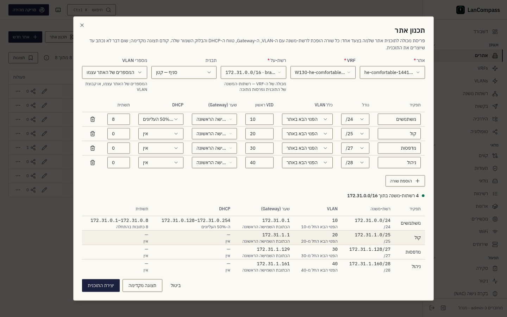

# אתרים

אתרים הם ראש ההיררכיה של ⁦LanCompass⁩ — מיקומים פיזיים או לוגיים כמו סניפים,
חוות שרתים או קומות. VRF-ים, VLAN-ים, קידומות, קווים, נכסים ושירותים
יכולים כולם להיות מקושרים לאתר.

## שדות

| שדה | הערות |
|---|---|
| **Name** | שם תצוגה; עברית נתמכת במלואה (רינדור `dir="auto"`) |
| **Slug** | מזהה בטוח ל־URL, נגזר אוטומטית מהשם |
| **Code** | קוד אתר קצר (למשל `NYC1`) — משמש את ייבוא ה־workbook להתאמת גיליון↔אתר |
| **Site number** | מזהה מספרי שמשמש את מתכנן הייבוא |
| **Size** | סיווג גודל בטקסט חופשי |
| **Active** | אתרים לא-פעילים נשמרים להיסטוריה אבל מוחרגים מהתאמת ייבוא |
| **Contact / Address / Description** | מטאדאטה בטקסט חופשי |

## עבודה עם הרשימה

- **אתר חדש** — דורש הרשאת *data:write* (Contributor ומעלה).
- **גררו לסידור** שורות; **נעצו** אתרים חשובים בראש. הסידור משותף לכולם.
- **עריכה inline** של התיאור ישירות בטבלה.
- צרפו **תגיות** והגדירו **צבע שורה** מפעולות השורה.
- כל שינוי נוחת ב[יומן השינויים](/he/docs/changelog/), וכפתור ההיסטוריה של
  כל שורה מציג את שביל הביקורת שלה.
- **שני אנשים, אתר אחד.** שמירת אתר שמישהו שמר אחרי שפתחתם אותו נדחית עם
  **הפריט השתנה מאז שנפתח כאן** — **טעינה מחדש** מראה את הגרסה שלו,
  **דריסה** שומרת את השדות ששיניתם מעל שלו.
- **מחיקת אתר** משאירה את הקידומות והמכשירים שלו: הם נשארים בלי אתר.
  דיאלוג האישור סופר את שניהם (*N קידומות יישארו בלי אתר*, *N מכשירים
  יישארו בלי אתר*). ב[היררכיה](/he/docs/hierarchy/) הקידומות האלה עוברים אז
  אל **ללא אתר**.

## תכנון אתר

**תכנון אתר** (בעמוד האתרים, בשורה של אתר, או בעמוד של קידומת מסוג מכולה)
פורס מכולה לתוכנית אתר שלמה בצעד אחד, כמו שצוות רשת מתכנן סניף חדש:

1. בוחרים את ה**אתר**, את ה־**VRF** שלו (מוצע ה־VRF של האתר), את **רשת-העל**
   — מכולה של אותו VRF — ו**תבנית**.
2. עורכים את השורות: כל שורה היא רשת משנה עם התפקיד, הגודל, כלל ה־VLAN וה־VID
   הראשון, ה־Gateway (הכתובת השמישה הראשונה או האחרונה, או בלי), חלק ה־DHCP
   (החלק העליון של רשת המשנה) ובלוק תשתית שמור בתחילתה.
3. **תצוגה מקדימה**: רשת המשנה של כל שורה היא הבלוק המיושר הפנוי הבא בגודל
   שלה בתוך רשת-העל — לעולם לא על קידומת שכבר שם, לעולם לא מחוצה לה — וכל
   כלל מוצג לצד התוצאה שלו. התנגשות (גודל שלא נכנס, אין עוד בלוק פנוי, VID
   שהאתר כבר משתמש בו) מצוינת בשורה שלה.
4. **יצירת התוכנית**: כל רשת משנה, ה־VLAN שלה, השורה השמורה של ה־Gateway, טווח
   ה־DHCP ובלוק התשתית נוצרים בטרנזקציה אחת — או ששום דבר לא נוצר.

מספרי VLAN: **הפנוי הבא באתר** מתחיל מה־VID הראשון של השורה ומדלג על כל מספר
שהאתר משתמש בו (בקבוצת ה־VLAN, כשבוחרים אחת); **האוקטט השלישי** לוקח את
האוקטט השלישי של רשת המשנה ומסורב כשהאתר כבר משתמש בו. תוכנית לעולם לא
משתמשת שוב ב־VID באתר שלה.

ברשת-על IPv6 הגדלים הם גבולות של ניבל (‎/52, ‎/56, ‎/60, ‎/64) וכל רשת משנה
שהתוכנית יוצרת למארחים היא ‎/64, בלי מאגר DHCP ובלי בלוק תשתית — התצוגה המקדימה
מציגה את הכללים האלה כ״אין״.

### תבניות

המתכנן מתחיל מתבנית. שתיים מובנות — **סניף — קטן** (משתמשים ‎/24 עם ה־VLAN
הפנוי הבא, Gateway בכתובת השמישה הראשונה, DHCP בחצי העליון ובלוק תשתית של 8
בתחילתה; קול ‎/25; מדפסות ‎/27; ניהול ‎/28) ו**סניף — גדול** (משתמשים וקול
כפולים). מנהל מערכת עורך אותן, או מוסיף את של הצוות, ב**הגדרות → ניהול כתובות
IP**; הן נשמרות עם ההגדרות של ההתקנה, כך שגיבוי נושא אותן.

## הגדרות קשורות

דגל התכונה **Site codes follow site changes** (Settings → Features, דולק
כברירת מחדל) שולל אם שמות VRF מקושרים ושדות אתר של קווים/שירותים מתעדכנים
אוטומטית כשקוד, מספר או שם של אתר משתנה. כשהוא כבוי, אי-התאמות מאוחסנות
נחשבות לעקיפה ידנית מכוונת.
