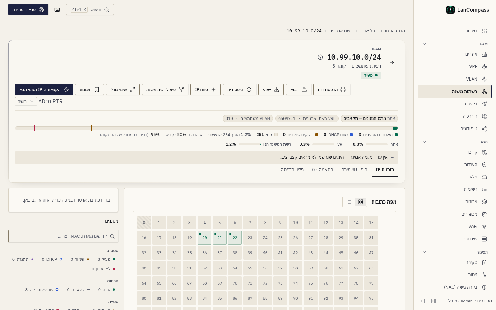
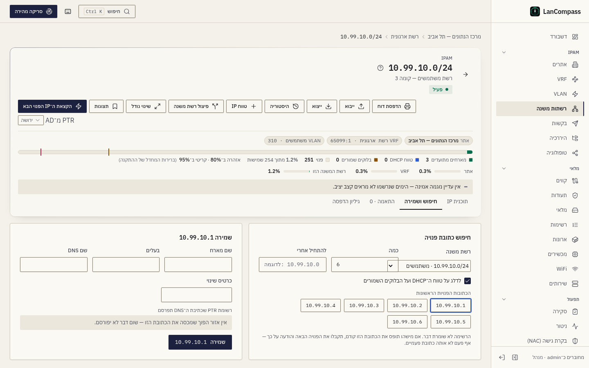
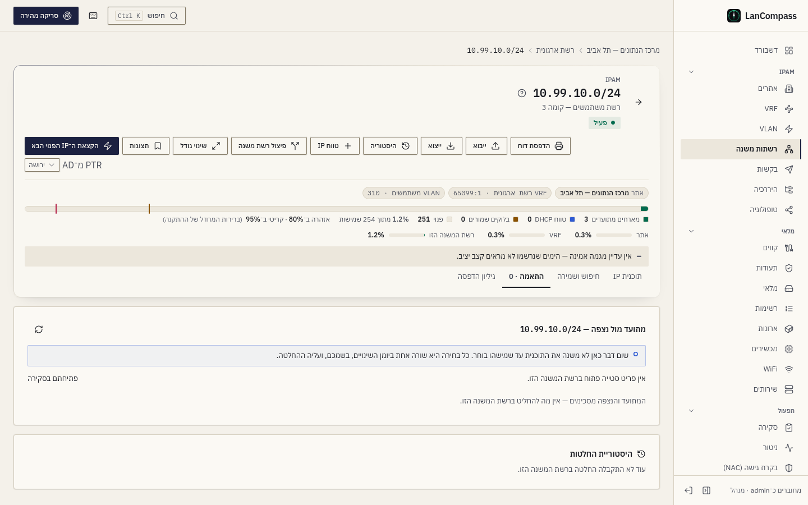

# רשתות משנה

רשתות משנה (קידומות) הן לב ה־IPAM. כל אחת חיה בתוך VRF, יכולה להיות
מקושרת לאתר ול־VLAN, ומכילה כתובות IP — או, כ`container`, קידומות אחרות.

## סטטוסים

| סטטוס | משמעות |
|---|---|
| `active` | רשת פרודקשן |
| `reserved` | מוקצה, עוד לא הופעלה |
| `deprecated` | בתהליך הוצאה משירות |
| `container` | מחזיק רשתות משנה-ילדות — פטור מבדיקות חפיפה |

## בטיחות חפיפה

בתוך VRF אחד, CIDR-ים חופפים נדחים על ידי אילוץ exclusion של PostgreSQL
GiST — בסיס הנתונים אוכף את זה, לא קוד האפליקציה. בין VRF-ים אותו CIDR
בסדר. קידומות `container` פטורים כך ש`10.0.0.0/16` (container) יכול להחזיק
`10.0.1.0/24` (active) כילד. Containers לא יכולים לזוז תחת קידומת שהם
מתנגשים איתו, והזזת container לוקחת את הילדים שלו איתה.

שלושה כללים נוספים שומרים על העץ אמין, וכל אחד עונה 409 שמציין את
הקידומת שמפריע:

- **רשת אחת פעם אחת בכל VRF.** `10.0.1.0/24` שני באותו VRF נדחה, לא משנה
  מה הסטטוס של כל אחד מהם (גם container). כפילויות שנשמרו לפני הכלל הזה
  מופיעות תחת **רשתות כפולות** ב[סקירה](/he/docs/review/) — השאירו אחת, העבירו
  אליה את הכתובות והטווחים ומחקו את השאר.
- **container אף פעם לא יושב בתוך רשת משנה.** container שהרשת שלו נמצאת בתוך
  קידומת active, reserved או deprecated נדחית, וכך גם רשת משנה שהייתה מכילה
  container קיים.
- **container עם ילדים נשאר container.** שינוי הסטטוס שלו לרשת משנה מציין עד
  חמישה קידומות-ילדים ומבקש להזיז או למחוק אותם קודם.

## לאן כתובת שייכת

כתובת משויכת לקידומת שאינו container **העמוק ביותר** ב־VRF שלה שמכיל
אותה (ל־container רק כשאף רשת משנה לא מכילה אותה). ציון קידומת רדוד יותר —
ה־container שמעל רשת משנה — עונה 422 עם הקידומת העמוק יותר. כשמוסיפים
קידומת-ילד, הכתובות שה־container שמעליו החזיק בתוכו עוברות לקידומת
החדש, כל אחת עם רשומה ב[יומן השינויים](/he/docs/changelog/).

## עמוד פרטי הקידומת

פתיחת רשת משנה מציגה פירורי לחם (האתר שלה עצמה → VRF → ה־containers שמעליה →
prefix), את רצועת הסיכום עם פס הקיבולת, וארבע לשוניות: **תוכנית IP** (המפה
או הרשימה, למטה), **חיפוש ושמירה**, **התאמה** ו**גיליון הדפסה**. תוכנית
ה־IP מציגה את מרחב הכתובות בשתי דרכים:

### מטריקס רשתות המשנה

רשת בסגנון `/24` — תא אחד לכל כתובת, מחולקת לרצועות לפי טווחי IP. מקשי
החצים זזים בין תאים, **Enter** פותח כתובת, **גרירה** בוחרת טווח לפעולות
bulk, **Esc** מנקה את הבחירה.

### תצוגת רשימה

טבלה ניתנת-למיון של כל כתובת עם **טווחים פנויים** מצטברים בין בלוקים
מנוצלים, בתוספת פעולות לכל־IP. פאנל הסינון מצמצם לפי סטטוס, תפקיד,
hostname ועוד.

### רשת המשנה כתוכנית IP

העמוד נקרא מלמעלה למטה כמו תוכנית רשת:

- **פס הסיכום** — ה־CIDR, הסטטוס והתיאור שלו; העובדות כתגיות (אתר, VRF
  ו־RD, VLAN, gateway, DNS — לחיצה על אחת מעתיקה אותה); **פס הקיבולת**, מחולק
  למארחים מתועדים, טווח ה־DHCP, בלוקים שמורים וכתובות פנויות, וכל מספר במקרא
  שלו; הניצול בכל רמה (האתר, ה־VRF, רשת-העל שמכילה אותה, רשת המשנה הזו — כל אחד
  אותו מספר שהלוח, ההיררכיה ורשימת רשתות המשנה מציגים); ושורת **התחזית**: היום
  שבו רשת המשנה תתמלא בקצב שנרשם, אין מגמה אמינה, או "באיסוף" עם מספר הימים
  שנרשמו עד כה.
- **הלשוניות** — **תוכנית IP** (ברירת המחדל), **חיפוש ושמירה**, **התאמה**
  (מתועד מול נצפה ברשת המשנה הזו, ומחליטים שם — בתווית שלה מספר הפריטים
  הפתוחים) ו**גיליון הדפסה**. הלשונית נשמרת בכתובת (`?tab=find`), כך שקישור
  פותח אותה.

ב**מפת הכתובות** כל תא נושא שני סימנים: הסטטוס **המתועד** בפינת ההתחלה שלו,
ומה **שהסריקות ראו** בפינת הסוף, כל אחד בצורה ובצבע שלו, כך שאפשר לקרוא תא
בלי לפתוח אותו. תא בתוך טווח DHCP, מאגר או בלוק שמור נושא **פס** לאורך הקצה
התחתון שלו, והמקרא שמתחת למפה נותן שם לכל טווח ואומר כמה מהכתובות שלו
מתועדות. התא של ה־gateway מסומן **gw**. המפה רצה משמאל לימין מהמארח 0 בכל
שפה.

בחירת תא פותחת את **חלונית הפרטים** לצד המפה (מתחתיה בטלפון): הערך המתועד של
כל שדה לצד הנצפה, עם ההבדלים מסומנים, וההחלטות — **להשאיר את המתועד**,
**לקבל את הנצפה**, **פתיחה בסקירה**. **עריכה** פותחת את טופס הכתובת. טווח
במקרא, או תא פנוי בתוכו, פותח את הטווח: הגבולות, התפקיד, התיאור וכמה כתובות
יש בו, עם העריכה שלו.

### חיפוש ושמירה

**חיפוש ושמירה** מציג את הכתובות הפנויות הראשונות של רשת המשנה כתגיות — מדלג
על טווח ה־DHCP ועל הבלוקים השמורים אלא אם מבטלים את הסימון, ומתחיל אחרי כתובת
שבוחרים אם רוצים — ולא שומר דבר בעצם ההצגה. בוחרים אחת, ממלאים שם מארח,
בעלים, שם DNS וכרטיס שינוי, וקוראים את **רשומת ה־PTR** שכתיבת ה־DNS תפרסם
עבורה (או למה לא תפורסם: אין אזור הפוך שמכסה את הכתובת, או שהשם אינו שם DNS
מלא). אם מישהו תופס את הכתובת קודם, מקבלים את הפנויה הבאה והודעה על כך — אף
פעם לא אותה כתובת פעמיים.

### התאמה: מתועד מול נצפה

**התאמה** עוברת על רשת משנה אחת מלמעלה למטה אחרי סריקה. היא מציגה את פריטי
הסטייה בכתובות הפתוחים של רשת המשנה — אותם פריטים שהסקירה מציגה תחת *סטייה
בכתובות* — בארבע קבוצות, בסדר שבו עובדים עליהן, ולכל כותרת הסימן והמספר
שלה: **התנגשות** (ה־MAC שהסריקה ראתה מתועד בכתובת אחרת או בפורט של מכשיר),
**השתנה** (ה־MAC, היצרן או הסוג הנצפים שונים מהמתועדים), **חסר** (מארח מתועד
ופעיל שכבר לא עונה) ו**חדש** (מארח שהסריקה מצאה ואף אחד לא תיעד). בכל שורה
מופיעים הכתובת, הערכים ב**מתועד** וב**נצפה** זה לצד זה עם ההבדל מסומן,
**מאז** (מתי הסריקה ראתה אותו לאחרונה — למארח חסר, התשובה האחרונה שלו; למארח
חדש, מתי נרשם לראשונה) וההחלטות.

הבאנר מעל הטבלה אומר את זה במפורש: *שום דבר כאן לא משנה את התוכנית עד
שמישהו בוחר. כל בחירה היא שורה אחת ביומן השינויים, בשמכם, ועליה ההחלטה.*
סריקה רק רושמת את מה שראתה; התוכנית המתועדת משתנה רק דרך ההחלטות האלה:

| קבוצה | החלטות בשורה | מה נכתב |
|---|---|---|
| התנגשות, השתנה | **שמירת המתועד**, **קבלת הנצפה**, **התעלמות ל־30 יום** | קבלת הנצפה מעתיקה את ה־MAC, היצרן והסוג הנצפים לשדות המתועדים; שמירת המתועד דוחה את התצפית הזו (תצפית אחרת תחזור); התעלמות מסתירה את הפריט ל־30 יום, ואז הוא חוזר אם ההבדל עדיין קיים |
| חסר | **שמירת המתועד**, **סימון כפנויה**, **התעלמות ל־30 יום** | סימון כפנויה מוחק את רשומת הכתובת, אותה מחיקה כמו ברשימת הכתובות — נדרשת הרשאת מחיקה |
| חדש | **תיעוד**, **התעלמות ל־30 יום** | תיעוד פותח את טופס הכתובת ממולא ממה שהסריקה ראתה; השמירה הופכת את הרשומה לשלכם (המקור שלה הופך ל־`manual`), כך שסריקות הבאות רק רושמות את מה שהן רואות |

שורה שהוחלטה הופכת לתגית **הוחלט** עד שהלשונית נטענת מחדש. בכל כותרת קבוצה
יש גם **קבלת כל הנצפים** ו**התעלמות מכולם**; שתיהן שואלות קודם עם מספר
הכתובות (מעשר ומעלה צריך להקליד את רשת המשנה), וכותבות שורה אחת ביומן
השינויים לכל כתובת. בקבוצת חסר, קבלת כל הנצפים מסמנת את המארחים כלא
מקוונים; בקבוצת חדש היא מאשרת אותם כפעילים.

**סריקת רשת המשנה עכשיו** מתחילה סריקה של רשת המשנה וטוענת את הלשונית מחדש כשהיא
מסתיימת. היא מוצגת רק כשהסורק רשאי לסרוק את רשת המשנה (בתוך רשתות הסריקה
שהוגדרו, לא מוחרגת ולא גדולה מדי) ולכם מותר להתחיל סריקה. **היסטוריית
החלטות** מתחת לטבלה מציגה את 50 ההחלטות האחרונות ברשת המשנה — שהתקבלו כאן,
בסקירה, במגירת הכתובת או תחת אי-התאמות MAC — עם מי, מתי, ההחלטה והכתובת.

צופים רואים את הטבלה ואת ההיסטוריה; תורמים מחליטים; **סימון כפנויה** דורש
הרשאת מחיקה. בטלפון כל שורה היא כרטיס וההחלטות מתחתיה, כך ששום דבר לא נגלל
הצידה. ברשימת רשתות המשנה, העמודה **סטייה** סופרת את הפריטים הפתוחים של כל
רשת משנה; ממיינים לפיה כדי למצוא את רשתות המשנה שצריך להתאים קודם, ולחיצה על
המספר פותחת את הלשונית.

### איך נטענת רשת משנה גדולה

רשת משנה בכל גודל נפתחת מיד: העמוד אף פעם לא מוריד את כל הכתובות שלה. המטריקס
קורא קודם סיכום של כל בלוק `/24` (כמה כתובות מתועדות, כמה בטווחים וכמה
פנויות), ואז טוען את הכתובות של הבלוקים שגוללים אליהם, `/24` אחד בכל פעם.
עד שבלוק נטען, התאים שלו מסומנים **בטעינה** — אף פעם לא פנויים, ואי אפשר
לשמור אותם — כך ש־`/16` שמתועד במלואו אף פעם לא מציג כתובת מתועדת כפנויה.

תצוגת הרשימה קוראת עמוד של 200 כתובות בכל פעם; הדפדפן שבראשה עובר בין
העמודים, והטווחים הפנויים בין השורות נמשכים גם מעבר לקצה העמוד. החיפוש,
המסננים ומיון העמודות רצים בשרת, כך שהספירות בפאנל הסינון הן של כל רשת המשנה
ולא של השורות שעל המסך. בטלפון העמוד משאיר שתי פעולות (הקצאת ה־IP הפנוי הבא
והדפסה) ומעביר את השאר אל **פעולות נוספות**.

שמירת תא פנוי שמישהו אחר תפס רגע לפני כן עונה במה שמחזיק אותו עכשיו (הסטטוס,
שם המארח והמכשיר), והתא מתרענן.

### מספרי ניצול

`total_ips` / `usable_ips` / `used_ips` / `free_ips` ואחוז ניצול מחושבים
לכל קידומת. קידומות של IPv6 מציגים `—` לקיבולת — ל/64 יש יותר hosts
מ`Number.MAX_SAFE_INTEGER` — אבל `used_ips` נשאר מדויק. כתובות רשת
ושידור (`unusable_first`/`unusable_last`) מוחרגות מספירות usable.

**מה נספר כבשימוש.** כתובות מתועדות וכל טווח DHCP, מאגר ושמור של רשת המשנה,
כל כתובת נספרת פעם אחת: `used_ips` הן הכתובות המתועדות, `range_ips` מה
שהטווחים מכסים, `allocated_ips` שניהם, והאחוז הוא
`allocated_ips / usable_ips`. ‏/24 עם 25 מארחים מתועדים ו־scope של DHCP
בן 100 כתובות מראה כ־49%, לא 10% — רשת משנה עם scope נראית מלאה יותר
משורות הכתובות שלה לבדן, וזו בדיוק הכוונה. הרשימה מציגה
`allocated/usable · %`, וה־tooltip שלה מפריד בין הכתובות המתועדות לטווחים.

**הנתון של container.** הפס של container הוא החלק מהמרחב שלו שהקידומות-הילדים
שלו מחזיקים — האיחוד שלהם, אף פעם לא הסכום — במילים **"… מוקצה"**
(`allocated_pct`). ה־`allocated_ips` שלו מסכם את כל תת-העץ שלו: הכתובות
המוקצות של כל רשת משנה מתחתיו, אף פעם לא רק השורות שלו עצמו.

[הדשבורד](/he/docs/dashboards/), הדוחות וסדרת התחזית היומית קוראים את אותו
כלל, כך שהסיכומים שלהם תואמים לרשימה: usable הוא הכתובות השמישות של
רשתות משנה IPv4, ובשימוש הוא הכתובות המוקצות שלהן ועוד כל כתובת שתועדה על
container עצמו. במשך 30 יום אחרי שהכלל השתנה, תג התחזית אומר **"כלל חדש"**
— הסדרה שלו עדיין מכילה ימים שנספרו בדרך הישנה.

### כתובות רשת ושידור

בקידומת IPv4 של /30 ומטה, כתובות הרשת והשידור אינן מארחים. תיעוד של אחת
מהן מבקש עקיפה — **תיעוד בכל זאת** — והכתובת שומרת סימון
`boundary_override`, כמו עקיפת המאגר; ייבוא ה־CSV צריך `force=1` לשורות
כאלה. gateway על אחת מהכתובות האלה נדחה. שורות שנשמרו לפני הכלל הזה נשארות
כפי שהן. ‏/31 ו-/32 משתמשים בכל כתובת; קידומת IPv6 קצר מ-/127 אף פעם לא
מחלק את כתובת ה־anycast של ה־subnet-router שלו (מזהה הממשק שכולו אפסים),
ואילו /127 ו-/128 משתמשים בכל כתובת.

## הקצאת ה־IP הפנוי הבא

"Next available" משתמש ב`SELECT … FOR UPDATE` בתוספת
`UNIQUE(vrf_id, address)`: הקצאות מקבילות אף פעם לא יכולות לחלק את אותה
כתובת פעמיים, גבולות רשת/שידור מדולגים, ו**טווחי IP** מוגדרים מוחרגים
אוטומטית. כל כתובת של ה־VRF שבתוך רשת המשנה נחשבת תפוסה, לא משנה לאיזו
שורת קידומת היא משויכת. **קונטיינר** מחזיק רשתות משנה, לא מארחים: הקצאת
הפנוי הבא בו עונה "הקצו מאחת מרשתות המשנה שלו".

## טווחי IP

טווחים בעלי-שם בתוך קידומת עם תפקיד `dhcp`, `pool` או `reserved`. הם
מופיעים כרצועות במטריקס רשתות המשנה ומדולגים על ידי הקצאה. טווח חדש לא
יכול לחפוף שום טווח של אותו VRF (טווח של קונטיינר מכסה גם את הכתובות של
רשתות המשנה שלו); שני אנשים שיוצרים טווחים חופפים באותו רגע יקבלו טווח אחד
וסירוב ברור. העיפרון בשורת הטווח עורך את התפקיד, התיאור והגבולות שלו: טווח
DHCP, מאגר או בלוק שמור גדלים או קטנים רק בתוך הקידומת שלהם ולעולם לא על
טווח אחר של ה־VRF, ויומן השינויים שומר שורה אחת שמציינת את הגבולות הישנים
והחדשים. הכתובות שבתוך הגבולות החדשים מצטרפות לטווח.

טווחים שייכים לקידומת שלהם: **העברת הקידומת ל־VRF אחר לוקחת איתה את
הטווחים**, ו**מחיקת קידומת או VRF מוחקת את הטווחים שלו עם שורת יומן
שינויים לכל אחד** — דיאלוג המחיקה סופר את הטווחים שיימחקו, לצד הכתובות
והקידומות.

## קיבולת: ספים, התראות ותחזית

לכל רשת משנה IPv4 שאינה מכל, ולכל טווח DHCP או מאגר שבתוכה, יש סף **אזהרה**
וסף **קריטי** באחוזים. הנתון של רשת משנה הוא הניצול שלה כפי שהרשימה מציגה
אותו (כתובות מתועדות וטווחי ה־DHCP, המאגר והשמורים שלה, כל כתובת פעם
אחת); הנתון של טווח הוא הכתובות המתועדות בו מתוך גודלו. בלוק שמור נשמר
בכוונה ואין לו ספים; מכלים וקידומות של IPv6 נשארים עם ספירות, לא
אחוזים.

**ספים.** בדיאלוג העריכה של רשת המשנה ובדיאלוג של טווח יש **סף אזהרה (%)**
ו**סף קריטי (%)**. שדה ריק יורש את הערך של ההתקנה, שמופיע בו כטקסט
מקום: **הגדרות ← ניהול כתובות IP ← ספי קיבולת**, ‏80% ו־95% כל עוד מנהל
לא שינה אותם. סף האזהרה נשאר נמוך מהסף הקריטי, בין שנקבע ובין שעבר
בירושה. בעמוד רשת המשנה פס הקיבולת מסמן את שני הספים, והשורה שמתחתיו
מציינת אותם (עם "(ברירות המחדל של ההתקנה)" כשאין לרשת המשנה ספים משלה)
ואם רשת המשנה עברה אחד מהם.

**התראות.** כותב תמונות-המצב היומי — התקתוק של ה־worker, לכל היותר פעם
ב־15 דקות, וטעינות ההדגמה, חוברת העבודה ו־NetBox — רושם את הניצול של
כל רשת משנה וכל טווח לאותו יום ומשווה אותו ליום האחרון שנרשם, לפי הספים של
היום. עלייה מעבר לסף האזהרה או לסף הקריטי שולחת התראת **`ipam.capacity`**
אחת דרך ערוצי ההתראות (אירועי **קיבולת IP** בניתוב של ערוץ); ירידה בחזרה
אל מתחת לסף האזהרה שולחת התראת חזרה אחת. הישארות מעל סף, באותו יום או
למחרת, לא שולחת דבר, וירידה מקריטי לאזהרה לא שולחת דבר. היום הראשון
שנרשם לרשת משנה הוא נקודת הפתיחה שלה, לא חצייה, כך ששדרוג לא מזעיק על כל
רשת משנה שכבר מלאה, והזזת סף לעולם לא שולחת התראה בעצמה. ההודעה מציינת את
רשת המשנה (או את הטווח ואת רשת המשנה שלו), את האתר, את הניצול ואת היום שבו
היא צפויה להתמלא, כשיש כזה — וכל כתובת נשארת שלמה בעברית ובערבית.

**התחזית.** כל רשת משנה וכל טווח שומרים שנה של שורות יומיות (שורות בנות
יותר מ־400 יום נמחקות באותו מעבר). התחזית שלהם היא קו ריבועים-מזעריים דרך
הימים שלהם עצמם, לפי הכללים של תחזית הדשבורד: "אוספים" מתחת ל־14
ימים, רמת ביטחון low, ‏medium או high לפי R², בלי תאריך לקו שטוח או יורד,
ושום דבר מעבר לשנה קדימה. שורת התחזית בעמוד רשת המשנה קוראת אותה, העמודה
**צפי מילוי** ברשימה מציגה את היום שבו היא צפויה להתמלא וממיינת לפיו (הקרוב
ביותר קודם, רשתות משנה בלי תאריך אחריהן), ו**סקירה ← תחזית קיבולת** מציגה
כל רשת משנה וכל טווח שעברו את סף האזהרה — "עברה את סף האזהרה שלה" או "עברה
את הסף הקריטי שלה" — וכל אחד שצפוי להגיע לסף הקריטי שלו בתוך 90 יום
בביטחון בינוני ומעלה. אזהרה שבוטלה חוזרת כשרשת המשנה הופכת לקריטית.

**דוח הקיבולת.** **דוח קיבולת** מעל הרשימה (או **דוחות ← קיבולת
רשתות משנה**) מדפיס, לפי אתר ו־VRF, כל רשת משנה והטווחים שלה עם הניצול, שני
הספים, השיפוע היומי, יום המילוי הצפוי והרמה — על גיליון ההדפסה, בשפת
הקורא. הדוח של אתר שומר את רשתות המשנה שלו בלבד.

## כששני אנשים עורכים אותה רשת משנה

כל טופס IPAM — רשת משנה, VRF, אתר, VLAN, טווח ומגירת הכתובת — שולח רק את
השדות ששיניתם, עם אסימון של מה שנטען. אם מישהו שמר את האובייקט אחרי
שפתחתם אותו, השמירה שלכם נדחית עם **הפריט השתנה מאז שנפתח כאן**: **טעינה
מחדש** מציגה את הגרסה שלו, **דריסה** שומרת את השדות ששיניתם מעל שלו. לכן
שמירת תיאור לעולם לא שולחת מחדש את ה־gateway, רשימת ה־DNS או ה־VRF. לקוחות
API שלא שולחים אסימון (`expected_etag`) נשארים עם "הכותב האחרון מנצח"; כל
תשובה נושאת את ה־`etag` הנוכחי של האובייקט.

## תצוגת הדפסה

לכל קידומת יש עמוד ידידותי-להדפסה (פעולת ההדפסה על תצוגת הפרטים) שמרנדר
את רשימת הכתובות נקי ל־audit-ים והדפסות קיר-ops.

הגיליון מדפיס **כל** כתובת מתועדת של רשת המשנה, כמה שלא יהיו — הוא קורא אותן
בעמודים לפני שהוא מצייר. ברשת משנה ארוכה אפשר לבחור להדפיס רק את 1,000, 5,000
או 20,000 הכתובות הראשונות; הכותרת של הגיליון אומרת זאת אז ("1,000 הראשונות
מתוך 65,534 כתובות"), כך שגיליון מודפס אף פעם לא נעצר באמצע בלי לומר זאת.

## Gateway ו־DNS

קידומת יכולה לתעד את ה**gateway** שלה ועד ארבעה **resolvers של DNS** —
ערכו את הרשת משנה או השתמשו באשף *Add network*. ה־gateway חייב להיות בתוך
הקידומת (resolvers יכולים לחיות בכל מקום — לעתים קרובות הם כן).

כל כתובת טכנית שנופלת בתוך הקידומת משוקפת לתוך שורת כתובת `reserved`
אמיתית מתויגת `technical: gateway|dns` — היא מופיעה על המטריקס עם glyph
משלה (⌂ gateway, ≋ resolver), מוחרגת מהקצאת next-IP, ומבוקרת במלואה ביומן
השינויים. ניקוי השדה מסיר את השורה *רק* בזמן שהיא עדיין בדיוק מה שהמערכת
כתבה — שורה שמישהו ערך נשמרת. שורה שיצרתם בעצמכם באותה כתובת אף פעם לא
נגעת.

## Pools והקצאות סטטיות

כתובות בתוך טווח `ip_ranges` מתעדות חברות אוטומטית (`ip_range_id`) —
המגירה מציגה "in pool …" ורשימת הכתובות יכולה להיות מסוננת לפי
`ip_range_id`. יצירה או עריכה של כתובת `active`/`reserved` בתוך טווח
`dhcp`/`pool` נדחית עם התנגשות שמנקבת את הטווח — שרת DHCP עשוי לתת את
הכתובת ללקוח. העבירו `force=1` (או לחצו *Assign anyway* במגירה) כדי
לאפשר בכל זאת; הדריסה מתועדת כ`custom_fields.pool_override` לביקורת.
שורות בסטטוס `dhcp` בתוך pool הן תמיד בסדר, ותצפיות סורק אף פעם לא נחסמות.

ייבואי workbook/CSV מתעדים מציאות קיימת, אז ייבוא מכוון פועל ככוח:
סטטיים בתוך pool נוחתים עם סמן ה`pool_override` ודוח ה־commit מזכיר אותם
("inside a pool (override marked)") במקום לדחות את השורה — או כל האצווה.

## פיצול, מיזוג ושינוי גודל

שלוש כתיבות משנות את הצורה של קידומת ומעבירות את מה שהיא מחזיקה; כל אחת
מסורבת, בלי שום שינוי, כשמשהו חוסם, והסירוב מציין אותו.

- **פיצול רשת משנה** (בפעולות של עמוד הקידומת) מציג קודם את רשתות המשנה
  באורך שבוחרים, ואז יוצר אותן: הקידומת הופכת למכולה שלהן, וכל כתובת וטווח
  שלה עוברים לרשת המשנה שמכילה אותם — שורה אחת ביומן השינויים לכל העברה.
  טווח שחוצה גבול של רשת משנה, כתובת שהייתה נוחתת על כתובת הרשת או השידור
  של רשת משנה, או יותר רשתות משנה מהמגבלה — עוצרים את הפיצול.
- **מיזוג רשתות משנה** (בפעולות של מכולה; דורש הרשאת מחיקה) מחזיר שתי
  רשתות משנה מיושרות או יותר לרשת-העל שלהן, עם הכתובות והטווחים שלהן:
  המכולה שממנה פוצלו חוזרת להיות רשת המשנה הממוזגת, אחרת הנמוכה שבהן מתרחבת;
  האחרות נמחקות. רשתות משנה שלא מרצפות רשת-על מיושרת אחת — מסורבות.
- **שינוי גודל** שומר על כתובת הרשת ומשנה את הגודל: גדול יותר רק כשדבר שאסור
  לו לחפוף לא חוסם (ואז הוא לוקח את הכתובות שמכולה מעליו החזיקה), קטן יותר
  רק כשכל כתובת, טווח, רשת משנה וה־Gateway עדיין נכנסים.

ה־API גם מציג את **רשתות המשנה הפנויות הבאות** בגודל מסוים בתוך קידומת —
`GET /prefixes/{id}/available-prefixes?size=26` (או `size=64` בתוך IPv6
‎/48) — בלי לשמור אותן; מתכנן האתרים משתמש באותו כלל.

## אשף Add network

כפתור ה**Add network** על עמוד הרשתות משנה מלווה דרך VLAN (חדש או קיים) →
רשת משנה → gateway/DNS → pool של DHCP → סקירה, ואז יוצר הכל בטרנזקציה אחת
דרך `POST /networks`. אם איזשהו שלב לא תקין, שום דבר לא נוצר — רשת
חצי-בנויה גרועה יותר מאף אחת.

הוא מסתיים עם ברירות המחדל שלו: ה־**VID** הוא המספר הפנוי הבא באתר שבוחרים
(בקבוצה, כשבוחרים קבוצה) וה**שם** הוא בסגנון "VLAN 10" עד שמקלידים שם משלכם;
ה־**VRF** הוא ה־VRF של האתר, אחרת Global — ובחירה ב־VRF של אתר בוחרת קודם גם את האתר שלו; **מאגר ה־DHCP** הוא החצי העליון של
רשת המשנה, והוא מתחיל כבוי ברשתות משנה קטנות מ-‎/26. מקלידים רק את רשת המשנה.

VLAN בלי קבוצה ממוספר לפי אתר, כך ש־VLAN 10 יכול להתקיים בכל סניף: האשף
משתמש שוב ב־VLAN רק כשהוא שייך לאתר של הרשת (או ששניהם בלי אתר) ונושא את
השם שהקלדתם — VLAN 10 של אתר אחר לעולם לא מקושר; נוצר VLAN חדש לאתר הזה.
כדי לתכנן אתר שלם בבת אחת, משתמשים ב**תכנון אתר** (ראו [אתרים](/he/docs/sites/)).
